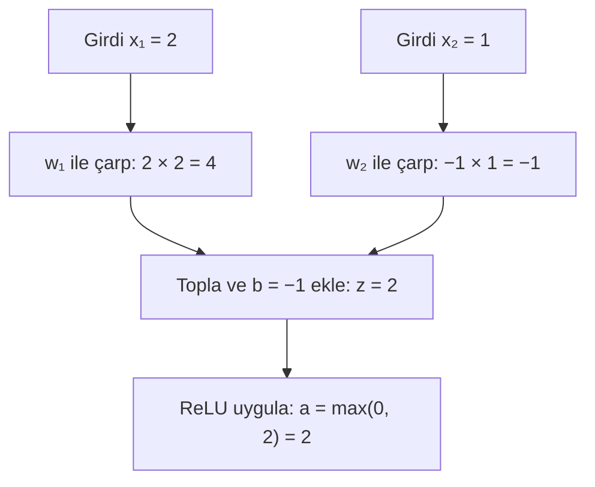
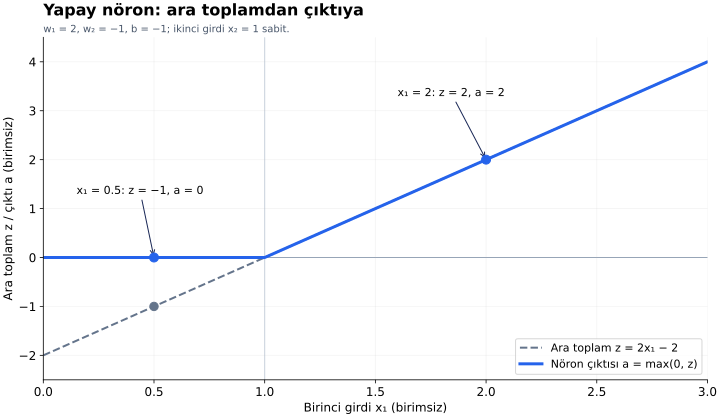

# Ders 09 — Yapay nöron

[Önceki ders: Regresyon ve sınıflandırma](08-regresyon-ve-siniflandirma.md) · [Temeller bölümüne dön](README.md)

**Ön koşul:** Ders 04–08.  
**Ana soru:** Bir yapay nöron girdilerden nasıl tek bir çıktı hesaplar?

## Bu dersin sonunda

- Bir nöronun girdilerini, parametrelerini, ara toplamını ve çıktısını ayırabileceksin.
- İki girdili bir nöronun hesabını elle yapabileceksin.
- Hesaplama şemasını ve çıktı grafiğini aynı denklemlerle okuyabileceksin.

## 1. Büyük bir ağdan önce tek hesap birimi

Bir yapay sinir ağını anlamak için önce tek bir hesap birimini inceleyelim.

Bu derste **yapay nöron (artificial neuron)** şu iki işlemi yapan birimdir:

1. Girdileri ağırlıklarıyla çarpıp toplar ve sabit terim ekler.
2. Elde ettiği sayıya bir fonksiyon uygulayıp çıktı üretir.

İki girdili biçimi:

$$
z=w_1x_1+w_2x_2+b
$$

$$
a=\phi(z)
$$

| Sembol | Anlamı |
|---|---|
| $x_1,x_2$ | Bu örneğin iki giriş değeri |
| $w_1,w_2$ | Girişlerin katkılarını ayarlayan ağırlıklar |
| $b$ | Toplama eklenen bias, yani sabit terim |
| $z$ | Aktivasyondan önce hesaplanan ara toplam |
| $\phi$ | Aktivasyon fonksiyonu |
| $a$ | Aktivasyon sonrası nöron çıktısı |

Bu dersin küçük sayısal örneğinde bütün değerleri **birimsiz** alıyoruz. Gerçek bir uygulamada girişlerin temsili ve ölçekleri ayrıca belirlenir.

$a$ harfini hedef için kullandığımız $y$ ile karıştırma. $a$ bir hesap biriminin çıktısıdır; bulunduğu yere göre son tahmine dönüşebilir veya başka nöronlara girdi olabilir.

## 2. Önceki modelle bağlantı

Ders 05'teki ağırlıklı toplamı zaten tanıyorsun. Burada benzer hesabı önce $z$ adıyla ayrı tutuyoruz; ardından $\phi$ ile işliyoruz.

**Aktivasyon fonksiyonu (activation function)**, ara toplamı nöron çıktısına dönüştüren seçilmiş fonksiyondur. Parantezli $\phi(z)$ ifadesi, “$\phi$ fonksiyonunu $z$ değerinde hesapla” demektir; $\phi$ ile $z$'yi çarpmıyoruz.

Örneğin $\phi(z)=z$ seçersek çıktı ara toplamın kendisi olur. Buna **özdeşlik (identity)** fonksiyonu denir. Önceki süre modelini bu tür bir çıktı hesabıyla ifade edebiliriz.

Bu derste ise farklı bir fonksiyon seçerek iki aşamanın ayrımını görünür kılacağız. Hangi aktivasyonu neden seçtiğimizi Ders 11'de ayrıntılı inceleyeceğiz.

## 3. Küçük nöronumuzu tanımlayalım

Parametrelerimiz:

$$
w_1=2,\qquad w_2=-1,\qquad b=-1
$$

Böylece:

$$
z=2x_1-x_2-1
$$

Aktivasyon olarak **ReLU (Rectified Linear Unit)** seçelim:

$$
\phi(z)=\max(0,z)
$$

$\max(0,z)$, 0 ile $z$ arasındaki büyük değeri seçmek demektir:

- $z$ negatifse çıktı 0.
- $z$ sıfırsa çıktı 0.
- $z$ pozitifse çıktı $z$.

ReLU bir 0/1 sınıf kararı vermez. Pozitif çıktısı 2, 5 veya başka bir sayı olabilir. Buradaki çıktıyı olasılık olarak da yorumlamıyoruz.

Parametreleri öğretim amacıyla verdik; bu derste nöronu eğitmiyoruz. Önce mevcut parametrelerle yaptığı hesabı anlıyoruz.

## 4. Çözümlü örnek: İki girdiden çıktıya

$x_1=2$, $x_2=1$ olsun.

**Önce ayrı katkılar:**

| İşlem | Sonuç |
|---|---|
| Birinci girişin katkısı: $w_1x_1=2\cdot2$ | 4 |
| İkinci girişin katkısı: $w_2x_2=(-1)\cdot1$ | −1 |
| Sabit terim: $b$ | −1 |

**Sonra ara toplam:**

$$
z=4-1-1=2
$$

**Son olarak aktivasyon:**

$$
a=\max(0,2)=2
$$

Nöronun çıktısı 2. Ara toplam ile çıktı bu örnekte eşit; bunun nedeni $z$'nin pozitif olması.

Şimdi yalnızca birinci girdiyi $x_1=0.5$ yapalım:

$$
z=2\cdot0.5-1-1=-1
$$

$$
a=\max(0,-1)=0
$$

Bu kez **ara toplam −1, çıktı 0**. Aktivasyonun ayrı bir işlem olması burada açıkça görülüyor.

## 5. Şema: Hangi sayı nerede hesaplanıyor?

Nöronu okunabilirlik için işlemlerine ayırarak çizdik. İki ayrı çarpma, toplama ve aktivasyon kutuları birlikte **tek nöronun** hesabını gösteriyor.

Girişten çıkışa bu hesaplamaya **ileri yayılım (forward propagation)** denir. Büyük ağlarda aynı fikir, birden fazla hesap birimi boyunca uygulanır.

## 6. Grafik: Girdi değişince ara toplam ve çıktı

Grafikte $x_2=1$ sabit. Dolayısıyla:

$$
z=2x_1-1-1=2x_1-2
$$

Yatay eksen birinci giriş $x_1$, dikey eksen ara toplam $z$ ve çıktı $a$ değerlerini gösterir.

- **Gri kesikli doğru:** Aktivasyondan önceki $z$.
- **Mavi çizgi:** ReLU uygulandıktan sonraki $a$.
- $x_1=0.5$ için $z=-1$, ama $a=0$.
- $x_1=1$ için $z=0$, dolayısıyla $a=0$.
- $x_1=2$ için $z=2$ ve $a=2$. Bu bölgede çizgiler üst üste gelir.

Ara toplam negatifken mavi çıktı sıfırda kalır; ara toplam pozitifken onu izler. Bu yüzden çıktı grafiği bütün aralıkta tek bir doğru değildir.

Bu, iki girdili nöronun **ikinci girdisi sabit tutulmuş bir kesitidir**. $x_2$ değişirse grafikteki ara toplam ilişkisi de değişir.

## 7. Daha fazla girdi olursa?

İki yerine $p$ giriş özelliği olsun. Aynı hesap:

$$
z=\sum_{j=1}^{p}w_jx_j+b,\qquad a=\phi(z)
$$

Yeni gösterimi açalım:

- $p$: Giriş sayısı.
- $j$: Girişleri saymak için kullanılan indis.
- $\sum$: Toplama işareti.
- $w_jx_j$: $j$ numaralı girdinin ağırlıklı katkısı.

Örneğin $p=3$ ise toplamın açık yazılışı $w_1x_1+w_2x_2+w_3x_3$ olur. Her girişe bir ağırlık ve ayrıca bir bias ayırdığımız bu biçimde $p+1$ parametre vardır.

Girişlerin sayısı artabilir; tek nöronun burada hesapladığı çıktı yine **tek sayıdır**.

## 8. Hesaplamak, öğrenmek ve ağ kurmak

Üç işlemi ayıralım:

| İşlem | Ne oluyor? |
|---|---|
| İleri hesaplama | Sabit parametrelerle $z$ ve $a$ hesaplanıyor |
| Eğitim | Bir öğrenme ölçütü kullanılarak parametreler seçiliyor veya güncelleniyor |
| Ağ oluşturma | Birden fazla nöronun çıktıları sonraki hesap birimlerine bağlanıyor |

Bir nöronun çıktı üretmesi, o çağrıda öğrenme yaptığı anlamına gelmez. Bu örnekte farklı $x_1$ değerleriyle hesabı tekrar yapmak ağırlıkları değiştirmedi.

Bir ağda başka nörondan gelen çıktı da yeni giriş olabilir. Her hesap birimi kendi ağırlıklarını ve bias'ını kullanır. Bu bağlantıları ayrıntılı ağ derslerinde kuracağız.

Ayrıca her nöronun çıktısını “gecikme”, “sıcaklık” veya “kenar” gibi bir kavramla adlandırmak zorunda değiliz. Ara katman çıktıları öğrenilmiş temsillerin parçaları olabilir; anlamları otomatik olarak önceden belirlenmez.

## 9. Kısa deney ve anlama kontrolü

Aynı parametreleri ve ReLU'yu kullan:

1. $x_1=1$, $x_2=0$ için önce $z$'yi, sonra $a$'yı hesapla.
2. $x_1=1$, $x_2=3$ için hesapla. Çıktı ile ara toplam neden farklı?
3. Girdileri değiştirip on kez hesap yaptık; ağırlıklar ve bias sabit kaldı. Nöron eğitilmiş oldu mu? Bu nöronda kaç parametre var?

Örnek cevapları göster

**1.** $z=2\cdot1-0-1=1$. Ardından $a=\max(0,1)=1$.

**2.** $z=2\cdot1-3-1=-2$. Ardından $a=\max(0,-2)=0$. Fark, ReLU'nun negatif ara toplamları sıfıra dönüştürmesinden kaynaklanır.

**3.** Hayır, yalnızca ileri hesaplama yaptık. Eğitimde parametre seçimi veya güncellemesi gerekir. İki ağırlık ve bir bias olmak üzere üç parametre var.

## Kaynak ve destek

Şema, grafik ve hesaplar özgün öğretim materyalleridir. Grafik doğrudan bu dersin denklemlerinden hesaplanmıştır.

- **Video/görsel okuma:** [3Blue1Brown — But what is a Neural Network?](https://www.3blue1brown.com/lessons/neural-networks/). **How Information Passes Between Layers** bölümündeki ağırlıklı toplam ve bias anlatımına odaklan. Kaynak farklı bir aktivasyon örneği kullanır; buradaki ReLU hesabıyla fonksiyon seçimini ayır. Kaynaktaki 0–1 aralığı o örneğin seçimidir; bütün nöronların çıktıları bu aralıkta olmak zorunda değildir.
- **Önceki bağlantı:** [Ders 05](05-model-ve-parametre.md) içindeki ağırlıklı toplamı buradaki $z$ hesabıyla karşılaştır.

[Önceki ders: Regresyon ve sınıflandırma](08-regresyon-ve-siniflandirma.md) · [Temeller bölümüne dön](README.md)

**Sonraki konu:** Ders 10 — Ağırlık ve bias *(henüz hazırlanmadı)*.
