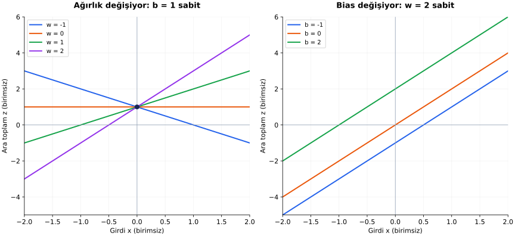
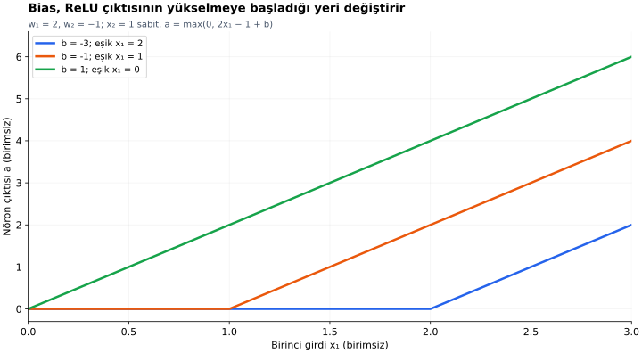

# Ders 10 — Ağırlık ve bias

[Önceki ders: Yapay nöron](09-yapay-noron.md) · [Temeller bölümüne dön](README.md)

**Ön koşul:** Ders 05 ve 09.  
**Ana soru:** Ağırlık ve bias değişince nöronun hesabı ve grafiği nasıl değişir?

## Bu dersin sonunda

- Ağırlığın işaretini ve büyüklüğünü ara toplam üzerinden yorumlayabileceksin.
- Bias'ın neden ayrı bir parametre olduğunu açıklayabileceksin.
- Parametre değişiminin ara toplam ve aktivasyon sonrası çıktı üzerindeki etkilerini ayırabileceksin.

## 1. Önce tek girdiye bakalım

Ders 09'da iki girdili nöron kullandık. Etkileri ayırmak için önce tek girişle başlayalım:

$$
z=wx+b,\qquad a=\phi(z)
$$

| Sembol | Anlamı |
|---|---|
| $x$ | Giriş değeri |
| $w$ | Girişin katkısını ayarlayan ağırlık |
| $b$ | Bias, yani sabit terim |
| $z$ | Aktivasyon öncesi ara toplam |
| $\phi$ | Aktivasyon fonksiyonu |
| $a$ | Nöron çıktısı |

Bu dersteki örnekler birimsiz, özgün öğretim örnekleridir. İlk grafiklerde **$z$'yi** inceleyeceğiz. Aktivasyon sonrası $a$'nın aynı biçimde değişeceğini henüz varsaymıyoruz.

## 2. Ağırlık: Girdi değişince ara toplam ne kadar değişir?

$w=2$, $b=1$ seçelim:

$$
z=2x+1
$$

| Girdi $x$ | Hesap | Ara toplam $z$ |
|---|---|---|
| 0 | $2\cdot0+1$ | 1 |
| 1 | $2\cdot1+1$ | 3 |
| 2 | $2\cdot2+1$ | 5 |

Girdi 1 arttığında ara toplam 2 artıyor. Bu, ağırlığın 2 olmasından kaynaklanır.

Bunu genel olarak da çıkarabiliriz. Girdi $x$'ten $x+\Delta x$'e değişsin. $\Delta x$, girdideki değişimi gösterir:

$$
z_{\text{yeni}}=w(x+\Delta x)+b
$$

Parantezi açınca:

$$
z_{\text{yeni}}=wx+w\Delta x+b
$$

Eski değer $z_{\text{eski}}=wx+b$ olduğundan çıkaralım:

$$
\Delta z=z_{\text{yeni}}-z_{\text{eski}}=w\Delta x
$$

$\Delta z$, ara toplamın değişimidir. **Ağırlık, girdideki değişimi ara toplama taşıyan katsayıdır.**

### İşaret ne söylüyor?

- $w>0$: Girdi arttıkça $z$ artar.
- $w<0$: Girdi arttıkça $z$ azalır.
- $w=0$: Bu giriş, bu nöronun ara toplamına katkı yapmaz.

Örneğin $w=-1$, $b=1$ ise $z=-x+1$. $x=0,1,2$ için $z=1,0,-1$ olur.

Bunlar modelin davranışıdır; ağırlıkların işareti tek başına gerçek dünyadaki neden–sonuç ilişkisini kanıtlamaz.

## 3. Bias: Girdiden bağımsız bir kaydırma

Ağırlığı $w=2$ sabit tutalım:

$$
z=2x+b
$$

$x=1$ için:

| Bias $b$ | Hesap | Ara toplam |
|---|---|---|
| −1 | $2\cdot1-1$ | 1 |
| 0 | $2\cdot1+0$ | 2 |
| 2 | $2\cdot1+2$ | 4 |

Bias 1 arttığında her girdideki **ara toplam** 1 artar. Çünkü $b$ girdiye çarpılmadan eklenir.

Buradaki “bias” kelimesi modeldeki sabit terimdir; bir hata istatistiği olan istatistiksel yanlılık kavramıyla aynı tanım değildir.

## 4. Grafik: Eğimi değiştirmek ve doğruyu kaydırmak

İki panelin de yatay ekseni $x$, dikey ekseni $z$.

**Sol panelde $b=1$ sabit:**

- Bütün doğrular $x=0$'da $z=1$ noktasından geçiyor.
- $w=2$ doğrusu, $w=1$ doğrusundan daha dik.
- $w=-1$ doğrusu aşağı doğru eğimli.
- $w=0$ için yatay doğru var: Girdi değişse de $z=1$.

**Sağ panelde $w=2$ sabit:**

- Doğrular aynı eğimde; birbirine paralel.
- $b=-1,0,2$, doğruların dikey konumlarını değiştiriyor.
- $x=0$'daki değer doğrudan $b$.

**Tek girdili ara toplam grafiğinde ağırlık eğim, bias dikey eksen kesişimidir.** Çok girdili nöronda her ağırlık kendi girişinin katkısını ayarlar; tek bir eğimle bütün davranışı anlatamayız.

## 5. Neden yalnızca ağırlık yeterli değil?

Şu ilişkiyi temsil etmek istediğimizi düşün:

$$
z=2x+3
$$

Bias olmayan modelimiz $z=wx$ olsun. $x=0$ koyarsak:

$$
z=w\cdot0=0
$$

Ağırlığı hangi değere getirirsek getirelim sonuç 0. Ama istediğimiz ilişkide $x=0$ için sonuç 3.

**Bu model biçiminde ağırlığı değiştirmek, eksik sabit terimi oluşturamaz.** Bias, doğrunun başlangıç noktasını ayarlamak için ayrı bir serbestlik sağlar. Hedefimiz $2x+3$ ise $w=2$, $b=3$ seçebiliriz.

Bu ifade, burada kullandığımız yalın tek girdili model için geçerlidir. Girişe ayrıca sabit 1 özelliği ekleseydik onun ağırlığı bias görevini üstlenebilirdi: $wx+b\cdot1$. Standart gösterim $b$'yi ayrı tutmayı kolaylaştırır.

## 6. İki girdili nörona dönelim

Önceki nöron:

$$
z=2x_1-x_2-1,\qquad a=\max(0,z)
$$

Başlangıçta $x_1=2$, $x_2=1$ için $z=2$, $a=2$.

Şimdi aynı girdiyi koruyup her satırda **yalnızca bir parametreyi** değiştirelim:

| Durum | Parametreler $(w_1,w_2,b)$ | Ara toplam hesabı | $z$ | ReLU çıktısı $a$ |
|---|---|---|---|---|
| Başlangıç | $(2,-1,-1)$ | $2\cdot2-1\cdot1-1$ | 2 | 2 |
| Yalnız $w_1=3$ | $(3,-1,-1)$ | $3\cdot2-1\cdot1-1$ | 4 | 4 |
| Yalnız $w_2=-2$ | $(2,-2,-1)$ | $2\cdot2-2\cdot1-1$ | 1 | 1 |
| Yalnız $b=-4$ | $(2,-1,-4)$ | $2\cdot2-1\cdot1-4$ | −1 | 0 |

İlk ağırlığı 1 artırınca $x_1=2$ olduğu için ara toplam 2 artıyor. Bias'ı 3 azaltınca ara toplam 3 azalıyor; fakat ReLU çıktısı 2'den 0'a düşüyor.

**Parametre değişiminin $z$ üzerindeki etkisiyle $a$ üzerindeki etkisi aynı olmak zorunda değildir.** Arada aktivasyon vardır.

## 7. Grafik: Bias, ReLU'nun hangi noktada yükseldiğini değiştirir

$x_2=1$, $w_1=2$, $w_2=-1$ sabit olsun:

$$
z=2x_1-1+b,\qquad a=\max(0,z)
$$

ReLU çıktısı $z>0$ olduğunda pozitiftir. Sınır noktasını $z=0$ ile bulalım:

$$
2x_1-1+b=0
$$

$$
2x_1=1-b
$$

$$
x_1=\frac{1-b}{2}
$$

| Bias | $z=0$ sınırı | Pozitif çıktı koşulu |
|---|---|---|
| $b=-3$ | $x_1=2$ | $x_1>2$ |
| $b=-1$ | $x_1=1$ | $x_1>1$ |
| $b=1$ | $x_1=0$ | $x_1>0$ |

Sınır noktasında çıktı hâlâ sıfırdır. Grafik etiketlerindeki “eşik”, bu ReLU geçiş noktasını anlatır; Ders 08'deki sınıf karar eşiği değildir.

Bias arttıkça bu örnekte pozitif çıktıya geçmek için gereken $x_1$ azalıyor. Bu grafikte **$z$ doğrularını değil, aktivasyon sonrası $a$ eğrilerini** görüyoruz. Bu yüzden “bias her çıktıyı aynı miktarda artırır” diyemeyiz: ReLU'nun sıfırda tuttuğu bölgeler var.

## 8. Büyük ağırlık her zaman önemli özellik mi demek?

Bir özelliğin ağırlığı 100, diğerinin 0.1 diye ilkini doğrudan daha önemli ilan edemeyiz. Girdilerin ölçeği ve birimi de önemlidir.

Örneğin mesafe katkısı:

$$
(1\ \text{s/m})\cdot(10\ \text{m})=10\ \text{s}
$$

Aynı mesafeyi santimetreyle yazarsak:

$$
(0.01\ \text{s/cm})\cdot(1000\ \text{cm})=10\ \text{s}
$$

Katsayının sayısal değeri 100 kat küçüldü; modeldeki fiziksel katkı değişmedi.

Özelliklerin etkisini değerlendirirken ölçekleri, değişim aralıkları, birbirleriyle ilişkileri ve aktivasyonu dikkate alacağız. Ağırlık büyüklüğü tek başına genel bir önem ölçütü değildir.

## 9. Anlama kontrolü

1. $z=-2x+3$ için $x$'i 1'den 2'ye çıkar. Ara toplam ne kadar değişir? Sonra $x=2$ sabitken bias'ı 3'ten 5'e çıkar.
2. Bias olmayan $z=wx$ modeli, bütün $x$ değerlerinde $z=4x+2$ ilişkisini temsil edebilir mi? $x=0$ üzerinden açıkla.
3. İki girdili nöronda $x_1=0.5$, $x_2=1$, $w_1=2$, $w_2=-1$. Bias'ı −1'den 0'a, ardından 1'e getir. Her durumda $z$ ve ReLU çıktısı ne olur?

Örnek cevapları göster

**1.** $x=1$ için $z=1$, $x=2$ için $z=-1$; değişim −2. Ardından bias 2 arttığı için $x=2$'de ara toplam −1'den 1'e çıkar.

**2.** Hayır. Bias olmayan modelde $x=0$ için sonuç her ağırlıkta 0'dır; hedef ilişkide sonuç 2'dir.

**3.** $2x_1-x_2=1-1=0$ olduğundan $z=b$. Bias −1, 0, 1 için ara toplamlar −1, 0, 1; çıktılar 0, 0, 1 olur. Her +1 bias değişimi ara toplamı +1 değiştirirken çıktı değişimleri sırasıyla 0 ve +1'dir.

## Kaynak ve destek

Grafikler, tablolar ve hesaplar özgün öğretim materyalleridir. Grafikler dersin denklemlerinden üretilmiştir.

- **Kısa okuma:** [Dive into Deep Learning — Linear Regression, Model](https://d2l.ai/chapter_linear-regression/linear-regression.html#model), **3.1.1.1 Model** alt bölümü. Ağırlıkların katkısı ile bias'ın başlangıç değerini ayır; sonraki eğitim türetmelerini şimdilik tamamlamak gerekmiyor.
- **Önceki bağlantı:** [Ders 09](09-yapay-noron.md) grafiğini bu dersteki ReLU eğrileriyle karşılaştır. Önceki grafik burada $b=-1$ eğrisine karşılık gelir.

[Önceki ders: Yapay nöron](09-yapay-noron.md) · [Temeller bölümüne dön](README.md)

**Sonraki konu:** Ders 11 — Aktivasyon fonksiyonu *(henüz hazırlanmadı)*.
