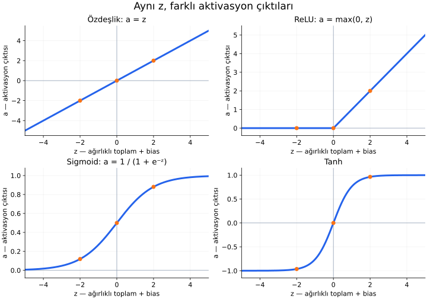
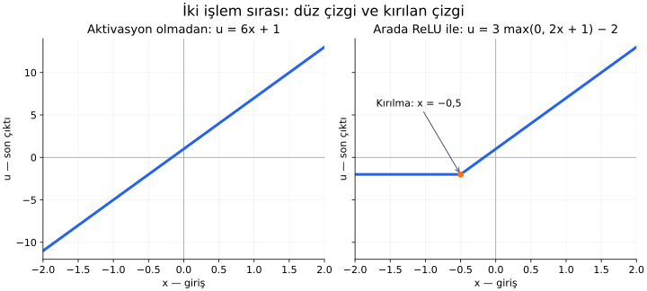

# Ders 11 — Aktivasyon fonksiyonu

[Temeller bölümüne dön](README.md) · [Önceki ders: Ağırlık ve bias](10-agirlik-ve-bias.md)

**Ana soru:** Ağırlık ve bias zaten çıktıyı değiştiriyorsa aktivasyon fonksiyonuna neden ihtiyaç duyarız?

Bu dersin sonunda aynı ağırlıklı toplamı farklı aktivasyonlarla dönüştürebilecek, grafiklerini okuyabilecek ve doğrusal olmayan aktivasyonun katmanları neden daha güçlü hâle getirdiğini açıklayabileceksin.

## 1. Toplamı hesaplamak ve çıktıyı üretmek

Önceki dersteki tek girdili nöronu hatırlayalım:

$$
z=wx+b,\qquad a=\phi(z)
$$

| Sembol | Anlamı |
|---|---|
| $x$ | Nörona gelen giriş |
| $w$ | Girişin hangi katsayıyla çarpılacağını belirleyen ağırlık |
| $b$ | Toplama eklenen bias |
| $z$ | Aktivasyondan önceki sonuç: $wx+b$ |
| $\phi$ | Seçilen aktivasyon fonksiyonu; “fi” diye okunur |
| $a$ | Aktivasyon uygulandıktan sonraki çıktı |

**Aktivasyon fonksiyonu (activation function)**, hesaplanan $z$ değerini bir kurala göre çıktıya dönüştürür. Buradaki “fonksiyon”, bir sayıyı alıp başka bir sayı üreten matematiksel kuraldır.

Örneğin $x=1$, $w=2$, $b=-4$ olsun:

$$
z=2\cdot1-4=-2
$$

Nokta çarpma işaretidir. Henüz yalnızca $z$'yi hesapladık. Çıktının $-2$, $0$ veya yaklaşık $0{,}119$ olması, seçeceğimiz aktivasyona bağlıdır.

Bu örneklerde ağırlık ve bias'ı biz seçiyoruz. Eğitimde genellikle ağırlıklar ve bias'lar veriden öğrenilir; aktivasyonun türü ise model kurulurken seçilir.

## 2. Aynı sayıya dört farklı kural uygulayalım

Her panelde yatay eksen **$z$**, dikey eksen **$a$** değeridir. Bir $z$ seçip eğriye kadar yukarı veya aşağı ilerlediğinde, dikey eksenden çıktıyı okuyabilirsin. Turuncu noktalar $z=-2$, $z=0$ ve $z=2$ örnekleridir.

Panellerin dikey ölçekleri farklıdır. Çıktıları karşılaştırırken yalnızca çizginin sayfadaki yüksekliğine değil, eksendeki sayılara bak.

### Özdeşlik: gelen sayıyı aynen geçir

**Özdeşlik fonksiyonu (identity function)**:

$$
a=z
$$

Dolayısıyla $z=-2$ ise $a=-2$ olur. Grafiği baştan sona aynı eğime sahip düz bir çizgidir. Çıktının alabileceği değerlere alt veya üst sınır koymaz.

“Aktivasyon uygulamadan çıktıyı kullanmak” burada özdeşliği kullanmakla aynı sonucu verir. Özdeşlik bir fonksiyondur, fakat hesaba doğrusal olmayan bir davranış eklemez.

### ReLU: negatif tarafı sıfırla

**ReLU (Rectified Linear Unit)**:

$$
a=\max(0,z)
$$

$\max$, verilen sayıların en büyüğünü seçer. İki durum vardır:

- $z\leq0$ ise çıktı $0$ olur.
- $z>0$ ise çıktı doğrudan $z$ olur.

Örneğin $\max(0,-2)=0$ ve $\max(0,2)=2$.

Grafik negatif tarafta yataydır; pozitif tarafta yükselir. **Sıfırda kural değiştiği için tüm grafik tek bir düz çizgi değildir.** Doğrusal olmayan davranış için mutlaka yuvarlak bir eğri gerekmez; böyle bir kırılma da yeterlidir.

ReLU çıktısı negatif olamaz, ama $1$'den büyük olabilir. $z=7$ için $a=7$ olur. Bu yüzden ReLU bir “0 veya 1 kararı” ya da bir olasılık değildir.

### Sigmoid: çıktıyı 0 ile 1 arasına sıkıştır

**Sigmoid**, S biçimli bir eğri oluşturur:

$$
a=\frac{1}{1+e^{-z}}
$$

$e$, yaklaşık $2{,}718$ olan sabit bir sayıdır. Üstteki $-z$, bu sayının hangi kuvvete yükseltileceğini belirtir. Örneğin $z=-2$ olduğunda $-z=2$ ve $e^{-z}=e^2\approx7{,}389$ olur:

$$
a=\frac{1}{1+7{,}389}\approx0{,}119
$$

$z=0$ için $e^0=1$ olduğundan çıktı $1/(1+1)=0{,}5$ olur.

Büyük pozitif $z$ değerleri çıktıyı $1$'e, büyük negatif değerler $0$'a yaklaştırır. Matematiksel olarak sonlu bir $z$ için çıktı bu iki uç değere tam ulaşmaz.

Sigmoid, iki sınıflı bir modelin son çıktısını olasılık olarak modellemek için kullanılabilir. Ancak **bir sayının 0 ile 1 arasında olması, tek başına doğru bir olasılık tahmini olduğu anlamına gelmez.** Bunun anlamlı olması, modelin nasıl eğitildiği ve değerlendirildiğiyle de ilgilidir.

### Tanh: negatif ve pozitif çıktıları sınırla

**Tanh**, “hiperbolik tanjant” fonksiyonunun kısa adıdır:

$$
a=\tanh(z)=\frac{e^z-e^{-z}}{e^z+e^{-z}}
$$

Buradaki $e$ aynı sabittir. Şimdilik ismin kökeninden çok davranışını anlamamız yeterli.

Tanh da S biçimindedir, fakat çıktısı $-1$ ile $1$ arasındadır. Negatif giriş için negatif, pozitif giriş için pozitif çıktı verir. $z=0$ için pay $1-1=0$ olduğundan $a=0$ olur.

Örneğin $z=2$ için:

$$
a\approx\frac{7{,}389-0{,}135}{7{,}389+0{,}135}
\approx0{,}964
$$

Sonlu girişler için $-1$ ve $1$ uçlarına yaklaşır, tam ulaşmaz.

### Sayıları yan yana görelim

| $z$ | Özdeşlik | ReLU | Sigmoid | Tanh |
|---:|---:|---:|---:|---:|
| $-2$ | $-2$ | $0$ | $\approx0{,}119$ | $\approx-0{,}964$ |
| $0$ | $0$ | $0$ | $0{,}5$ | $0$ |
| $2$ | $2$ | $2$ | $\approx0{,}881$ | $\approx0{,}964$ |

Ağırlık ve bias aynı kalırken yalnızca aktivasyonu değiştirerek bu farklı çıktıları elde ettik.

## 3. Aktivasyonun asıl katkısı: doğrusal olmayan davranış

**Doğrusal olmayan (nonlinear)**, bu tek girdili örnekte ilişkinin tüm girişler boyunca tek bir düz çizgiyle anlatılamaması demektir.

Küçük bir terminoloji ayrımı: $wx+b$ kuralı, $b\neq0$ olduğunda matematikte daha kesin olarak **afin (affine)** dönüşüm diye adlandırılır. Makine öğrenmesinde bias içeren bu işlemler için de sıkça “doğrusal katman” denir. Buradaki görsel fikir aynıdır: tek girdili grafik düz bir çizgidir.

**Katman (layer)**, bir ağda aynı aşamada hesap yapan nöronların grubudur. Önce tek nöronlu iki aşama düşünelim. İlk aşamanın çıktısı ikinci aşamanın girdisi olsun. Araya doğrusal olmayan aktivasyon koymayalım:

$$
h=2x+1
$$

$$
u=3h-2
$$

$h$ ara sonucu, $u$ son çıktıyı gösterir. İkinci denklemdeki $h$ yerine ilk denklemi yazarsak:

$$
u=3(2x+1)-2=6x+3-2=6x+1
$$

İki aşama kurduk, fakat sonuç yine tek bir ağırlık ve bias ile yazılabildi: ağırlık $6$, bias $1$.

Örneğin $x=1$ için önce $h=3$, sonra $u=7$ bulunur. Birleştirilmiş kural da $6\cdot1+1=7$ verir.

**Yalnızca bu tür afin işlemleri üst üste eklemek, daha fazla katman kullansak bile yine bir afin dönüşüme karşılık gelir.** Çok girdili ve çok nöronlu durumda da bu özellik geçerlidir. İşlem sayısı artar, ancak bu yolla doğrusal olmayan bir ilişki elde edemeyiz.

## 4. Aynı iki aşamanın arasına ReLU koyarsak?

Şimdi ilk toplamı ReLU'dan geçirelim:

$$
h=\max(0,2x+1),\qquad u=3h-2
$$

Son aşamada çıktıyı aynen kullanıyoruz. Yani değişiklik yalnızca iki aşamanın arasındadır.

| Giriş $x$ | İlk toplam $2x+1$ | ReLU sonrası $h$ | Son çıktı $u=3h-2$ |
|---:|---:|---:|---:|
| $-1$ | $-1$ | $0$ | $-2$ |
| $0$ | $1$ | $1$ | $1$ |
| $1$ | $3$ | $3$ | $7$ |

Önceki kuralla $x=-1$ için $u=-5$ bulurduk. Şimdi ReLU negatif ara toplamı sıfırladığı için son çıktı $-2$ oldu.

Soldaki grafik $u=6x+1$ kuralıdır. Sağdaki grafik arada ReLU kullanılan hesaptır. İki panel aynı eksen ölçeklerini kullanır.

Kırılmanın yeri, ReLU'ya gelen toplamın sıfır olduğu noktadır:

$$
2x+1=0\quad\Rightarrow\quad x=-0{,}5
$$

$\Rightarrow$ işareti “buradan şu sonuç çıkar” anlamındadır.

- $x\leq-0{,}5$ için ilk toplam sıfır veya negatiftir. $h=0$ ve $u=-2$ olur: grafik yataydır.
- $x>-0{,}5$ için ReLU ilk toplamı aynen geçirir. $u=6x+1$ olur: grafik yükselir.

**Sonuç artık tüm girişler için tek bir düz çizgiyle anlatılamaz.** Bu, doğrusal olmayan aktivasyonun katmanlar arasında ne kazandırdığının küçük bir örneğidir. Tek bir ReLU her ilişkiyi temsil etmeye yetmez; daha zengin ilişkiler için nöronların ve katmanların birlikte nasıl kurulduğu da önemlidir.

## 5. Hangi yerde hangi aktivasyon?

**Gizli katman (hidden layer)**, girdiler ile son çıktı arasında kalan hesaplama aşamasıdır. **Çıktı katmanı (output layer)** ise modelin son tahminini üretir.

| Yer veya ihtiyaç | Sık karşılaşılan seçim | Bu seçim ne sağlar? |
|---|---|---|
| Gizli katmanda doğrusal olmayan dönüşüm | ReLU | Negatif ve pozitif bölgelerde farklı davranış |
| Sınırsız bir sayısal tahminin son çıktısı | Özdeşlik | Çıktıya yapay bir alt veya üst sınır koymama |
| İki sınıflı modelin son çıktısı | Sigmoid | Olasılık olarak modellenebilecek 0–1 arası değer |
| İşaretli ve sınırlı ara çıktı | Tanh | Negatif ve pozitif değerleri -1 ile 1 arasında tutma |

Bunlar başlangıç örnekleridir; her problem için değişmez kurallar değildir. Regresyon çıktısı fiziksel olarak pozitif veya belirli bir aralıkta olmak zorundaysa, çıktı dönüşümü de buna göre seçilebilir.

Sigmoid çıktısı $0{,}8$ olduğunda “sınıf 1” demek için ayrıca bir **karar eşiği (decision threshold)** gerekir. Örneğin $0{,}5$ eşiğini seçersek, bu değerin üzerindekileri sınıf 1 sayabiliriz. Sigmoidin hesapladığı sayı ile sonradan uygulanan sınıf kararı farklı işlemlerdir.

## 6. Küçük bir deney: önce tahmin et, sonra hesapla

$w=2$, $b=-4$ değerlerini sabit tut. Girişi sırayla $1$, $2$, $3$ seç ve $z=2x-4$ toplamını bul. Sonra özdeşlik ve ReLU uygula.

Hesapları aç

| $x$ | $z=2x-4$ | Özdeşlik çıktısı | ReLU çıktısı |
|---:|---:|---:|---:|
| $1$ | $-2$ | $-2$ | $0$ |
| $2$ | $0$ | $0$ | $0$ |
| $3$ | $2$ | $2$ | $2$ |

Aktivasyonlar negatif toplamda farklı çıktı verdi. Sıfır ve pozitif toplamda aynı çıktıyı verdiler. Aynı ağırlık ve bias kullanılması, farklı aktivasyonların her girişte farklı sonuç vermesini gerektirmez.

## 7. Anlama kontrolü

1. ReLU'ya $z=4$ gelirse çıktı kaçtır? Bu çıktı neden bir olasılık sayılamaz?
2. Sigmoid ve tanh için $z=0$ çıktıları neden farklıdır?
3. $h=4x-1$ ve $u=2h+3$ işlemlerinde doğrusal olmayan aktivasyon yoksa, ikisini tek kuralla nasıl yazarsın?

Yanıtları aç

1. $\max(0,4)=4$. Olasılık 0 ile 1 arasında olmalıdır; ReLU bu üst sınırı koymaz.
2. Sigmoid için $1/(1+1)=0{,}5$; tanh için $(1-1)/(1+1)=0$. Fonksiyonların sıfırdaki kuralları farklıdır.
3. $u=2(4x-1)+3=8x+1$. İki aşama yine tek bir ağırlık ve bias ile ifade edildi.

## Kaynak ve sonraki adım

Ana okuma: [Dive into Deep Learning — Multilayer Perceptrons](https://d2l.ai/chapter_multilayer-perceptrons/mlp.html). Bu derse karşılık gelen kısımlar “From Linear to Nonlinear” ve “Activation Functions” başlıklarıdır. Türev ve eğitim ayrıntılarına şimdilik geçmeden fonksiyonların grafiklerini ve dönüşüm fikrini inceleyebilirsin.

[Önceki ders: Ağırlık ve bias](10-agirlik-ve-bias.md) · [Temeller bölümüne dön](README.md)

**Sonraki konu:** Ders 12 — Tek nöronun sınırları *(henüz hazırlanmadı)*.
