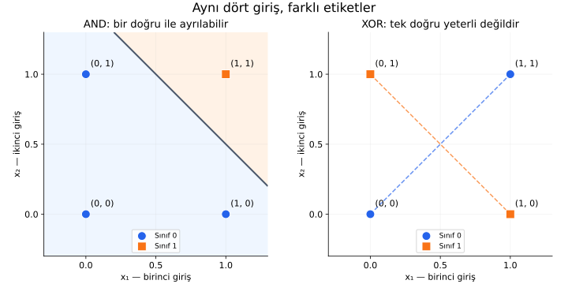
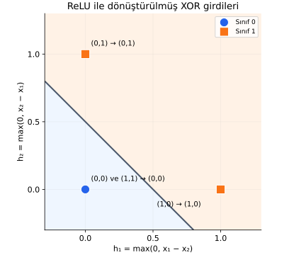

# Ders 12 — Tek nöronun sınırları

[Temeller bölümüne dön](README.md) · [Önceki ders: Aktivasyon fonksiyonu](11-aktivasyon-fonksiyonu.md)

**Ana soru:** Bir nöronun ağırlıklarını ve bias'ını istediğimiz kadar değiştirerek her sınıflandırma problemini çözebilir miyiz?

Bu derste tek bir doğruyla ayrılabilen ve ayrılamayan iki küçük problemi karşılaştıracağız. Ardından iki nöronun oluşturduğu ara çıktılarla bu sınırın nasıl aşılabildiğini hesaplayacağız.

**Ön koşul:** [Yapay nöron](09-yapay-noron.md), [ağırlık ve bias](10-agirlik-ve-bias.md) ve [aktivasyon](11-aktivasyon-fonksiyonu.md). Bütün giriş ve çıktılar bu örneklerde birimsiz sayılardır.

## 1. Dört giriş, iki farklı görev

İki girişimiz olsun: $x_1$ ve $x_2$. Her biri yalnızca $0$ veya $1$ değerini alabilsin. Böylece dört olası giriş çifti vardır.

Bu sayılar, iki anahtarın kapalı veya açık durumları gibi düşünülebilir. Etiket $y$, her giriş için istediğimiz doğru çıktıdır.

| $x_1$ | $x_2$ | AND etiketi $y$ | XOR etiketi $y$ |
|---:|---:|---:|---:|
| $0$ | $0$ | $0$ | $0$ |
| $0$ | $1$ | $0$ | $1$ |
| $1$ | $0$ | $0$ | $1$ |
| $1$ | $1$ | $1$ | $0$ |

**AND (“ve”)** işleminde iki giriş de $1$ olduğunda çıktı $1$ olur.

**XOR (exclusive OR, “dışlayan veya”)** işleminde girişlerden yalnızca biri $1$ olduğunda çıktı $1$ olur. İkisi aynıysa çıktı $0$ olur.

Girişler aynı, öğrenmek istediğimiz ilişkiler farklıdır. Buradaki amaç, bu dört girişin etiketlerini doğru üretebilen bir kural kurmaktır.

## 2. Tek nöron nasıl sınıf kararı verecek?

Önce ağırlıklı toplamı hesaplayalım:

$$
z=w_1x_1+w_2x_2+b
$$

| Sembol | Anlamı |
|---|---|
| $x_1,x_2$ | İki giriş değeri |
| $w_1,w_2$ | Girişlerin çarpıldığı ağırlıklar |
| $b$ | Bias |
| $z$ | Ağırlıklı toplam ve bias'ın sonucu |
| $y$ | İstenen doğru sınıf |
| $\hat y$ | Modelin tahmin ettiği sınıf; “y şapka” diye okunur |

Bu dersin ilk modelinde **basamak fonksiyonu (step function)** kullanacağız:

$$
\hat y=
\begin{cases}
1,&z\geq0\\
0,&z<0
\end{cases}
$$

Bu gösterim “koşula göre şu işlemi yap” demektir. $z$ sıfır veya pozitifse sınıf $1$, negatifse sınıf $0$ seçiyoruz. Sıfırdaki kararımızı baştan belirledik.

Bu ağırlıklı toplam ve basamak kuralıyla karar veren basit model, **perceptron** olarak adlandırılır. Burada eğitim algoritmasını değil, hangi kararları temsil edebildiğini inceliyoruz.

**Karar sınırı (decision boundary)**, tahminin bir sınıftan diğerine geçtiği yerdir. Bu model için sınır:

$$
w_1x_1+w_2x_2+b=0
$$

En az bir ağırlık sıfırdan farklıysa bu denklem, iki girişin çizildiği düzlemde bir **doğru** oluşturur. Doğrunun bir tarafı sınıf $0$, diğer tarafı sınıf $1$ olur. İki ağırlık da sıfırsa model girdiden bağımsız sabit bir karar verir.

**Doğrusal ayrılabilirlik (linear separability)**, sınıfları böyle tek bir doğruyla ayırabilmemizdir. Daha çok giriş olduğunda geometrinin boyutu artar; burada iki girişli grafik yeterlidir.

## 3. AND: tek nöronun yapabildiği bir iş

Şu değerleri seçelim:

$$
w_1=1,\qquad w_2=1,\qquad b=-1{,}5
$$

Böylece $z=x_1+x_2-1{,}5$ olur.

| Giriş $(x_1,x_2)$ | $z$ hesabı | $\hat y$ | AND etiketi |
|---|---|---:|---:|
| $(0,0)$ | $0+0-1{,}5=-1{,}5$ | $0$ | $0$ |
| $(0,1)$ | $0+1-1{,}5=-0{,}5$ | $0$ | $0$ |
| $(1,0)$ | $1+0-1{,}5=-0{,}5$ | $0$ | $0$ |
| $(1,1)$ | $1+1-1{,}5=0{,}5$ | $1$ | $1$ |

Dört giriş de doğru sınıflandırıldı. Karar sınırı $x_1+x_2=1{,}5$ doğrusudur.

Yatay eksen $x_1$, dikey eksen $x_2$ girişidir. **Bu grafik aktivasyon grafiği değildir:** eksenlerde toplam ve çıktı yerine iki giriş bulunur. Her noktanın rengi ve şekli doğru etiketi gösterir.

Solda AND için sınıf $1$ olan tek nokta, çizginin sağ üst tarafında kalır. Diğer üç nokta karşı taraftadır. Arka plan renkleri modelin karar bölgeleridir.

Sağda XOR için aynı sınıftaki noktalar karşılıklı köşelerdedir. Kesikli çizgiler aynı sınıftaki noktaları birbirine bağlar; **karar sınırı değildir.** Ortada kesişmeleri, noktaların neden tek bir doğruyla ayrı taraflara dağıtılamadığını düşünmeye yardımcı olur.

## 4. XOR: yalnızca kötü ağırlık mı seçtik?

AND için seçtiğimiz ağırlıkların XOR'da işe yaramaması, tek başına imkânsızlık kanıtı değildir. Başka ağırlıklarla başarabilir miyiz?

Her girişin istediğimiz sınıfta olması için gereken koşulları yazalım:

| Giriş | İstenen sınıf | Gerekli koşul |
|---|---:|---|
| $(0,0)$ | $0$ | $b<0$ |
| $(1,0)$ | $1$ | $w_1+b\geq0$ |
| $(0,1)$ | $1$ | $w_2+b\geq0$ |
| $(1,1)$ | $0$ | $w_1+w_2+b<0$ |

Ortadaki iki koşuldan:

$$
w_1\geq-b,\qquad w_2\geq-b
$$

İki ağırlığın alt sınırlarını toplar, ardından $b$ eklersek:

$$
w_1+w_2+b\geq-2b+b=-b
$$

İlk koşul $b<0$ dediği için $-b>0$ olur. Dolayısıyla $(1,1)$ girişindeki toplamın **pozitif** olması gerekir.

Fakat son koşul aynı toplamın **negatif** olmasını istiyor. Bir sayı aynı anda pozitif ve negatif olamaz.

**Bu modelde dört XOR etiketini aynı anda doğru üreten hiçbir ağırlık ve bias seçimi yoktur.** Daha uzun eğitim veya farklı başlangıç değerleri, modelin temsil edemediği bu ilişkiyi ona kazandıramaz.

## 5. Sigmoid kullanmak bu sınırı kaldırır mı?

Sigmoid eğrisi doğrusal değildir. Ancak tek nöronda:

$$
a=\operatorname{sigmoid}(w_1x_1+w_2x_2+b)
$$

hesaplayıp $a\geq0{,}5$ olduğunda sınıf $1$ dersek, yine $z\geq0$ olduğunda sınıf $1$ demiş oluruz. Çünkü sigmoid $z=0$ için $0{,}5$ verir ve $z$ arttıkça artar.

Bu nedenle **sigmoid çıktısının eğri olması, iki giriş düzlemindeki karar sınırının eğri olduğu anlamına gelmez.** Bu karar kuralında sınır yine $w_1x_1+w_2x_2+b=0$ doğrusudur.

Başka bir sabit sigmoid eşiği seçmek de sınırı kaydırır; XOR'u tek doğruyla ayırabilir hâle getirmez.

Buradaki sınırlama, **ham girdilerin afin toplamını alıp tek eşikle sınıflandıran modele** aittir. “Tek nöron” adı verilen her olası hesaplama düzeni için genel bir imkânsızlık iddiası değildir. Girdilere yeni, doğrusal olmayan özellikler eklemek veya farklı bir hesaplama yapısı kurmak problemi değiştirebilir.

## 6. İki ara nöronla girdileri dönüştürelim

Şimdi iki ReLU nöronundan oluşan bir gizli katman kuralım:

$$
h_1=\max(0,x_1-x_2)
$$

$$
h_2=\max(0,x_2-x_1)
$$

$h_1$ ve $h_2$, iki ara nöronun çıktılarıdır. $\max$ büyük sayıyı seçer; önceki dersteki ReLU kuralıdır.

İlk nöronun ağırlıkları $1$ ve $-1$, ikinci nöronun ağırlıkları $-1$ ve $1$ olur. İkisinin bias'ı $0$'dır.

Bu **ikili girişlerde** $h_1$, yalnızca birinci giriş $1$ ve ikinci giriş $0$ olduğunda $1$ verir. $h_2$ bunun tersini yakalar. Son karar için bunları toplayalım:

$$
s=h_1+h_2-0{,}5
$$

$s$, çıktı nöronunun aktivasyondan önceki toplamıdır. Bu nöronun iki ağırlığı da $1$, bias'ı $-0{,}5$'tir. $s\geq0$ ise $\hat y=1$, değilse $\hat y=0$ seçelim.

| $(x_1,x_2)$ | $h_1$ | $h_2$ | $s=h_1+h_2-0{,}5$ | $\hat y$ |
|---|---:|---:|---:|---:|
| $(0,0)$ | $0$ | $0$ | $-0{,}5$ | $0$ |
| $(0,1)$ | $0$ | $1$ | $0{,}5$ | $1$ |
| $(1,0)$ | $1$ | $0$ | $0{,}5$ | $1$ |
| $(1,1)$ | $0$ | $0$ | $-0{,}5$ | $0$ |

Örneğin $(1,1)$ girişinde iki fark da $0$ olur. İki ReLU da $0$ üretir; son toplam $-0{,}5$ olduğu için çıktı $0$'dır. Böylece dört XOR etiketi doğru üretildi.

Bu kez eksenler **$h_1$ ve $h_2$** değerleridir. Gizli katman, girdileri yeni bir gösterime dönüştürdü.

Başlangıçta ayrı duran $(0,0)$ ve $(1,1)$ girişleri artık aynı $(h_1,h_2)=(0,0)$ noktasına gitti. İkisi de sınıf $0$ olduğu için bu birleşme burada işe yarıyor. Sınıf $1$ olan girişler ise $(1,0)$ ve $(0,1)$ noktalarına gitti.

Yeni düzlemde $h_1+h_2=0{,}5$ doğrusu sınıfları ayırabiliyor. **Doğruyla ayrılamayan ham girdiler, doğrusal olmayan dönüşümden sonra doğruyla ayrılabilir hâle geldi.**

Bu ağın parametrelerini elle seçtik; henüz eğitim yapmadık. Modelin XOR'u **temsil edebilmesi**, bir eğitim yönteminin bu parametreleri nasıl bulacağı sorusundan farklıdır.

## 7. Küçük deney: ReLU'yu kaldırırsak?

Ara nöronları $h_1=x_1-x_2$ ve $h_2=x_2-x_1$ yap. Son toplam yine $s=h_1+h_2-0{,}5$ olsun. Her giriş için ne olur?

Hesabı aç

$$
s=(x_1-x_2)+(x_2-x_1)-0{,}5=-0{,}5
$$

İki fark birbirini götürür. Bütün girişlerde sınıf $0$ tahmin edilir. XOR'un sınıf $1$ olan iki girişini kaybederiz.

Bu örnekte başarının nedeni yalnızca nöron sayısını artırmak değildir. Ara nöronlardaki doğrusal olmayan ReLU dönüşümü de gereklidir. Önceki derste gördüğümüz gibi, yalnızca afin işlemleri üst üste koymak yine bir afin işlem verir.

## 8. Anlama kontrolü

1. AND için bias'ı $-1{,}5$ yerine $-0{,}5$ yaparsak hangi girişlerin tahmini değişir?
2. XOR'u çözemeyen tek perceptronu daha uzun eğitmek neden yeterli değildir?
3. Yukarıdaki ReLU ağında $(0,1)$ girişinin bütün hesaplarını sırayla yaz.

Yanıtları aç

1. $(0,1)$ ve $(1,0)$ için toplam $-0{,}5$ yerine $0{,}5$ olur; tahminleri $0$'dan $1$'e döner. $(0,0)$ yine $0$, $(1,1)$ yine $1$ verir. Model artık “en az bir giriş 1 ise 1” kuralını uygular.
2. Sorun uygun parametreleri henüz bulamamamız değildir. Bu hesaplama yapısında bütün XOR etiketlerini aynı anda sağlayan parametreler yoktur.
3. $h_1=\max(0,0-1)=0$, $h_2=\max(0,1-0)=1$. Ardından $s=0+1-0{,}5=0{,}5$ ve $\hat y=1$ olur.

## 9. Temeller bölümünden neyle çıkıyoruz?

İlk 12 dersin içeriği artık hazır. Sonraki bölüme geçmeden şu bağlantıları kendi cümlelerinle kurabilmelisin:

- Veri, özellik ve etiket öğrenme problemini tanımlar.
- Model bir hesaplama kuralıdır; parametreler bu kuralın ayarlanabilir sayılarıdır.
- Eğitim parametreleri belirler, tahmin mevcut parametrelerle çıktı hesaplar.
- Ağırlık ve bias toplamı değiştirir; aktivasyon toplamı çıktıya dönüştürür.
- Bir modelin temsil edebildiği ilişkiler sınırlıdır; bu sınır yalnızca eğitim süresini artırarak aşılmaz.

XOR ağının dört olası ikili girişte doğru sonuç vermesi, gerçek bir veri kümesindeki başarının nasıl ölçüleceğini henüz açıklamaz. Gerçek problemler için kayıp, eğitim yöntemi ve yeni veriye genelleme sorularını da ele almamız gerekecek.

**Sonraki bölümde “uygun model kurmak”tan “parametreleri veriden bulmak”a geçiyoruz.** İlk konu Ders 13 — Veriden fonksiyon öğrenmek olacak.

## Kaynak ve sonraki adım

Ana okuma: [Goodfellow, Bengio ve Courville — Deep Learning, Bölüm 6](https://www.deeplearningbook.org/contents/mlp.html), **6.1 “Example: Learning XOR”**. Bu okuma, doğrusal modelin sınırını ve gizli katmanla yeni bir gösterim oluşturmayı inceler. Buradaki grafikler ve sayısal çözüm ders için ayrıca hazırlanmıştır.

[Önceki ders: Aktivasyon fonksiyonu](11-aktivasyon-fonksiyonu.md) · [Temeller bölümüne dön](README.md) · [Öğrenmenin matematiği bölümüne geç](../02-ogrenmenin-matematigi/README.md)

**Sonraki ders:** [Ders 13 — Veriden fonksiyon öğrenmek](../02-ogrenmenin-matematigi/13-veriden-fonksiyon-ogrenmek.md).
