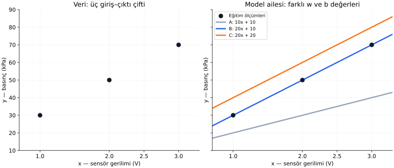
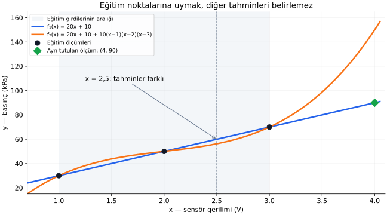

# Ders 13 — Veriden fonksiyon öğrenmek

[Bölüm girişine dön](README.md) · [Önceki ders: Tek nöronun sınırları](../01-temeller/12-tek-noronun-sinirlari.md)

**Ana soru:** Birkaç giriş–çıktı örneğinden, henüz görmediğimiz bir giriş için çıktı üreten bir kuralı nasıl kurarız?

Temeller bölümünde model, parametre ve eğitim kavramlarını tanıdık. Bu bölümde onları matematiksel olarak birbirine bağlayacağız. Bu derste küçük bir modelin parametrelerini veriden bulacağız; ardından bu hesabın neyi kanıtladığını, neyi kanıtlamadığını inceleyeceğiz.

**Ders sonunda:** Bir veri çiftini fonksiyon gösterimiyle ilişkilendirebilecek, model ailesi ile belirli bir modeli ayırabilecek, basit parametreleri elle bulabilecek ve eğitim noktalarına uymanın neden tek başına yeterli olmadığını açıklayabileceksin.

**Ön koşul:** [Model ve parametre](../01-temeller/05-model-ve-parametre.md), [eğitim ve tahmin](../01-temeller/06-egitim-ve-tahmin.md), [regresyon](../01-temeller/08-regresyon-ve-siniflandirma.md). Bu derste türev veya matris bilgisi gerekmiyor.

## 1. Somut problem: sensör geriliminden basıncı bulmak

Bir basınç sensörünün çıkışında gerilim okuduğumuzu düşünelim. Uygulamamız gerilimi değil, basıncı kullanmak istiyor. Elimizde sensörün dönüşüm formülü olmasın.

Sensörü birkaç koşulda ölçüp gerilim değerini bir referans basınç ölçümüyle eşleştirelim:

| Örnek numarası | Sensör gerilimi $x$ (V) | Referans basınç $y$ (kPa) |
|---:|---:|---:|
| $1$ | $1$ | $30$ |
| $2$ | $2$ | $50$ |
| $3$ | $3$ | $70$ |

**V**, volt; **kPa**, kilopaskal birimidir. Her satırda aynı koşula ait bir gerilim–basınç çifti bulunur. Girişimiz gerilim, tahmin etmek istediğimiz hedefimiz basınçtır. Basınç sayısal bir değer olduğu için bu bir **regresyon (regression)** problemidir.

Bu sayılar anlatım için oluşturulmuş **sentetik (synthetic), yani yapay verilerdir**. İlk hesabın açık olması için gürültüsüz ve tam bir doğru üzerinde seçildiler. Gerçek sensör ölçümleri bu kadar düzenli olmak zorunda değildir.

Şimdi sensör $2{,}5$ V okursa ne yapacağız? Tabloda bu gerilime ait satır yok. Bize yalnızca eski satırları geri veren bir tablo yerine, yeni girdilerde de çalışan bir hesaplama kuralı gerekiyor.

## 2. Fonksiyon: tablonun ötesine geçen kural

**Fonksiyon (function)**, kabul ettiği her girişe belirli bir çıktı atayan matematiksel kuraldır.

$$
\hat y=f(x)
$$

Bu denklemi “$x$ girişini $f$ kuralına ver, tahmin edilen $\hat y$ çıktısını al” diye okuyabiliriz.

| Gösterim | Anlamı |
|---|---|
| $x$ | Giriş; bu örnekte sensör gerilimi |
| $f$ | Girişi çıktıya dönüştüren kural |
| $f(x)$ | $f$ kuralı $x$'e uygulandığında çıkan sonuç |
| $y$ | Verideki referans hedef |
| $\hat y$ | Modelin hedef için ürettiği tahmin |

$\hat y$, “y şapka” diye okunur. Şapka, bir değerin tahmin olduğunu belirtir. Tahmin referans değere eşit çıkabilir; yine de bu iki sembol farklı rolleri gösterir.

Örneğin $f(x)=20x+10$ kuralını kullanırsak:

$$
f(2)=20\cdot2+10=50
$$

Burada $f(2)$, “$f$ ile $2$'yi çarp” anlamına gelmez. Fonksiyonun içine $x=2$ koyup hesabı yap demektir. Çarpma, $20\cdot2$ kısmındadır.

**Birimlerle ilgili çalışma kuralımız:** Formüllerde $x$ gerilimin **volt cinsinden sayısal değeri**, $y$ ve $\hat y$ basıncın **kPa cinsinden sayısal değeri** olacak. Böylece $x=2$ yazdığımızda $2$ V kastediyoruz. Başka birimlere geçersek katsayıları da buna göre değiştirmemiz gerekir.

Bu kuralı şimdilik biz yazdık. Asıl sorumuz, veriden nasıl elde edeceğimizdir.

## 3. Veriyi matematiksel olarak nasıl yazarız?

Örnekleri birbirinden ayırmak için üst indis kullanalım:

$$
(x^{(1)},y^{(1)})=(1,30)
$$

$$
(x^{(2)},y^{(2)})=(2,50)
$$

$$
(x^{(3)},y^{(3)})=(3,70)
$$

$x^{(2)}$, **ikinci örneğin girdisi** demektir; $x$'in karesi değildir. Parantezli üst indis örnek numarasını gösterir. Önceki derslerdeki $x_1,x_2$ ise tek örneğin farklı giriş özelliklerini gösteriyordu. Bu derste her örneğin yalnızca bir özelliği var.

Veri kümesini topluca şöyle yazabiliriz:

$$
\mathcal D=\{(x^{(i)},y^{(i)})\}_{i=1}^{n}
$$

Bu gösterimi parçalara ayıralım:

- $\mathcal D$, veri kümesinin adıdır; “D” diye okunur.
- Süslü parantez, giriş–hedef çiftlerini birlikte toplar.
- $i$, hangi örneğe baktığımızı belirten sayıdır.
- $i=1$ ile başlayıp $n$'e kadar gideriz.
- $n$, toplam örnek sayısıdır; burada $n=3$.

Uzun gösterim yeni bir hesap eklemiyor. Üç satırlık tabloyu daha çok örnek için de kullanılabilecek kısa bir dille yazıyor.

## 4. Model ailesini seçmek: hangi kurallara izin veriyoruz?

Veri, kullanılacak fonksiyonun biçimini kendiliğinden tek bir şekilde belirlemez. Önce hangi tür kuralları deneyeceğimize karar verelim.

İlk model ailemiz:

$$
f(x;w,b)=wx+b
$$

**Model ailesi (model family)**, aynı hesaplama biçimine sahip, parametreleri değiştikçe farklı kurallar veren modellerin topluluğudur. Burada bütün adaylar düz bir çizgidir; eğim ve kayma değişebilir.

$w$, ağırlık; $b$, bias'tır. Bunlar önceki bölümden tanıdığımız parametrelerdir. $wx+b$, kesin matematiksel adlandırmayla bir **afin dönüşümdür**; makine öğrenmesinde bu biçime dayanan regresyon modellerine genellikle doğrusal regresyon denir.

$f(x;w,b)$ içindeki noktalı virgül bir ayrım gösterir:

- $x$, tahmin yapılacak örneğin girdisidir.
- $w$ ve $b$, modelin ayarlanabilir sayılarıdır.

Gerçek kullanımda her yeni ölçümde $x$ değişebilir. Eğitimden sonra $w$ ve $b$ sabit tutularak tahmin yapılır.

Parametreleri birlikte belirtmek için:

$$
\theta=(w,b),\qquad f(x;\theta)=wx+b
$$

yazabiliriz. $\theta$, “teta” diye okunur ve bu iki parametrenin ortak adıdır. Yeni bir sensör ölçümü değildir.

| Model ailesi | Seçilen parametreler | Belirli model |
|---|---|---|
| $wx+b$ | $w=10,\ b=10$ | $10x+10$ |
| $wx+b$ | $w=20,\ b=10$ | $20x+10$ |
| $wx+b$ | $w=20,\ b=20$ | $20x+20$ |

**Aileyi seçmek**, bütün adayları düz çizgilerle sınırlamaktır. **Parametreleri seçmek**, bu çizgilerden hangisini kullanacağımızı belirlemektir.

## 5. Grafikte veri ile modeli ayırmak

Solda yalnızca bildiğimiz üç ölçüm çifti var. Yatay eksen gerilim, dikey eksen basınçtır. Siyah noktalar referans veriyi gösterir.

Sağda üç aday kuralı ekledik. Çizgiler, yalnızca ölçtüğümüz gerilimlerde değil, çizilen aralıktaki diğer gerilimlerde de tahmin üretir.

Mavi çizgi üç noktadan geçiyor. Gri çizgi ölçümlerin altında kalıyor. Turuncu çizginin eğimi maviyle aynı, fakat bütün tahminleri $10$ kPa daha yüksek.

Grafikteki çizgi, yeni bir ölçüm yapılmış olduğunu söylemez. **Noktalar gözlenen veri; çizginin diğer kısımları modelin ürettiği tahmindir.**

Şimdi bu görsel gözlemi sayılarla doğrulayalım.

## 6. “Daha iyi uyum”u sayıyla karşılaştırmak

Üç adayın eğitim girdilerindeki tahminlerini hesaplayalım:

| Giriş $x$ | Referans $y$ | A: $10x+10$ | B: $20x+10$ | C: $20x+20$ |
|---:|---:|---:|---:|---:|
| $1$ | $30$ | $20$ | $30$ | $40$ |
| $2$ | $50$ | $30$ | $50$ | $60$ |
| $3$ | $70$ | $40$ | $70$ | $80$ |

Bir tahminin referanstan farkına bakalım:

$$
r^{(i)}=\hat y^{(i)}-y^{(i)}
$$

$r^{(i)}$, $i$'nci örnekteki **artık (residual)**, yani tahmin ile gözlenen hedef arasındaki farktır. Bu derste çıkarma sırasını “tahmin eksi hedef” olarak tanımladık.

Örneğin A modelinin ikinci örneğinde:

$$
r^{(2)}=30-50=-20
$$

Negatif işaret modelin $20$ kPa düşük tahmin yaptığını söyler. C modelinin aynı örneğinde $60-50=10$; bu kez $10$ kPa yüksek tahmin vardır.

Farkların büyüklüklerini toplamak için **mutlak değer (absolute value)** kullanalım. $|-20|=20$ ve $|10|=10$ olur. Dikey çizgiler, işareti değil büyüklüğü aldığımızı gösterir.

| Model | Üç artık | Mutlak farkların toplamı (kPa) |
|---|---|---:|
| A | $-10,-20,-30$ | $10+20+30=60$ |
| B | $0,0,0$ | $0$ |
| C | $10,10,10$ | $30$ |

Bu ölçüte göre B, bu üç aday arasında eğitim verisine en iyi uyan modeldir. Farkları doğrudan işaretleriyle toplasaydık, yüksek ve düşük tahminler birbirini götürebilirdi. Mutlak değer burada bunu önler.

Tahmin hatalarını bir sayıyla değerlendiren kurallar **kayıp fonksiyonu (loss function)** fikrine götürür. Farklı kayıpları ve neden seçildiklerini 15. derste ayrıntılı inceleyeceğiz. Bu derste yalnızca adayları karşılaştırmak için basit bir ölçüt kurduk.

## 7. Parametreleri tahmin etmek yerine veriden bulalım

Üç noktanın da $wx+b$ modeline tam uyduğunu varsayarak ilk iki satırı denkleme çevirelim:

$$
w\cdot1+b=30
$$

$$
w\cdot2+b=50
$$

İkinci denklemden birinciyi çıkaralım:

$$
(2w+b)-(w+b)=50-30
$$

Soldaki $b$'ler birbirini götürür, $2w-w=w$ kalır:

$$
w=20
$$

Bu değeri ilk denkleme koyarsak:

$$
20+b=30\quad\Rightarrow\quad b=10
$$

$\Rightarrow$ işareti “buradan şu sonuç çıkar” demektir. Böylece:

$$
\hat y=20x+10
$$

modelini bulduk. Üçüncü eğitim örneğini de kontrol edelim:

$$
20\cdot3+10=70
$$

O da tam uyuyor.

Fiziksel yorumuyla eğim $20$ kPa/V'dir: bu modelde gerilim $1$ V artınca tahmin $20$ kPa artar. Bias $10$ kPa'dır. Model, $x=0$ için $10$ kPa hesaplar; fakat $0$ V'de ölçüm yapmadık. Bias'ın cebirsel anlamını bilmek, sıfırdaki gerçek basıncı bildiğimiz anlamına gelmez.

Bu küçük örnekte **eğitimi (training)** denklem çözerek yaptık. Eğitim mutlaka çok sayıda deneme veya sinir ağı kullanmak demek değildir; burada modelin parametrelerini veriden belirledik.

Gerçek üç ölçüm $30,51,70$ olsaydı aynı doğru hepsinden tam geçmeyebilirdi. O zaman yalnızca iki satıra uymak yerine bütün eğitim örnekleri üzerinde uygun bir hata ölçütünü azaltmak isterdik. Bu durum sonraki dersin ana konusu olacak.

## 8. Eğitim bitti: yeni bir girişte tahmin yapalım

Parametreler artık sabit: $w=20$, $b=10$. Yeni gerilim $x_{\text{yeni}}=2{,}5$ olsun. Altındaki “yeni” sözcüğü bunun yeni girdinin adı olduğunu belirtir.

$$
\hat y_{\text{yeni}}=20\cdot2{,}5+10=50+10=60
$$

Sonuç: **$2{,}5$ V için modelin basınç tahmini $60$ kPa.**

Bu hesapta yeni bir eğitim yapılmadı. Sabit modelin içine yeni giriş koyduk; bu **tahmin (inference)** işlemidir.

Yeni girişin referans basıncını henüz bilmiyorsak tahmini hesaplayabiliriz, ama hatasını hesaplayamayız. $\hat y=60$ elde etmek ile $y=60$ olduğunu ölçerek doğrulamak farklı işlerdir.

## 9. Üç noktaya uymak, tek bir fonksiyon bulduğumuz anlamına mı gelir?

Seçtiğimiz düz çizgi ailesi içinde farklı giriş değerleri olan ilk iki nokta $w$ ve $b$'yi belirledi. Fakat bütün olası fonksiyonlara izin verirsek, aynı üç noktadan geçen başka kurallar da vardır.

Örneğin:

$$
f_1(x)=20x+10
$$

$$
f_2(x)=20x+10+10(x-1)(x-2)(x-3)
$$

Yan yana yazılan parantezler çarpılır. İkinci kuralda, ilkine fazladan bir çarpım ekledik.

$x=1$ için $(x-1)=0$; $x=2$ için $(x-2)=0$; $x=3$ için $(x-3)=0$ olur. Her eğitim girdisinde çarpımın bir faktörü sıfırdır. Dolayısıyla eklenen terim sıfır olur ve iki model de $30,50,70$ tahminlerini üretir.

Buradaki sayısal formüller yine volt ve kPa cinsinden değerler içindir. Birimleri açıkça yazarsak çarpımın katsayısı $10$ kPa/V³, çıkarılan gerilimler $1,2,3$ V olur; böylece eklenen terim de kPa birimindedir.

Yeni girdide hesaplayalım:

$$
f_2(2{,}5)=60+10(1{,}5)(0{,}5)(-0{,}5)
$$

$$
f_2(2{,}5)=60-3{,}75=56{,}25
$$

İki model aynı eğitim verisinde sıfır hata verdiği hâlde, yeni girişte biri $60$, diğeri $56{,}25$ kPa tahmin etti.

Siyah noktalar ortak eğitim verileridir. Mavi ve turuncu eğriler bu noktalarda birleşir; aralarında ve dışında farklılaşırlar. Kesikli dikey çizgi, $x=2{,}5$ girişindeki farkı gösterir.

**Sonlu sayıda örnek, genel olarak bütün girişlerdeki davranışı tek başına belirlemez.** Model ailesini seçerken yaptığımız varsayımlar, ölçmediğimiz girdilerde nasıl tahmin yapacağımızı da etkiler. Basit modeli tercih etmek bir başlangıç olabilir; gerçek başarısını ayrıca ölçmemiz gerekir.

## 10. Ayrı tuttuğumuz ölçüm ve ölçüm aralığının dışı

Öğrenilen kuralın yeni veride işe yaramasına **genelleme (generalization)** diyoruz.

Örneğin en başta $x=4$ V, $y=90$ kPa olan bir ölçümü eğitimden ayrı tuttuğumuzu düşünelim. Bu satırı parametreleri bulmakta kullanmadık. Grafikteki yeşil elmas bu ölçümdür.

Önceden kurduğumuz iki modelin sonuçlarını sonradan karşılaştırırsak:

$$
f_1(4)=20\cdot4+10=90
$$

$$
f_2(4)=90+10(3)(2)(1)=150
$$

Bu ayrı ölçümde ilk model doğru, ikinci model $60$ kPa yüksek tahmin verdi. **Tek bir doğru yeni tahmin, modelin her koşulda başarılı olduğunu kanıtlamaz.** Daha çok bağımsız ölçüm ve uygulamanın çalışma koşullarını kapsayan değerlendirme gerekir.

Ayrı veri üzerinde sonuçlara bakıp model seçmeye veya modeli değiştirmeye başlarsak, o veri artık geliştirme kararlarımızı da etkiler. Son başarı değerlendirmesi için başka, dokunulmamış veriye ihtiyaç doğar. Eğitim, doğrulama ve test ayrımını 17. derste ayrıntılandıracağız.

Bir başka ayrım da giriş aralığıdır:

| Tahmin | Eğitim girdilerine göre konumu | Adı |
|---|---|---|
| $x=2{,}5$ V | $1$–$3$ V aralığının içinde | İnterpolasyon (interpolation) |
| $x=4$ V | Bu aralığın dışında | Ekstrapolasyon (extrapolation) |

İlkinde örneklerin arasındaki davranışı, ikincisinde gördüğümüz aralığın ötesindeki davranışı tahmin ediyoruz. Aralık dışında ilişkinin biçimi değişebilir. Örneğin gerçek sensör bir noktadan sonra çıkış sınırına ulaşabilir. Düz çizgiyi uzatmak bunu kendiliğinden hesaba katmaz.

Aralık içinde olmak da doğruluğu garanti etmez; $2{,}5$ örneğinde iki fonksiyonun içeride bile farklı sonuç verdiğini gördük.

## 11. Gerçek ölçümlerde neden tam eşleşme beklemeyiz?

Gerçekte aynı gerilime karşılık farklı referans ölçümleri görebiliriz. Ölçüm gürültüsü, sıcaklık gibi modele eklemediğimiz değişkenler veya deney koşulları buna yol açabilir.

Basit bir ifade:

$$
y=f^\star(x)+\varepsilon
$$

$f^\star$, “f yıldız” diye okunur; modellemek istediğimiz ideal veya ortalama ilişkiye verdiğimiz addır. Yıldız çarpma işareti değildir. $\varepsilon$, “epsilon” diye okunur; bu ilişki ile gözlenen hedef arasındaki sapmayı gösterir. Burada epsilon için belirli bir olasılık dağılımı varsaymıyoruz.

Modelimiz bu bilinmeyen ilişkiyi yaklaşık olarak temsil etmeye çalışır. Her ölçümdeki sapmayı da aynen öğrenmek, yeni ölçümlerde daha iyi sonuç vereceği anlamına gelmez.

Bu nedenle sensör örneğinde üç ayrı soruyu takip etmeliyiz: Seçtiğimiz aile ilişkiyi yeterince temsil ediyor mu? Parametreleri uygun biçimde bulduk mu? Yeni ölçümlerde sonuçlar iyi mi? Bunlar birbirine bağlı, fakat ayrı sorulardır.

## 12. Kısa deney ve anlama kontrolü

Önce yanıtları kendin hesapla:

1. $w=15$, $b=10$ modelinin üç eğitim girdisindeki tahminleri ve toplam mutlak farkı kaçtır?
2. Bu derste $x^{(2)}$ ile $x^2$ arasındaki fark nedir?
3. $f_1$ ve $f_2$ neden eğitim noktalarında eşit, $x=2{,}5$'te farklıdır?
4. Yeni girişte hedef $y$ bilinmiyorsa hangi işlemi yapabilir, hangisini yapamayız?

Adım adım yanıtları aç

1. Tahminler $25,40,55$ kPa olur. Artıklar $25-30=-5$, $40-50=-10$, $55-70=-15$; toplam mutlak fark $5+10+15=30$ kPa'dır.
2. $x^{(2)}$ ikinci örneğin girdisidir; bu veride $2$ V'nin sayısal değeridir. $x^2$ ise seçilen $x$ sayısının kendisiyle çarpımıdır.
3. Eğitim noktalarında ek çarpımın bir faktörü sıfırdır. $2{,}5$'te hiçbir faktör sıfır değildir ve ek terim $-3{,}75$ olur.
4. Modelle $\hat y$ tahminini hesaplayabiliriz. Referans hedef olmadan bu örnekteki $\hat y-y$ farkını hesaplayamayız.

## Bu dersin ardından

Bir öğrenme problemini artık şu parçalarla okuyabiliriz: verideki giriş–hedef çiftleri, izin verdiğimiz model ailesi, veriden belirlenen parametreler ve sabit modelin yeni girişteki tahmini. Eğitim verisindeki uyum ile yeni verideki başarıyı ayrıca değerlendirmemiz gerektiğini de gördük.

**14. derste**, düz çizgi modelini daha ayrıntılı inceleyeceğiz: ölçümler aynı doğru üzerinde olmadığında ağırlık ve bias'ı bütün verilere göre nasıl seçeriz?

Ana okuma: [Dive into Deep Learning — 3.1 Linear Regression](https://d2l.ai/chapter_linear-regression/linear-regression.html), bölümün giriş kısmı ve **3.1.1.1 “Model”**. Şimdilik örnek, özellik, hedef ve parametrelerin nasıl ilişkilendirildiğine odaklan; matris ve türev gösterimleri sonraki adımlarda ele alınacak. Bu dersteki sensör verileri, hesaplar ve grafikler ayrıca hazırlanmıştır.

[Önceki ders: Tek nöronun sınırları](../01-temeller/12-tek-noronun-sinirlari.md) · [Bölüm girişine dön](README.md)

**Sonraki ders:** [Ders 14 — Doğrusal regresyon](14-dogrusal-regresyon.md).
