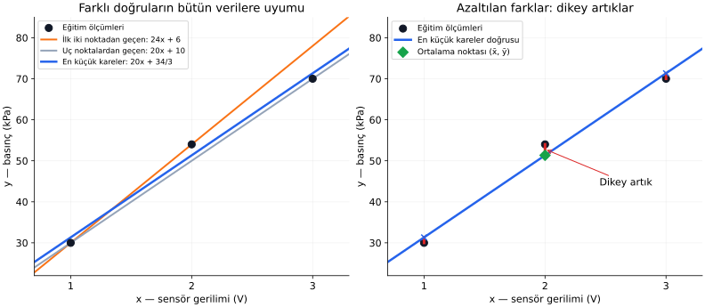
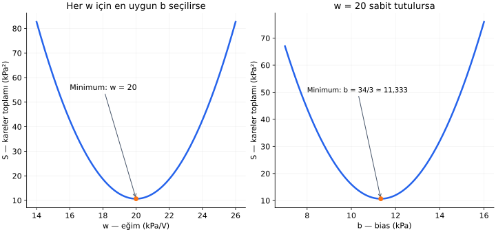

# Ders 14 — Doğrusal regresyon

[Bölüm girişine dön](README.md) · [Önceki ders: Veriden fonksiyon öğrenmek](13-veriden-fonksiyon-ogrenmek.md)

**Ana soru:** Ölçümler aynı doğru üzerinde değilse, bütün verilere göre en uygun ağırlık ve bias'ı nasıl seçeriz?

Önceki derste üç nokta tek bir doğru üzerindeydi. İlk iki noktadan parametreleri bulup üçüncüsünü doğrulayabildik. Bu derste ölçümleri biraz değiştireceğiz: artık her noktaya tam uymak mümkün olmayacak. “En uygun” ifadesini bir hata ölçütüyle tanımlayacak ve bu ölçütün en küçük değerini veren doğruyu hesaplayacağız.

**Ders sonunda:** Dikey artıkları okuyabilecek, kareler toplamını hesaplayabilecek, tek girdili doğrusal regresyonun parametrelerini bütün eğitim verilerinden bulabilecek ve çözümün sınırlarını açıklayabileceksin.

**Ön koşul:** [13. ders](13-veriden-fonksiyon-ogrenmek.md), temel cebir ve kare alma. Türev veya matris bilgisi gerekmiyor. Genel formülleri hem açarak okuyacak hem küçük sayılarla uygulayacağız.

## 1. Aynı sensör problemi, daha düzensiz ölçümler

Gerilimden basınç tahmin etmeye devam edelim. Bu kez eğitim verimiz:

| Örnek | Gerilim $x$ (V) | Referans basınç $y$ (kPa) |
|---:|---:|---:|
| $1$ | $1$ | $30$ |
| $2$ | $2$ | $54$ |
| $3$ | $3$ | $70$ |

İkinci hedef önceki dersteki $50$ yerine $54$ oldu. Bunlar yine anlatım için hazırlanmış **sentetik (synthetic)** verilerdir. Gerçek bir sensörden alındıkları iddia edilmiyor.

İlk aralıkta gerilim $1$ V artarken basınç $24$ kPa artıyor. İkinci aralıkta aynı gerilim artışına karşılık basınç $16$ kPa artıyor. Tek bir doğrunun eğimi sabit olduğundan bu iki artışı aynı anda tam veremez.

Model ailemiz:

$$
\hat y=wx+b
$$

| Sembol | Anlamı |
|---|---|
| $x$ | Giriş geriliminin volt cinsinden sayısal değeri |
| $y$ | Referans basıncın kPa cinsinden sayısal değeri |
| $\hat y$ | Modelin kPa cinsinden basınç tahmini |
| $w$ | Ağırlık; doğrunun eğimi |
| $b$ | Bias; doğrunun dikey kayması |

Birimleri açık yazarsak $w$ kPa/V, $b$ kPa birimindedir. Sayısal hesaplarda aynı birimleri baştan sona koruyacağız.

**Tek girdili doğrusal regresyon (simple linear regression)**, bir sayısal hedefi bu doğru biçimindeki modelle açıklamaya çalışır. “Regresyon” sayısal hedefi, “doğrusal” burada seçtiğimiz model biçimini belirtir. Bias içeren $wx+b$ kuralı matematikte afin dönüşümdür.

## 2. İki noktayı seçmek neden yeterli değil?

İlk iki noktadan geçen doğruyu bulursak:

$$
w+b=30,\qquad 2w+b=54
$$

İkinci denklemden birinciyi çıkarınca $w=24$ olur. İlk denkleme koyunca $b=6$ buluruz.

$$
\hat y=24x+6
$$

Bu doğru ilk iki ölçüme tam uyar. Fakat $x=3$ için:

$$
\hat y=24\cdot3+6=78
$$

Referans $70$ olduğundan tahmin $8$ kPa yüksektir.

Bu kez ilk ve son noktayı seçersek $w=20$, $b=10$ olur. Tahminler $30,50,70$ çıkar; orta noktada $4$ kPa düşük kalırız.

Hangisi daha iyi? Hangi iki noktayı sevdiğimize göre karar vermek yerine, **bütün eğitim örneklerini birlikte değerlendiren bir ölçüt** gerekiyor.

## 3. Nokta ile doğru arasındaki hangi farkı azaltıyoruz?

Her eğitim örneği için:

$$
\hat y^{(i)}=wx^{(i)}+b
$$

$$
r^{(i)}=\hat y^{(i)}-y^{(i)}
$$

Parantezli üst indis $(i)$, örnek numarasıdır; kuvvet değildir. $r^{(i)}$, **artık (residual)** dediğimiz tahmin–referans farkıdır. Burada çıkarma sırasını “tahmin eksi referans” seçtik.

Solda üç aday doğru var. Siyah noktalar ölçümlerdir. Turuncu doğru ilk iki noktadan geçiyor, gri doğru uç noktalardan geçiyor. Mavi doğruyu birazdan bütün verilerden hesaplayacağız.

Sağdaki kırmızı parçalar **aynı $x$ değerinde**, noktanın hedefi ile model tahmini arasındaki dikey farklardır. Mavi çarpılar doğrunun bu girdilerdeki tahminlerini gösterir.

Bu yöntemde noktadan doğruya çizilebilecek en kısa, dik bir mesafeyi azaltmıyoruz. **Giriş değerini sabit tutup hedef yönündeki farkı azaltıyoruz.** Bu ayrım, iki eksenin farklı fiziksel birimleri olduğu için de anlamlıdır.

Gerilim ölçümünün de önemli belirsizliği varsa, standart yöntem bunu kendiliğinden modellemez; ölçüm problemine uygun başka bir yaklaşım gerekebilir. Bu derste gerilimleri verilmiş girdiler olarak kabul ediyoruz.

## 4. En küçük kareler ölçütünü kuralım

Artıkları doğrudan toplamak uygun değildir. Örneğin $+4$ ve $-4$ birbirini götürür; ama iki tahmin de hatalıdır.

Bu derste her artığın karesini alıp toplayacağız:

$$
S(w,b)=\sum_{i=1}^{n}\left(wx^{(i)}+b-y^{(i)}\right)^2
$$

Denklemi soldan sağa okuyalım:

- $S$, bütün eğitim örneklerinin **kareler toplamı**dır.
- $S(w,b)$, toplamın seçtiğimiz ağırlık ve bias'a bağlı olduğunu belirtir.
- $\sum$, büyük sigma işaretidir ve “topla” anlamına gelir.
- $i=1$'den $n$'e kadar her örneğin terimini hesaplarız.
- Parantezin içi artıktır; dışındaki $2$ gerçek bir kuvvettir ve artığı kendisiyle çarpar.

Burada $n=3$ olduğundan uzun gösterim şudur:

$$
S(w,b)=(w+b-30)^2+(2w+b-54)^2+(3w+b-70)^2
$$

Veriler sabit, değiştirdiğimiz sayılar $w$ ve $b$'dir. **En küçük kareler (least squares)** yöntemi, bu toplamı mümkün olduğunca küçük yapan parametreleri bulur.

Neden kare? Negatif ve pozitif farkların birbirini götürmesini önler. Ayrıca daha büyük farklara daha fazla ağırlık verir: $2^2=4$, $4^2=16$. Fark iki katına çıktığında kareli katkı dört katına çıkar. Bu, bir seçimdir; her uygulama için tek mümkün ölçüt değildir.

Artık kPa biriminde olduğundan $S$'nin birimi kPa²'dir. Kareler toplamını basınç değerinin kendisiyle karıştırmamalıyız.

## 5. Adayları bu ölçütle karşılaştıralım

| Model | Tahminler (kPa) | Artıklar (kPa) | $S$ (kPa²) |
|---|---|---|---:|
| $24x+6$ | $30,54,78$ | $0,0,8$ | $64$ |
| $20x+10$ | $30,50,70$ | $0,-4,0$ | $16$ |

İlk iki noktaya kusursuz uyan doğru, bütün eğitim verilerinde daha büyük kareler toplamı veriyor. İkinci doğru daha iyi, fakat **yalnızca bu iki adayı karşılaştırarak bütün olası doğruların en iyisini bulduğumuzu söyleyemeyiz**.

Örneğin ikinci doğruyu biraz yukarı kaydırırsak orta noktadaki hata küçülür; uç noktalarda küçük hatalar oluşur. Bu değişimin toplamı azaltıp azaltmadığını hesaplamalıyız.

## 6. Bütün veriyi kullanan çözüm

Tek girişli ve bias içeren model için en küçük kareler çözümü:

$$
\hat w=
\frac{\sum_{i=1}^{n}(x^{(i)}-\bar x)(y^{(i)}-\bar y)}
{\sum_{i=1}^{n}(x^{(i)}-\bar x)^2}
$$

$$
\hat b=\bar y-\hat w\bar x
$$

$\hat w$ ve $\hat b$ üzerindeki şapka, **veriden bulduğumuz parametre tahminlerini** gösterir. Bunların gerçek sensörün fiziksel parametrelerine kesin olarak eşit olduğu iddia edilmiyor.

$\bar x$ ve $\bar y$, “x bar” ve “y bar” diye okunur; üst çizgi ortalamayı gösterir:

$$
\bar x=\frac{x^{(1)}+x^{(2)}+\cdots+x^{(n)}}{n}
$$

$$
\bar y=\frac{y^{(1)}+y^{(2)}+\cdots+y^{(n)}}{n}
$$

Ortalamayı bulmak için değerleri toplar, örnek sayısına böleriz. Üç nokta $\cdots$, aradaki örnekler için aynı işlemin sürdüğünü belirtir.

Eğim formülünün payında, her örneğin giriş ve hedef **ortalamadan sapmalarını çarpıp topluyoruz**. Paydada giriş sapmalarının karelerini topluyoruz. Birlikte artan giriş ve hedef değerleri genellikle pozitif eğim verir.

Paydanın pozitif olması gerekir. Bütün girişler aynıysa giriş sapmaları sıfırdır ve eğimi bu formülle belirleyemeyiz. Bu sınırı dersin sonunda ayrıca inceleyeceğiz.

## 7. Sayısal çözüm: hiçbir toplamı atlamayalım

### 7.1. Ortalamalar

$$
\bar x=\frac{1+2+3}{3}=2
$$

$$
\bar y=\frac{30+54+70}{3}=\frac{154}{3}
\approx51{,}333
$$

Yuvarlama hatası birikmesin diye hesapta $154/3$ kesrini koruyalım.

### 7.2. Ortalamadan sapmalar ve çarpımları

| $i$ | $x^{(i)}$ | $y^{(i)}$ | $x^{(i)}-\bar x$ | $y^{(i)}-\bar y$ | İki sapmanın çarpımı | Giriş sapmasının karesi |
|---:|---:|---:|---:|---:|---:|---:|
| $1$ | $1$ | $30$ | $-1$ | $-64/3$ | $64/3$ | $1$ |
| $2$ | $2$ | $54$ | $0$ | $8/3$ | $0$ | $0$ |
| $3$ | $3$ | $70$ | $1$ | $56/3$ | $56/3$ | $1$ |

Örneğin ilk hedef sapması:

$$
30-\frac{154}{3}
=\frac{90-154}{3}
=-\frac{64}{3}
$$

İlk satırdaki çarpım $(-1)(-64/3)=64/3$ olur. İki negatif sayının çarpımı pozitiftir.

Paydaki toplam:

$$
\frac{64}{3}+0+\frac{56}{3}
=\frac{120}{3}=40
$$

Paydadaki toplam:

$$
1+0+1=2
$$

### 7.3. Ağırlık ve bias

$$
\hat w=\frac{40}{2}=20
$$

$$
\hat b=\frac{154}{3}-20\cdot2
=\frac{154}{3}-\frac{120}{3}
=\frac{34}{3}
\approx11{,}333
$$

Son modelimiz:

$$
\boxed{\hat y=20x+\frac{34}{3}}
$$

Kutunun anlamı yalnızca önemli sonucu vurgulamaktır. Ağırlık $20$ kPa/V, bias $34/3$ kPa'dır.

Bu veri kümesinde eğim uç noktaları birleştiren doğrununkiyle aynı çıktı. Bu, her veri kümesinde böyle olacağı anlamına gelmez; burada girişlerin simetrik yerleşiminin etkisidir.

### 7.4. Çözümün bütün örneklerdeki hatası

| $x$ | $y$ | $\hat y$ | $r=\hat y-y$ | $r^2$ |
|---:|---:|---:|---:|---:|
| $1$ | $30$ | $94/3$ | $4/3$ | $16/9$ |
| $2$ | $54$ | $154/3$ | $-8/3$ | $64/9$ |
| $3$ | $70$ | $214/3$ | $4/3$ | $16/9$ |

$$
S=\frac{16+64+16}{9}
=\frac{96}{9}
=\frac{32}{3}
\approx10{,}667
$$

Bu değer $16$ ve $64$'ten küçüktür. Doğru artık üç noktadan da tam geçmiyor; buna rağmen toplam kareli hata daha küçük.

Artıkların toplamı $4/3-8/3+4/3=0$ olur. Bu, bütün tahminlerin doğru olduğunu göstermez. Bias'ın serbest olduğu en küçük kareler çözümünde yüksek ve düşük artıkların dengelenmesinin bir sonucudur.

## 8. Ortalama noktası neden doğrunun üzerinde?

Bias formülünü yeniden yazalım:

$$
\hat b=\bar y-\hat w\bar x
\quad\Rightarrow\quad
\hat w\bar x+\hat b=\bar y
$$

Dolayısıyla giriş ortalamasını modele verdiğimizde hedef ortalamasını elde ederiz. En küçük kareler doğrusu **$(\bar x,\bar y)$ ortalama noktasından geçer**.

İlk grafikteki yeşil elmas bu noktadır: $(2,154/3)$. Bu bir referans ölçüm noktası değildir; bütün veriden hesaplanan ortalama noktasıdır. Aynı gerilimdeki gerçek eğitim hedefi $54$ kPa olduğundan elmas ile siyah nokta farklı yerlerdedir.

Bu özellik, bias'ı serbest bıraktığımız, bütün örneklerin eşit ağırlık taşıdığı bu çözüm için geçerlidir.

## 9. Formülün gerçekten en küçüğü verdiğini nasıl biliriz?

Sadece birkaç doğruyu deneyerek bütün olasılıkları kontrol edemeyiz. Bu örnek için kareler toplamını eşdeğer bir biçime getirebiliriz:

$$
S(w,b)=
2(w-20)^2+
3\left(2w+b-\frac{154}{3}\right)^2+
\frac{32}{3}
$$

İlk iki terim karelerden oluşur. Bir gerçek sayının karesi negatif olamayacağı için:

$$
S(w,b)\geq\frac{32}{3}
$$

Bu alt sınıra ulaşmak için iki kareyi de sıfır yaparız:

$$
w-20=0,\qquad 2w+b-\frac{154}{3}=0
$$

Bunlardan $w=20$ ve $b=34/3$ çıkar. Böylece bulduğumuz doğrunun **bu eğitim verisindeki kareler toplamını bütün doğrular arasında en küçük yaptığını** kanıtlamış olduk. Türev kullanmadık.

Eşdeğer kareler toplamına adım adım nasıl geçildiğini aç

İki geçici kısaltma tanımlayalım:

$$
d=w-20,\qquad c=2w+b-\frac{154}{3}
$$

$d$, eğimin $20$'den sapmasıdır. $c$, modelin $x=2$'deki tahmininin hedef ortalamasından sapmasıdır. Bu sayıları yalnızca cebiri kısa yazmak için kullanıyoruz.

İlk artık:

$$
w+b-30
=c-w+\frac{64}{3}
=c-d+\frac{4}{3}
$$

İkinci artık:

$$
2w+b-54=c-\frac{8}{3}
$$

Üçüncü artık:

$$
3w+b-70
=c+w-\frac{56}{3}
=c+d+\frac{4}{3}
$$

Bunların karelerini toplayalım:

$$
S=\left(c-d+\frac43\right)^2
+\left(c-\frac83\right)^2
+\left(c+d+\frac43\right)^2
$$

İlk ve son karedeki $d$'li çapraz terimler birbirini götürür. $(A-d)^2+(A+d)^2=2A^2+2d^2$ özdeşliğinde $A=c+4/3$ alırsak:

$$
S=2\left(c+\frac43\right)^2+2d^2
+\left(c-\frac83\right)^2
$$

Kareleri açalım:

$$
S=
2c^2+\frac{16}{3}c+\frac{32}{9}
+2d^2+c^2-\frac{16}{3}c+\frac{64}{9}
$$

$c$'li doğrusal terimler birbirini götürür; sabitler $96/9=32/3$ verir:

$$
S=3c^2+2d^2+\frac{32}{3}
$$

$c$ ve $d$ yerine tanımlarını koyduğumuzda ana metindeki ifade elde edilir.

## 10. Parametreler değişince toplam hatanın grafiği

Bu grafiklerde dikey eksen artık basınç değil, **$S$ kareler toplamıdır**. İki panel, parametreleri farklı kurallarla değiştirir:

- Solda $w$'yi değiştiriyoruz. Her $w$ için $b=\bar y-w\bar x$ seçiyoruz; yani doğrunun ortalama noktasından geçmesini sağlıyoruz. Toplam $w=20$'de en küçüktür.
- Sağda $w=20$ sabit. Yalnızca $b$ değişiyor; toplam $b=34/3$'te en küçüktür.

Mavi eğriler ölçümden geçen doğrular değildir. **Parametrelerin hangi değerlerinde hata büyüyor veya küçülüyor** sorusunu cevaplar. Turuncu noktalarda toplam yaklaşık $10{,}667$ kPa²'dir; sıfır değildir.

16. derste parametreleri böyle bir hata yüzeyinde daha küçük değerlere doğru adım adım güncelleme fikrine geçeceğiz.

## 11. Eğitimden sonra yeni bir tahmin

Yeni sensör gerilimi $2{,}5$ V olsun. Parametreler sabitken:

$$
\hat y=20\cdot2{,}5+\frac{34}{3}
=50+\frac{34}{3}
=\frac{184}{3}
\approx61{,}333\ \text{kPa}
$$

Bu hesap yeni bir eğitim değildir. Öğrendiğimiz doğruya yeni girdiyi yerleştirdik.

Hedef ölçümü olmadan bu tahminin hatasını bilemeyiz. Eğitimde en küçük kareler toplamını elde etmek, yeni ölçümlerde en iyi sonucu garanti etmez. Yeni veri değerlendirmesi ve çalışma aralığı, önceki derste olduğu gibi ayrı sorulardır.

## 12. Çözümün koşulları ve sınırları

**Girişler farklı olmalı.** Bütün gerilimler $2$ V ise yalnızca $2w+b$ birleşimini belirleyebiliriz. Örneğin $w=10,b=30$ ile $w=20,b=10$, bu tek gerilimde aynı $50$ kPa tahminini verir. Eğimi belirlemek için farklı giriş koşulları gerekir.

**“En iyi”, seçilen ölçüte bağlıdır.** Önceki derste mutlak farkları toplamıştık; bu derste kareleri topluyoruz. Bu veride $20x+10$ doğrusunun toplam mutlak farkı $4$ kPa'dır. En küçük kareler doğrusunda ise $4/3+8/3+4/3=16/3$ kPa'dır. Kareler toplamını azaltan değişiklik, mutlak farklar toplamını azaltmak zorunda değildir.

**Aykırı değerler sonucu etkileyebilir.** Aykırı değer (outlier), diğer gözlemlerin genel davranışından belirgin biçimde ayrılan bir noktadır. Kare alma büyük artıkları güçlü biçimde büyüttüğü için böyle bir nokta doğruyu önemli ölçüde kaydırabilir. Önce ölçümün neden ayrıldığını incelemek gerekir.

**Doğru biçimi yeterli olmayabilir.** Veride eğri bir ilişki, sıcaklığa bağlı değişim veya sensör sınırları varsa, iki parametreli doğru bunları tek başına temsil edemez. Bu modelin veriye uymayan kısmının tamamını “rastgele gürültü” sayamayız.

Bu çözümü hesaplamak için gürültünün normal dağıldığını varsaymadık. İstatistiksel güven aralıkları veya bazı optimal tahmin iddiaları için gereken ek varsayımlar, olasılıksal yorumda ayrıca ele alınacaktır.

## 13. Küçük deney ve anlama kontrolü

1. Bulduğumuz eğimi $20$'de tutup bias'ı $12$ yaparsak üç tahmin, artıklar ve $S$ kaç olur?
2. En küçük kareler doğrusu bütün ölçüm noktalarından geçmek zorunda mı?
3. $S$ yerine $S/n$ kullanırsak, aynı eğitim verisi için en iyi $w$ ve $b$ değişir mi?
4. Bütün girişler aynı olduğunda eğim formülünün hangi kısmı sorun çıkarır?

Çözümleri aç

1. Tahminler $32,52,72$; artıklar $2,-2,2$ olur. $S=4+4+4=12$ kPa². Bias $12$, optimum $34/3$'e yakın olsa da toplam biraz daha büyüktür.
2. Hayır. Amaç her artığı sıfır yapmak değil, bütün artıkların kareler toplamını en küçük yapmaktır. Bu örnekte minimum $32/3$ kPa²'dir.
3. Değişmez. $n$ sabit ve pozitiftir; bütün adayların toplamını aynı pozitif sayıya bölmek sıralamayı değiştirmez. $S/n$ ölçütüne ortalama kare hata denir; ayrıntısını sonraki derste inceleyeceğiz.
4. $\sum(x^{(i)}-\bar x)^2$ sıfır olur. Paydadaki sıfır nedeniyle formülle tek bir eğim belirlenemez.

## Kaynak ve sonraki adım

Ana okuma: [NIST — Least Squares](https://www.itl.nist.gov/div898/handbook/pmd/section4/pmd431.htm), **“LS for Straight Line”** kısmı. Kaynakta eğim ve sabit terim farklı harflerle gösterilir; bu dersteki $\hat w$ ve $\hat b$ ile aynı rolleri taşırlar.

Tamamlayıcı okuma: [NIST — Linear Least Squares Regression](https://www.itl.nist.gov/div898/handbook/pmd/section1/pmd141.htm), yöntem tanımı ve sınırları. Sayısal örnekler, grafikler ve türevsiz cebir kontrolü bu ders için ayrıca hazırlanmıştır.

**15. derste**, “hangi hatayı azaltıyoruz?” sorusunu derinleştireceğiz: mutlak hata, kare hata, ortalama alma ve kayıp seçiminin model davranışını nasıl etkilediği.

[Önceki ders: Veriden fonksiyon öğrenmek](13-veriden-fonksiyon-ogrenmek.md) · [Bölüm girişine dön](README.md)

**Sonraki konu:** Ders 15 — Kayıp fonksiyonu *(henüz hazırlanmadı)*.
