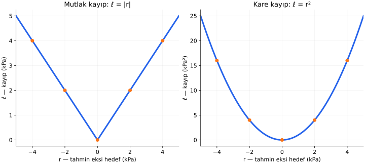
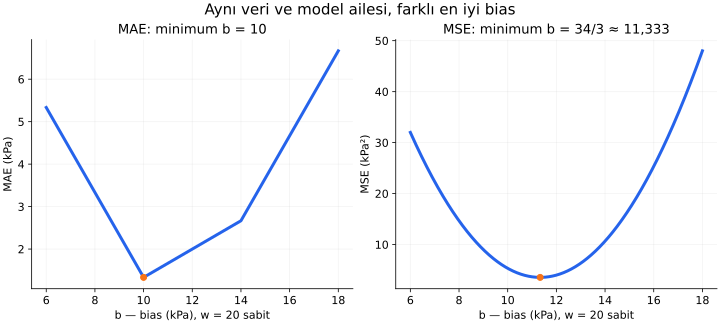
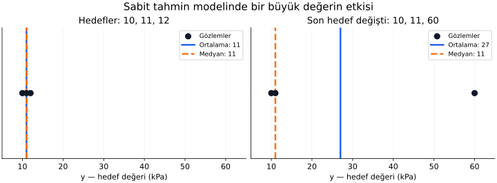

# Ders 15 — Kayıp fonksiyonu

[Bölüm girişine dön](README.md) · [Önceki ders: Doğrusal regresyon](14-dogrusal-regresyon.md)

**Ana soru:** “İyi tahmin”i hangi sayıyla ölçeriz ve bu sayıyı değiştirmek öğrenilen modeli nasıl değiştirir?

Önceki derste bir doğrunun parametrelerini kareler toplamını azaltarak bulduk. Bu seçim, büyük hatalara daha fazla önem veriyordu. Bu derste hata ile kaybı ayıracak, tek örnekten bütün veri kümesine geçecek ve farklı kayıpların aynı model ailesinde farklı sonuçlar üretebildiğini hesaplayacağız.

**Ders sonunda:** MAE, MSE ve RMSE'yi elle hesaplayabilecek, birimlerini yorumlayabilecek, toplam ile ortalamanın ilişkisini açıklayabilecek ve kayıp seçiminin büyük hataların etkisini nasıl değiştirdiğini gösterebileceksin.

**Ön koşul:** [13. ders](13-veriden-fonksiyon-ogrenmek.md) ve [14. ders](14-dogrusal-regresyon.md). Bu derste türev gerekmiyor. Örnekler tek hedefli regresyondur; bütün örnekleri eşit ağırlıkla değerlendiriyoruz.

## 1. Tahmin, artık ve kayıp farklı şeylerdir

Sensör örneğini hatırlayalım. $x=2$ V girişinde referans basınç $y=54$ kPa olsun. Modelimiz $20x+10$ ise tahmini:

$$
\hat y=20\cdot2+10=50
$$

Artık:

$$
r=\hat y-y=50-54=-4
$$

| Gösterim | Anlamı |
|---|---|
| $y$ | Verideki referans hedef |
| $\hat y$ | Modelin tahmini |
| $r$ | Tahmin eksi hedef; işaretli fark |
| $\ell(y,\hat y)$ | Tek örnek için seçtiğimiz kayıp |

$\ell$, küçük “el” diye okunur. **Kayıp fonksiyonu (loss function)**, hedef ve tahmin arasındaki uyuşmazlığı seçtiğimiz kurala göre bir sayıya dönüştürür.

Aynı $r=-4$ için mutlak kayıp $4$, kare kayıp $16$ olur. **Hata farkı aynı, onu değerlendiren kural farklıdır.** Negatif artık düşük tahmin yaptığımızı gösterir; burada ele aldığımız kayıplar ise negatif değildir.

Bir kayıp seçmek, hangi tür yanlışların öğrenme sırasında daha fazla önem taşıyacağını belirlemektir.

## 2. Tek örnekte mutlak ve kare kayıp

**Mutlak kayıp (absolute loss):**

$$
\ell_{\text{mutlak}}(y,\hat y)=|\hat y-y|=|r|
$$

Dikey çizgiler mutlak değerdir: farkın büyüklüğünü alırız. $|-4|=4$, $|4|=4$.

**Kare kayıp (squared loss):**

$$
\ell_{\text{kare}}(y,\hat y)=(\hat y-y)^2=r^2
$$

Kare almak sayıyı kendisiyle çarpmaktır. $(-4)^2=16$, $4^2=16$.

| Artık $r$ (kPa) | Mutlak kayıp (kPa) | Kare kayıp (kPa²) |
|---:|---:|---:|
| $-4$ | $4$ | $16$ |
| $-2$ | $2$ | $4$ |
| $0$ | $0$ | $0$ |
| $2$ | $2$ | $4$ |
| $4$ | $4$ | $16$ |

Yatay eksen **artıktır**, model girdisi değildir. Dikey eksen tek örneğin kaybıdır. Panellerin dikey birimleri ve ölçekleri farklıdır; çizgilerin sayfadaki yüksekliklerini doğrudan karşılaştırmamalıyız.

Soldaki V biçiminde, artığın büyüklüğü iki katına çıkınca kayıp da iki katına çıkar. Sağda kare nedeniyle dört katına çıkar. Örneğin $2$ kPa'dan $4$ kPa'ya geçiş mutlak kaybı $2$'den $4$'e, kare kaybı $4$'ten $16$'ya götürür.

İki kural da pozitif ve negatif aynı büyüklükteki artıklara eşit değer verir. Düşük tahminin ve yüksek tahminin uygulamada farklı maliyetleri varsa, bu simetrik kurallar tek başına o farkı ifade etmez.

## 3. Tek kayıptan bütün verinin kaybına

Modelimiz $\hat y=f(x;\theta)$ olsun. $f$ hesaplama kuralı, $\theta$ parametrelerin ortak adıdır. Doğrusal regresyonda $\theta=(w,b)$ yazmıştık.

Veri kümesindeki kayıpların ortalaması:

$$
L(\theta)=\frac1n\sum_{i=1}^{n}
\ell\left(y^{(i)},f(x^{(i)};\theta)\right)
$$

Gösterimi adım adım okuyalım:

- Küçük $\ell$, tek bir örneğin kaybıdır.
- Büyük $L$, bütün veri kümesindeki ortalama kayıptır.
- $(i)$, örnek numarasını gösterir; kuvvet değildir.
- $\sum$, her örneğin kaybını topla demektir.
- $n$, örnek sayısıdır; toplamı $n$'e bölerek ortalamayı buluruz.
- Veriler sabitken parametreler değişirse tahminler ve dolayısıyla $L$ değişir.

Bu küçük–büyük harf ayrımı, bu derste kullandığımız gösterimdir; her kaynak aynı harfleri seçmez.

Mutlak kaybın ortalaması **MAE (Mean Absolute Error, ortalama mutlak hata)** olur:

$$
L_{\text{MAE}}(\theta)=
\frac1n\sum_{i=1}^{n}
\left|f(x^{(i)};\theta)-y^{(i)}\right|
$$

Kare kaybın ortalaması **MSE (Mean Squared Error, ortalama kare hata)** olur:

$$
L_{\text{MSE}}(\theta)=
\frac1n\sum_{i=1}^{n}
\left(f(x^{(i)};\theta)-y^{(i)}\right)^2
$$

İkisi de önce her örneğin farkını dönüştürür, sonra toplar, sonra örnek sayısına böler. **Önce işaretli artıkları ortalayıp sonra mutlak değer veya kare almak aynı işlem değildir.** Yüksek ve düşük tahminler daha ilk aşamada birbirini götürebilir.

## 4. Önceki veride bütün hesapları yapalım

Eğitim verimiz yine $(1,30)$, $(2,54)$, $(3,70)$ olsun. Sayılar volt ve kPa cinsinden değerlerdir.

İki modeli karşılaştıralım:

- A: $\hat y=20x+10$.
- B: Önceki derste bulduğumuz $\hat y=20x+34/3$.

| $x$ | Hedef $y$ | A tahmini | A artığı | B tahmini | B artığı |
|---:|---:|---:|---:|---:|---:|
| $1$ | $30$ | $30$ | $0$ | $94/3$ | $4/3$ |
| $2$ | $54$ | $50$ | $-4$ | $154/3$ | $-8/3$ |
| $3$ | $70$ | $70$ | $0$ | $214/3$ | $4/3$ |

### A modelinin MAE ve MSE'si

$$
\text{MAE}_A=\frac{|0|+|-4|+|0|}{3}
=\frac43\approx1{,}333\ \text{kPa}
$$

$$
\text{MSE}_A=\frac{0^2+(-4)^2+0^2}{3}
=\frac{16}{3}\approx5{,}333\ \text{kPa}^2
$$

### B modelinin MAE ve MSE'si

$$
\text{MAE}_B=
\frac{\frac43+\frac83+\frac43}{3}
=\frac{16}{9}\approx1{,}778\ \text{kPa}
$$

$$
\text{MSE}_B=
\frac{\frac{16}{9}+\frac{64}{9}+\frac{16}{9}}{3}
=\frac{32}{9}\approx3{,}556\ \text{kPa}^2
$$

| Model | MAE (kPa) | MSE (kPa²) |
|---|---:|---:|
| A | $4/3\approx1{,}333$ | $16/3\approx5{,}333$ |
| B | $16/9\approx1{,}778$ | $32/9\approx3{,}556$ |

**MAE ile A daha iyi, MSE ile B daha iyi.** MSE, A'daki tek $4$ kPa hatayı küçültmek için uç noktalarda daha küçük hatalar oluşmasını kabul ediyor. MAE için bu değişim toplam farkı artırıyor.

B modelinin işaretli artıklarının ortalaması sıfırdır. Buna rağmen MAE ve MSE sıfır değildir. Bu, neden önce artıkları dönüştürdüğümüzü gösterir.

## 5. Kayıp gerçekten farklı parametreler seçtiriyor mu?

Yalnızca iki adayı karşılaştırmak yerine eğimi $w=20$'de sabit tutup bütün bias değerlerini düşünelim:

$$
\hat y=20x+b
$$

Üç artık:

$$
r^{(1)}=b-10,\quad
r^{(2)}=b-14,\quad
r^{(3)}=b-10
$$

Örneğin ikinci artık $40+b-54=b-14$ olur. Böylece:

$$
L_{\text{MAE}}(b)=\frac{2|b-10|+|b-14|}{3}
$$

$$
L_{\text{MSE}}(b)=\frac{2(b-10)^2+(b-14)^2}{3}
$$

Soldaki minimum $b=10$'da, sağdaki minimum $b=34/3$'tedir. Her panelde dikey eksen kendi kaybını gösterir.

Burada $w$'yi **sabit** tuttuk. Grafik, bütün $w,b$ çiftlerini aramıyor; seçtiğimiz aynı model alt ailesinde bile kaybın optimumu değiştirebildiğini gösteriyor.

### MAE neden 10'u seçiyor?

$|b-10|+|b-14|$, sayı doğrusunda $b$'nin $10$ ve $14$'e uzaklıklarının toplamıdır. Bu toplam en az $4$ olur. MAE'nin payında bunlara bir de $|b-10|$ eklenir.

$b=10$ seçince ilk iki uzaklığın toplamı $4$, fazladan uzaklık $0$ olur. Toplam $4$ ve ortalama $4/3$ elde edilir; daha küçüğü mümkün değildir.

Aynı sonucu, $10,10,14$ değerlerini sıralayıp ortadakini seçerek de buluruz. Sıralı verinin orta değeri **medyan (median)**dır. Üç değer için medyan $10$'dur.

### MSE neden 34/3'ü seçiyor?

Kareleri açıp düzenlersek:

$$
L_{\text{MSE}}(b)
=\left(b-\frac{34}{3}\right)^2+\frac{32}{9}
$$

İlk kare negatif olamaz. Minimum, kare sıfır olduğunda yani $b=34/3$'te elde edilir.

Bu değer, $10,14,10$'un **aritmetik ortalamasıdır**:

$$
\frac{10+14+10}{3}=\frac{34}{3}
$$

Sabit bir değeri hedeflere uydururken kare kayıp ortalamaya, mutlak kayıp bir medyana yönelir. Çift sayıda gözlemde mutlak kaybın optimumu tek bir değer olmak zorunda değildir; ortadaki iki değer arasındaki aralık da optimum olabilir. Buradaki üç değerli örnekte optimum tektir.

## 6. Büyük bir değer ortalamayı ve medyanı nasıl etkiler?

Bu kez yalnızca **sabit tahmin modeli** $\hat y=c$ kullanalım. $c$, bütün örneklerde aynı tahmini veren tek parametredir; girişe bağlı bir değişim yoktur.

Başlangıç hedefleri $10,11,12$ kPa olsun:

$$
\text{Ortalama}=\frac{10+11+12}{3}=11,\qquad
\text{Medyan}=11
$$

Son hedefi $60$ yapalım:

$$
\text{Ortalama}=\frac{10+11+60}{3}=27,\qquad
\text{Medyan}=11
$$

Grafiğin yatay ekseni hedef değeridir; noktaların dikey yerleşimi yalnızca göstermek içindir. Mavi çizgi ortalama, turuncu kesikli çizgi medyandır. Solda ikisi üst üste gelir. Sağda ortalama kayar, medyan aynı kalır.

Bu yeni hedeflerde sonuçları karşılaştıralım:

| Sabit tahmin $c$ | Mutlak farklar | MAE (kPa) | MSE (kPa²) |
|---:|---|---:|---:|
| $11$ | $1,0,49$ | $50/3\approx16{,}667$ | $2402/3\approx800{,}667$ |
| $27$ | $17,16,33$ | $22$ | $1634/3\approx544{,}667$ |

Kare kayıp büyük artığı azaltmak için diğer iki örnekteki hataları büyütüyor. Mutlak kayıp bu örnekte ortadaki hedefi koruyor.

Bu, medyanın **bu örnekte** bir büyük değerden daha az etkilendiğini gösterir. MAE kullanan her modelin her aykırı veriden etkilenmeyeceği anlamına gelmez. Özellikle farklı girişlerdeki aykırı noktalar daha karmaşık modelleri etkileyebilir. Büyük bir ölçümü gördüğümüzde, onun hata mı yoksa gerçek bir çalışma koşulu mu olduğunu da araştırmalıyız.

## 7. RMSE: birimi yeniden hedef birimine döndürmek

MSE'nin birimi kPa²'dir. Hata büyüklüğünü kPa ile ifade etmek için karekökünü alabiliriz:

$$
\text{RMSE}=\sqrt{\text{MSE}}
=\sqrt{\frac1n\sum_{i=1}^{n}(r^{(i)})^2}
$$

**RMSE (Root Mean Squared Error)**, ortalama kare hatanın kareköküdür. $\sqrt{\cdot}$ karekök işaretidir.

İşlem sırası önemlidir: **kare al → ortalama al → karekök al**.

Önceki iki model için:

$$
\text{RMSE}_A=\sqrt{\frac{16}{3}}
\approx2{,}309\ \text{kPa}
$$

$$
\text{RMSE}_B=\sqrt{\frac{32}{9}}
=\frac{4\sqrt2}{3}
\approx1{,}886\ \text{kPa}
$$

Karekök, negatif olmayan sayılarda sıralamayı korur. Dolayısıyla aynı veri üzerinde MSE'yi en küçük yapan model, RMSE'yi de en küçük yapar.

Ancak **RMSE, mutlak hataların ortalaması değildir**. Her artığın karesinin kökünü önce alsaydık $\sqrt{r^2}=|r|$ elde eder, bunları ortalayınca MAE bulurduk. B modelinde MAE yaklaşık $1{,}778$, RMSE yaklaşık $1{,}886$ kPa'dır.

## 8. Toplam yerine ortalama almak neden işe yarar?

Önceki dersin kareler toplamı $S$ ile MSE ilişkisi:

$$
L_{\text{MSE}}=\frac{S}{n}
$$

Aynı veri kümesinde $n$ sabit ve pozitiftir. Bütün adayları aynı sayıya bölmek sıralamayı değiştirmez. Bu nedenle yalnızca bu veri kaybını azaltıyorsak, toplam ve ortalama aynı optimum parametreleri verir.

B modelinde $S=32/3$ ve $n=3$ olduğundan MSE $32/9$'dur. Her satırı bir kez daha aynen tekrar edersek toplam iki katına, örnek sayısı da iki katına çıkar; ortalama aynı kalır.

Bu, örnek sayısı arttı diye kaybın otomatik olarak büyümesini önler. **Farklı veri kümelerindeki ortalamaları karşılaştırmak yine de tek başına yeterli değildir:** hedef aralıkları, çalışma koşulları ve örneklerin zorluğu değişmiş olabilir.

Bazı kaynaklar kare kaybı $r^2/2$ olarak yazar. Sabit pozitif $1/2$ çarpanı da tek başına optimumu değiştirmez. Fakat kaybın ölçeği, sonraki dersteki adım adım parametre güncellemelerinin büyüklüğünü etkiler. Kayba başka ceza terimleri eklenirse, terimler arasındaki göreli ağırlıklar da korunmalıdır.

## 9. Kayıp sayısının birimi ve büyüklüğü

| Ölçüt | İşlem | Hedef kPa ise birim |
|---|---|---|
| MAE | Mutlak farkların ortalaması | kPa |
| MSE | Kare farkların ortalaması | kPa² |
| RMSE | MSE'nin karekökü | kPa |

MSE $3{,}556$ ile MAE $1{,}778$ sayılarını yan yana koyup “MSE daha kötü” diyemeyiz. Aynı şeyi ölçmüyorlar ve birimleri farklı.

Basıncı kPa yerine Pa cinsinden yazarsak bütün artıkların sayısal değeri $1000$ katına çıkar. MAE ve RMSE'nin sayısal değerleri $1000$, MSE'ninki $1000000$ katına çıkar. Fiziksel tahmin kalitesi değişmemiştir.

Bu yüzden bir kayıp için genel bir “şu sayının altı iyidir” eşiği yoktur. Birim, hedefin büyüklüğü, uygulamanın kabul ettiği hata ve aynı verideki basit karşılaştırma modelleriyle birlikte yorumlamalıyız.

## 10. Eğitim kaybı ile değerlendirme ölçütü

**Değerlendirme ölçütü (evaluation metric)**, sonuçları değerlendirmek için hesapladığımız sayıdır. Aynı MAE veya MSE formülü iki farklı rolde kullanılabilir:

- Eğitimde parametreleri seçmek için azaltılıyorsa eğitim kaybıdır.
- Sabit modelin ayrı verideki başarısını raporlamak için hesaplanıyorsa değerlendirme ölçütüdür.

Örneğin MSE ile eğitip ayrı veride hem MAE hem RMSE raporlayabiliriz. Böylece hem ortalama mutlak farkı hem büyük hataların etkisini görürüz. Ölçütleri uygulamanın amacıyla uyumlu seçmek gerekir; bir ölçütü azaltmak başka bir ölçütü otomatik olarak azaltmaz.

Bu derste hesapladığımız sensör kayıpları **eğitim verisine** aittir. Modelin yeni verideki başarısını henüz göstermiyor. Veri ayrımını ve genellemeyi 17. derste ayrıntılı ele alacağız.

Kayıp seçmek ile parametreleri bulma yöntemi de ayrı kararlardır. Kayıp neyi azaltmak istediğimizi tanımlar; eğitim yöntemi bu hedefe nasıl ilerleyeceğimizi belirler.

## 11. Kısa deney ve anlama kontrolü

1. Üç artık $-2,0,2$ kPa ise MAE, MSE ve RMSE kaçtır? İşaretli ortalama kaçtır?
2. Aynı veride MSE'si $4$ olan model ile MSE'si $9$ olan modelin RMSE sıralaması değişir mi?
3. Sensör örneğinde $w=20$, $b=12$ için MAE ve MSE hesapla.
4. Eğitim kaybının düşmesi yeni verideki hatanın da düştüğünü kanıtlar mı?

Hesapları aç

1. MAE $(2+0+2)/3=4/3$ kPa; MSE $(4+0+4)/3=8/3$ kPa²; RMSE $\sqrt{8/3}\approx1{,}633$ kPa. İşaretli ortalama $0$'dır; sıfır olması hataların yok olduğunu göstermez.
2. Değişmez. RMSE'ler sırasıyla $2$ ve $3$ olur; ilk model yine daha küçüktür.
3. Tahminler $32,52,72$; artıklar $2,-2,2$. MAE $2$ kPa, MSE $4$ kPa². Bu değerleri $b=10$ ve $b=34/3$ sonuçlarıyla karşılaştırabilirsin.
4. Hayır. Yeni verinin hedefleriyle ayrıca değerlendirme gerekir. Eğitim kaybı yalnızca üzerinde hesaplandığı örnekleri ölçer.

## Kaynak ve sonraki adım

Ana okuma: [scikit-learn — Regression metrics](https://scikit-learn.org/stable/modules/model_evaluation.html#regression-metrics), **“Mean absolute error”** ve **“Mean squared error”** başlıkları. Şimdilik formüllere ve birimlere odaklan; kod kullanmadan hesapları okuyabilirsin.

Tamamlayıcı okuma: Aynı sayfadaki **“Which scoring function should I use?”** başlığı, tahminin hangi özelliğini hedeflediğimiz ile kayıp seçimi arasındaki ilişkiyi inceler. Buradaki veriler, grafikler ve sayısal örnekler ders için ayrıca hazırlanmıştır.

**16. derste**, kaybı hesaplamaktan onu azaltmaya geçiyoruz: türev ve gradyanın ne söylediğini kurup gradyan inişinde parametreleri adım adım güncelleyeceğiz.

[Önceki ders: Doğrusal regresyon](14-dogrusal-regresyon.md) · [Bölüm girişine dön](README.md)

**Sonraki ders:** [Ders 16 — Gradyan inişi](16-gradyan-inisi.md).
