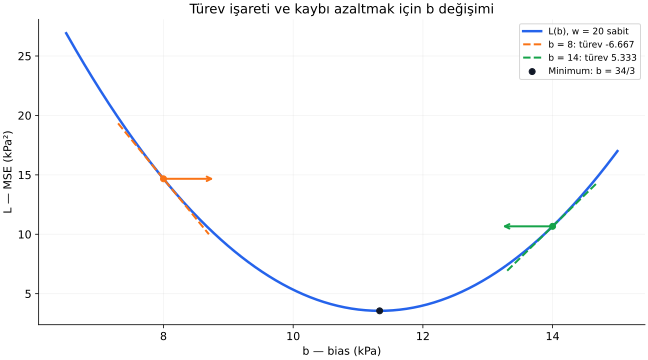
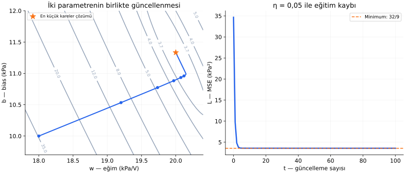

# Ders 16 — Gradyan inişi

[Bölüm girişine dön](README.md) · [Önceki ders: Kayıp fonksiyonu](15-kayip-fonksiyonu.md)

**Ana soru:** Kaybın hangi yönde değiştiğini kullanarak model parametrelerini adım adım nasıl iyileştiririz?

14. derste doğrusal regresyonun parametrelerini doğrudan bir formülle bulduk. Her model için böyle kolay bir çözüm yoktur. Bu derste farklı modellerde de kullanılabilen bir fikir kuracağız: mevcut parametrelerde kaybın değişimini hesapla, uygun bir adımla daha küçük kayba ilerle, hesabı tekrarla.

**Ders sonunda:** Türevin işaretini yorumlayabilecek, öğrenme hızıyla bir güncelleme hesaplayabilecek, MSE için ağırlık ve bias gradyanlarını çıkarabilecek ve kayıp azalmadığında hangi ayrımları kontrol edeceğini açıklayabileceksin.

**Ön koşul:** [Doğrusal regresyon](14-dogrusal-regresyon.md) ve [kayıp fonksiyonu](15-kayip-fonksiyonu.md). Türevin anlamını ve bu örnekte gereken hesabı burada kuruyoruz; genel türev kuralları biliniyor kabul edilmiyor.

## 1. Önce yalnızca bias'ı değiştirelim

Verimiz yine:

| Gerilim $x$ (V) | Referans basınç $y$ (kPa) |
|---:|---:|
| $1$ | $30$ |
| $2$ | $54$ |
| $3$ | $70$ |

Bunlar ders için hazırlanmış sentetik verilerdir. Gerilimleri volt, basınçları kPa cinsinden sayısal değerlerle hesaplıyoruz.

Şimdilik ağırlığı $w=20$'de sabit tutalım:

$$
\hat y=20x+b
$$

MSE kaybı:

$$
L(b)=\frac{(b-10)^2+(b-14)^2+(b-10)^2}{3}
$$

Önceki derste aynı ifadeyi şöyle düzenledik:

$$
L(b)=\left(b-\frac{34}{3}\right)^2+\frac{32}{9}
$$

Burada $L$, bütün eğitim verisinin ortalama kare hatası; $b$, değiştirdiğimiz tek parametredir. Bu özel örnekte minimumu biliyoruz: $b=34/3$. Fakat bir eğitim yönteminin bu noktaya **adım adım nasıl yaklaşacağını** görmek istiyoruz.

Başlangıç $b_0=8$ olsun. Alt indis $0$, başlangıç durumunun numarasıdır; bir giriş özelliği değildir.

## 2. Türev: küçük bir parametre değişimi kaybı nasıl değiştirir?

$b$'yi küçük bir $h$ miktarı artırırsak, kaybın ortalama değişim oranı:

$$
\frac{L(b+h)-L(b)}{h}
$$

$h$, geçici parametre değişimidir ve burada sıfır değildir. Pay, yeni kayıp eksi eski kayıptır. Payda, ne kadar parametre değişikliği yaptığımızdır.

$b=8$ ve $h=0{,}1$ için:

$$
L(8)=\frac{44}{3}\approx14{,}6667
$$

$$
L(8{,}1)\approx14{,}01
$$

$$
\frac{L(8{,}1)-L(8)}{0{,}1}\approx-6{,}5667
$$

Negatif sonuç, bu küçük artışta kaybın düştüğünü söylüyor.

**Türev (derivative)**, bu değişim oranının parametre değişimini sıfıra yaklaştırdığımızdaki değeridir:

$$
L'(b)=\frac{dL}{db}
=\lim_{h\to0}\frac{L(b+h)-L(b)}{h}
$$

$L'(b)$, “L'nin b'deki türevi” diye okunur. $dL/db$ aynı türevin başka gösterimidir; sıradan iki sayının bölümü değildir. $\lim_{h\to0}$, “$h$ sıfıra yaklaşırken bu ifadenin yaklaştığı değer” demektir.

Bu örnekte sonucu bulmak için kareyi açmamız yeterlidir:

$$
L(b+h)-L(b)
=2\left(b-\frac{34}{3}\right)h+h^2
$$

$h$'ye bölersek:

$$
\frac{L(b+h)-L(b)}{h}
=2\left(b-\frac{34}{3}\right)+h
$$

$h$ sıfıra yaklaşınca son terim sıfıra yaklaşır:

$$
\boxed{L'(b)=2\left(b-\frac{34}{3}\right)}
$$

Kayıptaki sabit $32/9$, yeni ve eski kaybın farkında birbirini götürür. Türev hesabına katkısı yoktur.

### Türevin işareti ne söylüyor?

| Türev | Küçük bir $b$ artışının yerel etkisi | Kaybı azaltmak için başlangıç yönü |
|---|---|---|
| Pozitif | Kayıp artar | $b$'yi azalt |
| Negatif | Kayıp azalır | $b$'yi artır |
| Sıfır | Birinci mertebedeki değişim sıfır | Noktanın yapısını ayrıca incele |

“Yerel”, mevcut parametrenin yakınında demektir. Türev, çok büyük bir değişimin sonucunu tek başına garanti etmez.



Yatay eksen $b$, dikey eksen MSE'dir. Kesikli kısa çizgiler eğrinin ilgili noktadaki **teğetini (tangent)**, yani yerel eğimini gösterir. Yatay oklar parametreyi hangi yöne değiştireceğimizi gösterir; gerçek bir güncellemenin bütün yolunu çizmez.

$b=8$'de türev $-20/3\approx-6{,}667$; sağa doğru küçük bir hareket uygundur. $b=14$'te türev $16/3\approx5{,}333$; sola hareket uygundur.

## 3. Güncelleme kuralı: neden türevi çıkarıyoruz?

**Gradyan inişi (gradient descent)**, türev veya gradyanın ters yönünde adımlar atarak kaybı azaltmayı amaçlayan yinelemeli bir yöntemdir. Yinelemeli, aynı hesabı yeni değerlerle tekrar eden demektir.

Tek parametre için:

$$
b_{t+1}=b_t-\eta L'(b_t)
$$

| Sembol | Anlamı |
|---|---|
| $t$ | Güncelleme numarası: $0,1,2,\ldots$ |
| $b_t$ | Güncellemeden önceki mevcut bias |
| $b_{t+1}$ | Bir sonraki bias |
| $L'(b_t)$ | Mevcut bias'taki kayıp türevi |
| $\eta$ | Öğrenme hızı; “eta” diye okunur |

**Öğrenme hızı (learning rate)** $\eta>0$, türevin söylediği değişimin ne kadarını uygulayacağımızı belirler. Adım büyüklüğü yalnızca eta değildir; **$\eta$ ile türevin çarpımıdır**.

Negatif türevi çıkarırsak parametre artar. Pozitif türevi çıkarırsak parametre azalır. Böylece iki durumda da uygun yerel yönü seçeriz.

$\eta$ veriden öğrendiğimiz $w,b$ gibi bir model parametresi değildir. Eğitim yönteminin ayarıdır; bu tür ayarlara **hiperparametre (hyperparameter)** denir.

## 4. İlk üç adımı elle hesaplayalım

$\eta=0{,}25$ ve $b_0=8$ seçelim.

### Birinci güncelleme

$$
L'(b_0)=2\left(8-\frac{34}{3}\right)
=-\frac{20}{3}
$$

$$
b_1=8-0{,}25\left(-\frac{20}{3}\right)
=8+\frac53=\frac{29}{3}\approx9{,}6667
$$

Yeni kayıp:

$$
L(b_1)=\left(-\frac53\right)^2+\frac{32}{9}
=\frac{57}{9}=\frac{19}{3}\approx6{,}3333
$$

### İkinci güncelleme

$$
L'(b_1)=2\left(\frac{29}{3}-\frac{34}{3}\right)
=-\frac{10}{3}
$$

$$
b_2=\frac{29}{3}+\frac56
=\frac{21}{2}=10{,}5
$$

### Üçüncü güncelleme

$$
L'(b_2)=2\left(\frac{21}{2}-\frac{34}{3}\right)
=-\frac53
$$

$$
b_3=\frac{21}{2}+\frac{5}{12}
=\frac{131}{12}\approx10{,}9167
$$

| $t$ | Mevcut $b_t$ | $L(b_t)$ (kPa²) |
|---:|---:|---:|
| $0$ | $8$ | $14{,}6667$ |
| $1$ | $9{,}6667$ | $6{,}3333$ |
| $2$ | $10{,}5$ | $4{,}25$ |
| $3$ | $10{,}9167$ | $3{,}7292$ |
| Optimum | $11{,}3333\ldots$ | $3{,}5556\ldots$ |

Her adımda yeniden türev hesapladık. Minimuma yaklaştıkça türev küçüldü; eta sabit kalmasına rağmen adımlar küçüldü. **Gradyan inişi, her seferinde sabit miktarda bias eklemek değildir.**

## 5. Öğrenme hızı küçük veya büyük olursa?

Bu özel kayıpta güncellemenin optimumdan sapmasını açıkça yazabiliriz:

$$
b_{t+1}-\frac{34}{3}
=(1-2\eta)\left(b_t-\frac{34}{3}\right)
$$

Yani her adımda mevcut sapmayı $1-2\eta$ ile çarpıyoruz.


Solda parametre, sağda kayıp gösterilir. Bütün deneyler $b_0=8$'den başlar ve **$w=20$ sabit** tutulur.

| $\eta$ | Sapmanın çarpanı | Bu örnekte davranış |
|---:|---:|---|
| $0{,}05$ | $0{,}9$ | Aynı taraftan yavaş yaklaşır |
| $0{,}25$ | $0{,}5$ | Aynı taraftan daha hızlı yaklaşır |
| $0{,}8$ | $-0{,}6$ | Minimumun iki tarafına geçerek yaklaşır |
| $1{,}1$ | $-1{,}2$ | Taraf değiştirirken uzaklaşır |

Minimumun öbür tarafına geçmek tek başına başarısızlık değildir. Yeşil deneyde mesafe küçülür ve kayıp düşer. Turuncu deneyde mesafe büyür; buna **ıraksama (divergence)** denir. Minimuma yaklaşmaya ise **yakınsama (convergence)** diyoruz.

Bu özel tek parametreli karesel kayıpta, başlangıç optimumda değilse sabit eta ile yakınsama için $0<\eta<1$ gerekir. Bu aralık **başka kayıplar veya iki parametreli model için genel bir reçete değildir**. Kaybın eğriliği ve değişkenlerin ölçeği uygun adımı etkiler.

## 6. İki parametre: kısmi türev ve gradyan

Şimdi $w$ ve $b$ birlikte değişsin:

$$
L(w,b)=\frac1n\sum_{i=1}^{n}
\left(wx^{(i)}+b-y^{(i)}\right)^2
$$

**Kısmi türev (partial derivative)**, diğer parametreyi sabit tutup bir parametreye göre kaybın değişimini ölçer:

$$
\frac{\partial L}{\partial w},
\qquad
\frac{\partial L}{\partial b}
$$

$\partial$, kısmi türev işaretidir. İlk ifadede $b$ sabitken $w$'nin, ikincide $w$ sabitken $b$'nin etkisini inceleriz.

Bu kısmi türevleri birlikte topladığımız sayılar dizisi **gradyan (gradient)**dır:

$$
\nabla L(w,b)=
\left(\frac{\partial L}{\partial w},
\frac{\partial L}{\partial b}\right)
$$

$\nabla$, “nabla” diye okunur. Gradyan iki sayının toplamı değildir; her parametrenin değişim bilgisini ayrı bir bileşende tutar.

### MSE gradyanı nereden geliyor?

Bir örneğin artığı $r=wx+b-y$ olsun.

$b$'yi $h$ artırırsak artık $r+h$ olur. Kare kaybın değişim oranı:

$$
\frac{(r+h)^2-r^2}{h}=2r+h
$$

$h$ sıfıra yaklaşınca $2r$ kalır.

$w$'yi $h$ artırırsak artık $r+hx$ olur:

$$
\frac{(r+hx)^2-r^2}{h}=2rx+hx^2
$$

$h$ sıfıra yaklaşınca $2rx$ kalır. **Ağırlığın etkisinde giriş $x$ de bulunur**, çünkü ağırlık değişimi tahmini girişle çarpılarak değiştirir.

Her örneğin katkısını toplayıp $n$'e bölersek:

$$
\boxed{\frac{\partial L}{\partial w}
=\frac2n\sum_{i=1}^{n}r^{(i)}x^{(i)}}
$$

$$
\boxed{\frac{\partial L}{\partial b}
=\frac2n\sum_{i=1}^{n}r^{(i)}}
$$

Bu formüller **MSE** içindir. Kaybı MSE'nin yarısı olarak tanımlasaydık baştaki $2$ bulunmazdı. Kayıp ölçeğinin adım büyüklüğünü etkilemesi tam olarak burada görülür.

## 7. Ağırlık ve bias'ı aynı adımda güncelleyelim

Başlangıç $w_0=18$, $b_0=10$ ve öğrenme hızı $\eta=0{,}05$ olsun. Bu kez $w$ sabit değildir.

### 7.1. Mevcut tahminler ve artıklar

| $x$ | $y$ | $18x+10$ | $r=\hat y-y$ | $rx$ |
|---:|---:|---:|---:|---:|
| $1$ | $30$ | $28$ | $-2$ | $-2$ |
| $2$ | $54$ | $46$ | $-8$ | $-16$ |
| $3$ | $70$ | $64$ | $-6$ | $-18$ |

$$
L(w_0,b_0)=\frac{4+64+36}{3}
=\frac{104}{3}\approx34{,}6667
$$

### 7.2. İki gradyan bileşeni

$$
g_w=\frac23(-2-16-18)=-24
$$

$$
g_b=\frac23(-2-8-6)=-\frac{32}{3}
$$

$g_w$ ve $g_b$, mevcut kısmi türevleri kısa yazmak için verdiğimiz adlardır. İkisi de **aynı eski parametrelerle** hesaplandı.

### 7.3. Eşzamanlı güncelleme

$$
w_1=w_0-\eta g_w
=18-0{,}05(-24)=19{,}2
$$

$$
b_1=b_0-\eta g_b
=10-0{,}05\left(-\frac{32}{3}\right)
=\frac{158}{15}\approx10{,}5333
$$

Yeni tahminler yaklaşık $29{,}7333$, $48{,}9333$, $68{,}1333$ olur. Yeni artıklar:

$$
-\frac4{15},\quad-\frac{76}{15},\quad-\frac{28}{15}
$$

Dolayısıyla:

$$
L(w_1,b_1)
=\frac{16+5776+784}{675}
=\frac{2192}{225}\approx9{,}7422
$$

Kayıp $34{,}6667$'den $9{,}7422$'ye düştü.

**Önce $w$'yi değiştirip sonra yeni $w$ ile $b$ gradyanını hesaplamadık.** Bu, burada tanımladığımız eşzamanlı gradyan inişi adımından farklı bir işlem olurdu.

### 7.4. Tekrarlayan güncellemeler

| $t$ | $w_t$ | $b_t$ | MSE |
|---:|---:|---:|---:|
| $0$ | $18$ | $10$ | $34{,}666667$ |
| $1$ | $19{,}2$ | $10{,}533333$ | $9{,}742222$ |
| $2$ | $19{,}733333$ | $10{,}773333$ | $4{,}798341$ |
| $3$ | $19{,}969778$ | $10{,}882667$ | $3{,}817399$ |
| $4$ | $20{,}074015$ | $10{,}933778$ | $3{,}622473$ |
| $5$ | $20{,}119386$ | $10{,}958930$ | $3{,}583453$ |

Tablo gösterim için yuvarlanmıştır; sonraki adımlar tam hassasiyetli değerlerle hesaplanmıştır.

Ağırlık bir süre $20$'yi geçiyor. Bu, kaybın arttığını göstermez: bias da değişiyor ve iki parametrenin ortak etkisini değerlendirmeliyiz.



Soldaki eksenler model girdileri değil, **parametrelerdir**. Gri eğriler aynı MSE değerini veren parametre çiftlerini bağlar; üzerlerindeki sayılar kayıptır. Mavi yol, ardışık $(w,b)$ değerlerini gösterir. İlk altı durum mavi noktalarla işaretlidir. Turuncu yıldız, 14. dersteki en küçük kareler çözümüdür: $(20,34/3)$.

Mavi yol 1000 güncellemenin tamamını, sağ panel ilk 100 güncellemedeki kaybı gösterir. Kayıp erken aşamada çok azalır; sonraki küçük iyileşmeler bu ölçekte zor görünür.

## 8. Küçük bir Python deneyi

Bu kod, anlattığımız **bütün veriyle gradyan inişi** hesabını tekrarlar. Her adımda üç örneğin tamamını kullanıyoruz.

```python
import numpy as np

x = np.array([1.0, 2.0, 3.0])
y = np.array([30.0, 54.0, 70.0])

w, b = 18.0, 10.0
eta = 0.05

for t in range(1001):
    prediction = w * x + b
    residual = prediction - y
    loss = np.mean(residual ** 2)

    if t in (0, 1, 2, 5, 100, 1000):
        print(t, w, b, loss)

    if t == 1000:
        break

    grad_w = 2 * np.mean(residual * x)
    grad_b = 2 * np.mean(residual)

    w_new = w - eta * grad_w
    b_new = b - eta * grad_b
    w, b = w_new, b_new
```

$\texttt{np.mean}$ listedeki değerlerin ortalamasını alır. $\texttt{** 2}$ kare alma işlemidir. İki gradyan, parametreleri değiştirmeden önce hesaplanır; yeni değerler sonra birlikte atanır.

1000 güncellemeden sonra yaklaşık:

$$
w\approx20{,}000001,\quad
b\approx11{,}333331,\quad
L\approx3{,}555556
$$

elde edilir. Bunlar doğrudan çözümle uyumludur. Sayısal yöntem sonlu adımda çoğunlukla tam eşitliğe değil, yeterince yakın bir çözüme ulaşır.

## 9. Ne zaman dururuz ve neyi kontrol ederiz?

Bu örnekte bilinen optimumla karşılaştırabildik. Genel bir problemde bunu bilmiyorsak şu bilgiler yardımcı olur: güncelleme sayısı sınırı, kaybın değişimi, parametrelerin değişimi ve gradyanın küçülmesi.

Bunların anlamlarını karıştırmamalıyız:

- **Gradyan küçükse:** Mevcut noktada parametre değişimine karşı kaybın yerel değişimi küçüktür.
- **Adım küçükse:** Eta küçük olduğu için de olabilir; optimuma ulaşıldığını tek başına söylemez.
- **Kayıp küçükse:** Seçilen veri ve ölçütte iyi uyum olabilir; yeni verideki başarının ayrıca ölçülmesi gerekir.
- **Gradyan sıfırsa:** Genel olarak minimumu tek başına kanıtlamaz; maksimum veya başka bir durağan nokta da olabilir.

Bu doğrusal regresyonun karesel kaybında, girişler farklı olduğu için tek bir minimum vardır; gradyanın sıfır olduğu nokta o minimumdur. Daha karmaşık modellerin kayıplarında aynı garanti bulunmayabilir.

Minimum kayıp burada sıfır değildir. **Gradyanın sıfır olması ile bütün örneklerde hatanın sıfır olması farklıdır.** Artıkların parametreler üzerindeki etkileri dengelenebilir.

### Öğrenme hızı neden ölçeğe bağlı?

Hesapları sabit birimlerdeki **sayısal koordinatlar** üzerinde yaptık. Bias ile ağırlığın fiziksel birimleri farklıdır; sayısal değerleri nasıl ifade ettiğimiz güncellemenin davranışını etkiler.

Gerilimi volt yerine milivolt cinsinden yazarsak giriş sayıları $1000$ katına çıkar ve ağırlık gradyanındaki $rx$ çarpımı da etkilenir. Aynı eta'yı doğrudan taşımak aynı eğitim davranışını vermez. Değişkenleri ölçekleme ve parametre başına farklı adım büyüklükleri, bu nedenle ileride ele alacağımız konulardır.

Bir önceki derste kaybın toplamını veya ortalamasını kullanmanın optimumu değiştirmediğini gördük. Ancak toplamın gradyanı ortalamanınkinden $n$ kat büyüktür; aynı eta ile atılan adım da farklıdır.

### Her adımda bütün veri kullanılmak zorunda mı?

Burada bütün örneklerle gradyan hesapladık. Daha büyük veri kümelerinde her adımda tek örnek kullanmaya **stokastik gradyan inişi (stochastic gradient descent, SGD)**, küçük bir örnek grubu kullanmaya **mini-batch** yaklaşımı denir. Böyle gradyanlar bütün veri gradyanını yaklaşık temsil eder; her adımda bütün veri kaybının azalması beklenmez. Bu varyantları sinir ağı eğitiminde ayrıntılı işleyeceğiz.

## 10. Anlama kontrolü

1. Tek bias örneğinde $b=14$, $\eta=0{,}25$ için sonraki $b$ kaçtır?
2. Tek bias örneğinde $\eta=1$ seçersek optimumdan sapma nasıl değişir?
3. İki parametreli modelde neden ağırlık gradyanında $x$ var, bias gradyanında yok?
4. Model parametreleri ile öğrenme hızının rolleri neden farklıdır?

<details>
<summary>Hesapları ve yanıtları aç</summary>

1. Türev $2(14-34/3)=16/3$. Yeni bias $14-(1/4)(16/3)=38/3\approx12{,}6667$ olur.
2. Çarpan $1-2\eta=-1$ olur. Optimumda başlamadıysak sapmanın işareti değişir, büyüklüğü aynı kalır; iki nokta arasında salınırız ve yakınsamayız.
3. Ağırlık $h$ değişince tahmin $hx$ değişir. Bias $h$ değişince tahmin doğrudan $h$ değişir. Kısmi türevlerde bu fark görünür.
4. $w,b$ tahmin kuralını belirler. Eta, bu parametreleri eğitim sırasında ne kadar değiştirdiğimizi belirler. Eğitim bitip tahmin yaparken eta'yı tahmin denklemine koymayız.

</details>

## Kaynak ve sonraki adım

Ana okuma: [Dive into Deep Learning — 12.3 Gradient Descent](https://d2l.ai/chapter_optimization/gd.html), **“One-Dimensional Gradient Descent”**, **“Learning Rate”** ve **“Multivariate Gradient Descent”** başlıkları. Kaynaktaki optimizasyon değişkeni bazı yerlerde $x$ ile gösterilir; bu derste sensör girdisiyle karışmaması için parametre olarak $b$ veya $(w,b)$ kullandık.

Tamamlayıcı okuma: [Dive into Deep Learning — Linear Regression](https://d2l.ai/chapter_linear-regression/linear-regression.html), **“Minibatch Stochastic Gradient Descent”**. Kaynaktaki $1/2$ çarpanı nedeniyle gradyanın katsayısı buradaki saf MSE'den farklı olabilir. Bu dersteki hesaplar, kod ve grafikler ayrıca hazırlanmıştır.

**17. derste**, eğitim kaybını azaltan modelin yeni veride neden başarısız olabildiğine geçiyoruz: genelleme, aşırı uyum ve veri ayrımı.

[Önceki ders: Kayıp fonksiyonu](15-kayip-fonksiyonu.md) · [Bölüm girişine dön](README.md)

**Sonraki ders:** [Ders 17 — Genelleme ve overfitting](17-genelleme-ve-overfitting.md).
