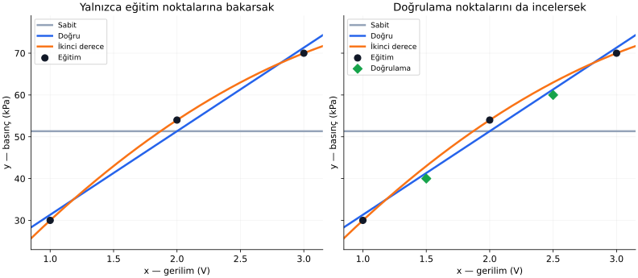
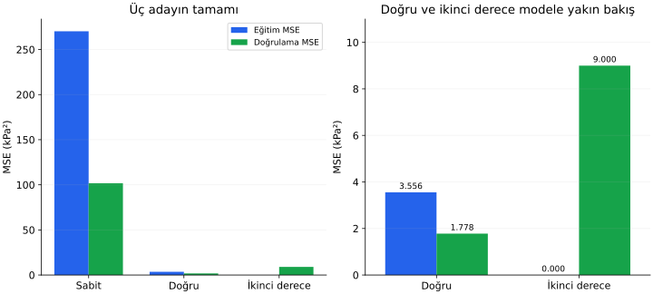

# Ders 17 — Genelleme ve overfitting

[Bölüm girişine dön](README.md) · [Önceki ders: Gradyan inişi](16-gradyan-inisi.md)

**Ana soru:** Eğitimde başarılı görünen bir model, yeni veride neden başarısız olabilir?

Son derslerde parametreleri bulduk, kaybı hesapladık ve gradyan inişiyle azalttık. Fakat asıl amacımız geçmiş ölçümleri yeniden üretmek değil, henüz kullanmadığımız örneklerde işe yarayan tahminler yapmak. Bu derste iki hedefin neden ayrılabildiğini sayılarla inceleyeceğiz.

**Ders sonunda:** Eğitim, doğrulama ve test kümelerinin rollerini ayırabilecek; aşırı uyum ile yetersiz uyumu tanıyabilecek; veri sızıntısı ve yanlış veri bölmenin değerlendirmeyi nasıl etkilediğini açıklayabileceksin.

**Ön koşul:** [Veriden fonksiyon öğrenmek](13-veriden-fonksiyon-ogrenmek.md), [doğrusal regresyon](14-dogrusal-regresyon.md) ve [kayıp fonksiyonu](15-kayip-fonksiyonu.md). Sayısal örnekte MSE kullanacağız. Türev gerekmiyor.

## 1. Aynı eğitim verisine farklı modeller uyduralım

Eğitim ölçümlerimiz yine sensör gerilimi ve referans basıncı:

| Gerilim $x$ (V) | Basınç $y$ (kPa) |
|---:|---:|
| $1$ | $30$ |
| $2$ | $54$ |
| $3$ | $70$ |

Bunlar gerçek sensör kaydı değildir. Bu dersin sentetik senaryosunu kurarken temel ilişkiyi $y=20x+10$ seçtik; yalnızca ortadaki eğitim hedefine $4$ kPa sapma ekledik. **Modeli eğiten kişi bu temel ilişkiyi bildiği için kullanmıyor; onu yalnızca örneğin neden böyle davrandığını açıklamak için biliyoruz.**

Üç model ailesini deneyelim:

| Aile | Tahmin biçimi | Serbest parametre sayısı |
|---|---|---:|
| Sabit | $\hat y=c$ | $1$ |
| Doğru | $\hat y=wx+b$ | $2$ |
| İkinci derece | $\hat y=ax^2+dx+c$ | $3$ |

Son satırda $a,d,c$ katsayılardır. $x^2$, girişin karesidir. Bu biçime **ikinci derece polinom (quadratic polynomial)** denir; grafiği eğri olabilir. Önceki derslerdeki başka geçici sembollerle aynı harfleri kullanmış olsak da burada rolleri bu tabloda tanımlanmıştır.

Her aileyi yalnızca eğitim verisiyle uyduruyoruz:

$$
f_{\text{sabit}}(x)=\frac{154}{3}
$$

$$
f_{\text{doğru}}(x)=20x+\frac{34}{3}
$$

$$
f_{\text{eğri}}(x)=-4x^2+36x-2
$$

Sabit tahmin, kare kaybı için eğitim hedeflerinin ortalamasıdır. Doğru, 14. derste bulduğumuz çözümüdür. Eğri ise bu üç eğitim noktasından tam geçer.

Eğrinin katsayılarını eğitim noktalarından nasıl bulduğumuzu aç

Üç girişi $ax^2+dx+c$ içine koyarsak:

$$
a+d+c=30
$$

$$
4a+2d+c=54
$$

$$
9a+3d+c=70
$$

İkinci denklemden birinciyi çıkaralım: $3a+d=24$.

Üçüncüden ikinciyi çıkaralım: $5a+d=16$.

Son iki ifadeyi çıkarınca $2a=-8$, yani $a=-4$ bulunur. $3a+d=24$ içine koyarsak $d=36$ olur. İlk denklemden $-4+36+c=30$ ve $c=-2$ çıkar.

Yalnızca eğitim verisini kullanarak üç katsayıyı belirledik.

## 2. Eğitim kaybına bakarsak hangi modeli seçeriz?

MSE:

$$
L=\frac1n\sum_{i=1}^{n}
\left(f(x^{(i)})-y^{(i)}\right)^2
$$

$f$, seçilen tahmin kuralıdır. $i$ örnek numarası, $n$ ilgili veri kümesindeki örnek sayısıdır. Her kaybı hesapladığımız kümenin kendi örnek sayısına böleriz.

Eğri için:

$$
f_{\text{eğri}}(1)=30,\quad
f_{\text{eğri}}(2)=54,\quad
f_{\text{eğri}}(3)=70
$$

Bütün eğitim artıkları sıfır olduğundan MSE de sıfırdır.

| Model | Eğitim MSE'si (kPa²) |
|---|---:|
| Sabit | $2432/9\approx270{,}222$ |
| Doğru | $32/9\approx3{,}556$ |
| İkinci derece eğri | $0$ |

Yalnızca bu tabloya bakarsak eğriyi seçeriz. Fakat bu kayıp, parametreleri belirlerken zaten kullandığımız ölçümler üzerindedir.

**Eğitim hatası (training error)**, modelin eğitimde kullandığı verilere ne kadar uyduğunu gösterir. Model seçiminin bütün gerekçesini bu sayıya dayandıramayız.

## 3. Genelleme: kullanılmamış ölçümlerde davranış

**Genelleme (generalization)**, öğrenilen kuralın eğitimde kullanılmayan, ilgilendiğimiz çalışma koşullarındaki yeni örneklerde işe yaramasıdır.

Model seçimine yardımcı olmak için iki ayrı ölçüm tutalım:

| Gerilim $x$ (V) | Basınç $y$ (kPa) |
|---:|---:|
| $1{,}5$ | $40$ |
| $2{,}5$ | $60$ |

Bu hedefler de sentetik senaryomuzun temel ilişkisinden üretildi. Bu iki satırın hedeflerini eğitimdeki katsayıları hesaplamak için kullanmadık. Şimdi bunlara **doğrulama verisi (validation data)** rolü vereceğiz.

### Doğrunun doğrulama hatası

$$
f_{\text{doğru}}(1{,}5)=30+\frac{34}{3}
=\frac{124}{3}\approx41{,}333
$$

$$
f_{\text{doğru}}(2{,}5)=50+\frac{34}{3}
=\frac{184}{3}\approx61{,}333
$$

İki artık da $4/3$ kPa:

$$
L_{\text{doğrulama, doğru}}
=\frac{(4/3)^2+(4/3)^2}{2}
=\frac{16}{9}\approx1{,}778
$$

### Eğrinin doğrulama hatası

$$
f_{\text{eğri}}(1{,}5)
=-4(1{,}5)^2+36(1{,}5)-2
=-9+54-2=43
$$

$$
f_{\text{eğri}}(2{,}5)
=-25+90-2=63
$$

İki artık da $3$ kPa:

$$
L_{\text{doğrulama, eğri}}
=\frac{3^2+3^2}{2}=9
$$

| Model | Eğitim MSE | Doğrulama MSE |
|---|---:|---:|
| Sabit | $\approx270{,}222$ | $\approx101{,}778$ |
| Doğru | $\approx3{,}556$ | $\approx1{,}778$ |
| Eğri | $0$ | $9$ |

Bütün değerlerin birimi kPa²'dir. **Eğitimde sıfır hata veren model, doğrulamada daha kötü çıktı.**

Solda eğitim noktalarına bakıyoruz. Sağda yeşil elmaslarla ayrı doğrulama noktalarını ekliyoruz. Turuncu eğri siyah noktalardan geçiyor, fakat yeşil noktalarda mavi doğrudan daha fazla sapıyor.

Yeni girişler $1$–$3$ V aralığının içindedir. Dolayısıyla bu örnekteki başarısızlığı yalnızca **ekstrapolasyon**, yani ölçüm aralığının dışına çıkmakla açıklayamayız.

## 4. Aşırı uyum ve yetersiz uyum

**Aşırı uyum (overfitting)**, modelin eğitim örneklerine özgü sapmaları da takip ederek yeni veride daha kötü davranmasıdır. Buradaki eğri, ortadaki $4$ kPa sapmayı tam karşılayacak biçimde büküldü. Bu, eğitim hatasını sıfırladı; doğrulama noktalarındaki hatayı artırdı.

**Yetersiz uyum (underfitting)**, modelin önemli ilişkiyi yeterince temsil edememesidir. Sabit model, basıncın gerilimle artışını hiç gösteremiyor; hem eğitim hem doğrulama hatası yüksek.

Doğru bu küçük örnekte iki uç arasında daha iyi bir seçimdir. Bunun anlamı “doğrular her zaman eğrilerden iyidir” değildir. Gerçek temel ilişki eğri olsaydı doğru model de yetersiz kalabilirdi.

Solda bütün modeller, sağda yalnızca doğru ve eğri daha küçük dikey ölçekte gösterilir. Aynı modeli değerlendirirken eğitim ve doğrulama sütunlarını birlikte oku. Sağdaki sıfır eğitim kaybı, görünür yükseklik oluşturmayan bir sütundur.

Bu grafik **bu üç adayın hesaplanmış sonuçlarıdır**. Model esnekliği arttıkça doğrulama hatasının her zaman böyle davranacağına dair evrensel bir eğri değildir. İki doğrulama örneği de genel başarıyı hassas biçimde ölçmeye yetmez; burada mekanizmayı görmek için sayıları küçük tuttuk.

### Hata farkını tek başına teşhis sanmayalım

Eğitim ve doğrulama kayıpları arasındaki farka **genelleme farkı (generalization gap)** denebilir. Burada eğri için fark $9-0=9$'dur.

Bu farkın büyük olması aşırı uyum belirtisi olabilir; fakat değerlendirme verisinin farklı koşullardan gelmesi, çok küçük olması veya ön işlemenin tutarsız uygulanması da sonuçları etkileyebilir. Tek bir sayıdan neden kesinleştirilmez.

Doğrulama kaybı eğitim kaybından düşük de çıkabilir. Bizim doğru modelimizde böyle oldu: eğitimdeki sapma, doğrulama örneklerinde yoktu. “Doğrulama hatası mutlaka eğitim hatasından büyük olmalıdır” diye bir kural yoktur.

## 5. Eğitim, doğrulama ve test neden üç ayrı rol?

| Veri rolü | Ne için kullanılır? | Örnekteki işlem |
|---|---|---|
| Eğitim (training) | Aday modelin parametrelerini bulmak | Sabiti, doğruyu ve eğriyi üç ölçümden uydurmak |
| Doğrulama (validation) | Model ailesi veya eğitim ayarını seçmek | Ayrı iki ölçümde üç adayı karşılaştırmak |
| Test (test) | Seçimlerden sonra sabit modelin son değerlendirmesi | Yeni, geliştirme kararlarında kullanılmamış ölçümler |

Doğrulama sonuçlarına bakıp doğruyu seçtik. Doğrulama verisi ağırlık ve bias formülüne girmedi, ama **model seçimi kararımızı etkiledi**. Bu yüzden son başarı değerlendirmesi için bağımsız başka veri gerekir.

Test sonuçlarını her denemeden sonra inceleyip “bu sefer dereceyi değiştir, bu sefer daha uzun eğit” dersek test verisini de seçim sürecine katmış oluruz. Artık o sonuçları bağımsız son değerlendirme gibi yorumlayamayız.

Üç rol, mutlaka belirli bir yüzdeyle bölme demek değildir. Ayrılacak miktar; veri sayısına, bağımlılıklara ve uygulamada hangi başarının ölçülmek istendiğine bağlıdır.

## 6. Modeli seçtikten sonra test hesabı

Başta ayrı tuttuğumuz test ölçümleri şu olsun:

| Gerilim (V) | Referans basınç (kPa) |
|---:|---:|
| $1{,}25$ | $35$ |
| $2{,}75$ | $65$ |

Bu satırları model seçmek için kullanmadık. Şimdi yalnızca **seçilmiş doğru modelini**, parametrelerini değiştirmeden değerlendiriyoruz:

$$
f_{\text{doğru}}(1{,}25)
=25+\frac{34}{3}\approx36{,}333
$$

$$
f_{\text{doğru}}(2{,}75)
=55+\frac{34}{3}\approx66{,}333
$$

Artıklar yine $4/3$ kPa olduğu için:

$$
L_{\text{test}}=\frac{16}{9}\approx1{,}778\ \text{kPa}^2
$$

Test hedefleri model değişikliğine yol açmadan sonucun raporlanmasında kullanıldı. Bu küçük sentetik test, bütün sensör koşullarında başarı kanıtı değildir.

Gerçek bir iş akışında seçim bittikten sonra seçilen aileyi eğitim ve doğrulama verisinin birleşiminde yeniden eğitmek de mümkündür. Bu durumda parametreler değişir; test edilen şey yeniden eğitilmiş son model olmalıdır. **Biz bu dersin hesabında yeniden eğitim yapmadık.**

## 7. Veri sızıntısı: modelin dolaylı olarak fazladan bilgi görmesi

**Veri sızıntısı (data leakage)**, değerlendirmeden gelen veya gerçek tahmin anında bulunmayacak bilginin modelin geliştirilmesine karışmasıdır. Sonuçlar olduğundan iyi görünebilir.

Örnekler:

- Özellik seçimini bütün verinin hedeflerine bakarak yapmak, sonra eğitim ve test diye bölmek.
- Eğitimden öğrenilecek ortalama ve ölçek değerlerini test verisini de kullanarak hesaplamak.
- Aynı deney kaydının kopyalarını farklı kümelere koymak.
- Geleceği tahmin ederken, hesaplamaya gelecek ölçümlerden bilgi taşıyan bir özellik eklemek.

**Ön işleme (preprocessing)**, modele vermeden önce veriyi dönüştürmektir. Örneğin bir özelliğin eğitim ortalamasını çıkarıp eğitimde hesaplanan bir ölçeğe bölmek olabilir.

Doğru sıralama: önce uygun veri ayrımını yap; öğrenilecek dönüşüm değerlerini eğitim bölümünden bul; bu **aynı dönüşümü** doğrulama ve teste uygula. Her kümede ayrı ortalama öğrenmek de çözüm değildir; modelin gördüğü gösterimi değiştirir.

Çapraz doğrulama kullanıldığında aynı kural her eğitim–doğrulama bölmesinin içinde yeniden uygulanmalıdır.

## 8. Her satırı rastgele ayırmak neden her zaman uygun değil?

Rastgele bölme, örneklerin uygun biçimde bağımsız olduğu ve benzer çalışma koşullarından geldiği bazı durumlarda kullanılabilir. Mühendislik verilerinde ise satırlar birbirine güçlü biçimde bağlı olabilir.

| Veri yapısı | Rastgele satır bölmesindeki sorun | Hedefe uygun bir ayrım örneği |
|---|---|---|
| Aynı sürüşün ardışık kamera kareleri | Çok benzer sahneler eğitim ve teste dağılır | Yeni sürüşte başarı için sürüşleri ayırmak |
| Bir sensörün ardışık zaman kayıtları | Gelecekten bilgi geçmiş değerlendirmesine karışabilir | Gelecek tahmini için zaman sırasını korumak |
| Birçok cihazdan ölçümler | Aynı cihazın özellikleri iki tarafta da bulunur | Yeni cihazda başarı için cihazları ayırmak |

**Grup bölmesi (group split)**, aynı gruba ait örnekleri birlikte tutar. Grup bir araç, sürüş, cihaz veya deney oturumu olabilir.

Tek doğru bölme biçimi yoktur. Soru şudur: **Modeli hangi yeni durumda kullanacağız?** Aynı cihazın yarınki ölçümü ile hiç görmediğimiz cihazın ölçümü farklı değerlendirme hedefleridir.

### Dağılım değişimi ayrı bir sorun olabilir

**Dağılım değişimi (distribution shift)**, uygulamadaki verilerin eğitimdeki koşullardan farklı davranmasıdır. Örneğin yalnızca bir sıcaklık aralığında eğitilen sensör dönüşümü, başka sıcaklıklarda sistematik hata yapabilir.

Eğitimde aşırı uyum olmasa bile böyle bir değişimde model başarısız olabilir. Yeni ortam hatalarının hepsini “overfitting” diye adlandırmamalıyız. Eğitime ek özellikler veya yeni koşulları kapsayan ölçümler gerekebilir.

## 9. Aşırı uyuma karşı hangi araçlar var?

| Araç | Temel fikir | Sınırı |
|---|---|---|
| Uygun model ailesi | Gereksiz esnekliği azaltmak | Fazla basit model yetersiz kalabilir |
| Daha çok ve uygun veri | İlişkiyi daha iyi örneklemek | Aynı kayıtları kopyalamak yeni bilgi değildir |
| Düzenlileştirme (regularization) | Bazı parametre veya model davranışlarını ceza terimiyle sınırlamak | Gücü seçilmeli; her parametre ölçeği aynı değildir |
| Erken durdurma (early stopping) | Doğrulama performansına göre eğitim durumunu seçmek | Test kullanılamaz; her modelde gerekli veya yararlı değildir |

Erken durdurmada eğitim kaybı azalmayı sürdürürken doğrulama kaybı kötüleşebilir. Bu durumda daha önceki bir parametre durumunu seçebiliriz. Gerçek doğrulama ölçümleri dalgalanabileceği için tek kötü adımda karar vermek yerine belirlenen bir izleme kuralı kullanılır.

16. dersteki basit doğru modeli için, gradyan inişinin minimuma yakınsaması tek başına aşırı uyumun büyüdüğünü göstermez. “Uzun eğitim her zaman kötüdür” diye bir kural kurmuyoruz.

Düzenlileştirmeyi sonraki derslerde matematiksel olarak açacağız. Bu derste bütün yöntemleri uygulamak yerine hangi problemi hedeflediklerini ayırıyoruz.

## 10. Küçük veri için çapraz doğrulama fikri

**Çapraz doğrulama (cross-validation)**, geliştirme verisini birkaç farklı eğitim–doğrulama düzeninde kullanarak seçimin tek bir bölmeye aşırı bağlı olmasını azaltmaya yardımcı olur.

Örneğin uygun biçimde bağımsız 12 örneği üç gruba ayıralım. Her turda iki grupla modeli **yeniden eğitir**, kalan grupla doğrularız. Üç turdaki doğrulama sonuçlarını özetleriz. Her örnek bir turda doğrulama için kullanılmış olur.

Böylece tek bir şanslı bölmeye bakmak yerine birden çok değerlendirme görürüz. Ancak bu sonuçlar da model seçiminde kullanılır; son bağımsız test rolünün yerine kendiliğinden geçmez.

Zaman veya grup bağımlılığı varsa standart rastgele katlamalar yerine bu yapıya uygun bölmeler gerekir. Ayrıntılı uygulamayı klasik makine öğrenmesi bölümünde yapacağız.

## 11. Anlama kontrolü

1. Eğrinin eğitim MSE'si sıfır olduğu hâlde doğrulama MSE'si neden sıfır değil?
2. Doğrulama sonuçlarıyla doğruyu seçtiğimizde bu veriyi bağımsız son test sayabilir miyiz?
3. Eğitim ortalamasını bulmak için test girdilerini de kullanmak neden sorun olabilir?
4. Eğitim ve doğrulama hatası yüksekse hemen “daha uzun eğitim” demek neden yeterli değildir?

Yanıtları aç

1. Eğri eğitim noktalarını tam karşılayacak şekilde bulundu; diğer girdilerde doğru hedefleri üreteceği garanti değildi. Ortadaki eğitim sapmasını takip etmesi doğrulama tahminlerini yükseltti.
2. Hayır. Model ailesi seçimi o sonuçlara göre yapıldı. Son değerlendirme için geliştirme kararlarından ayrı veri gerekir.
3. Dönüşümün değerleri test örneklerinden bilgi taşır; test artık tamamen ayrı bir değerlendirme sağlamaz. Öğrenilen ön işleme değerleri ilgili eğitim bölümünden bulunmalıdır.
4. Modelin temsil gücü yetersiz, özellikler eksik, ölçümler sorunlu veya optimizasyon başarısız olabilir. Önce nedeni ayırmalıyız. Sabit model örneğinde daha uzun eğitim gerilime bağlı artışı modele kazandıramaz.

## Bölümdeki başlangıç döngüsü artık tamamlandı

13–17. derslerde bir öğrenme problemini uçtan uca kurduk: fonksiyon ailesi seçtik, parametreleri veriden bulduk, kaybı tanımladık, gradyanla azalttık ve ayrı veride değerlendirdik.

**Bu, 02 bölümünün bütün kapsamının bittiği anlamına gelmez.** Çok girdili gösterim, olasılıksal yorum ve düzenlileştirme gibi konuları henüz ayrıntılı işlemedik.

Sırada **18 — Çok girdili doğrusal regresyon ve matris gösterimi** var. Tek gerilim yerine birkaç özelliği birlikte kullandığımızda, aynı hesapları nasıl düzenleyeceğimizi adım adım kuracağız.

## Kaynaklar ve sonraki adım

Ana okuma: [Dive into Deep Learning — Generalization](https://d2l.ai/chapter_linear-regression/generalization.html), eğitim verisinin ötesindeki başarı ve aşırı uyum fikri.

Uygulama rehberi: [scikit-learn — Cross-validation](https://scikit-learn.org/stable/modules/cross_validation.html), girişteki eğitim, doğrulama ve test ayrımı; [Common pitfalls — Data leakage](https://scikit-learn.org/stable/common_pitfalls.html#data-leakage), ön işleme ve veri sızıntısı. Kitap ve dokümantasyondaki kodları henüz uygulamadan kavramsal açıklamalara odaklanabilirsin. Bu dersteki küçük veri kümesi, hesaplar ve grafikler ayrıca hazırlanmıştır.

[Önceki ders: Gradyan inişi](16-gradyan-inisi.md) · [Bölüm girişine dön](README.md)

**Sonraki konu:** Ders 18 — Çok girdili doğrusal regresyon ve matris gösterimi *(henüz hazırlanmadı)*.
