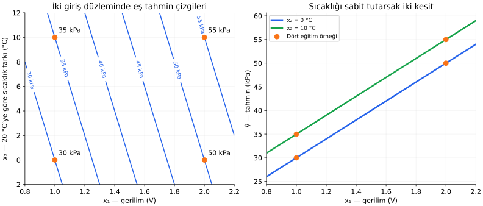
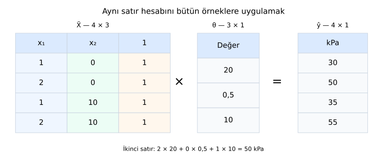

# Ders 18 — Çok girdili doğrusal regresyon ve matris gösterimi

[Bölüm girişine dön](README.md) · [Önceki ders: Genelleme ve overfitting](17-genelleme-ve-overfitting.md)

**Ana soru:** Birkaç özelliği birlikte kullanırken tahmin hesabını nasıl kurar, bütün örnekleri matrislerle nasıl düzenleriz?

Şimdiye kadar tek gerilimden basınç tahmin ettik. Bu derste sıcaklık bilgisini de ekleyeceğiz. Önce her örneği elle hesaplayacak, sonra aynı işlemi vektör ve matris biçiminde yazacağız. Matris gösterimi yeni bir tahmin yöntemi değil, aynı hesabı düzenli ve toplu yazmanın yoludur.

**Ders sonunda:** Örnek numarası ile özellik numarasını ayırabilecek; bir örneğin skaler tahminini, iç çarpımını ve bütün verinin matris hesabını eşleştirebilecek; işlemlerin boyutlarını kontrol edebileceksin.

**Ön koşul:** [13. ders](13-veriden-fonksiyon-ogrenmek.md), [14. ders](14-dogrusal-regresyon.md) ve [15. ders](15-kayip-fonksiyonu.md). Vektör, transpoz ve matris çarpımını burada kullanılan biçimleriyle açıklıyoruz.

## 1. Bir gerilim, farklı sıcaklıklar

Yeni bir sentetik sensör senaryosu kuralım. Basıncı tahmin ederken iki özellik kullanalım:

- $x_1$: Gerilimin volt cinsinden sayısal değeri.
- $x_2$: Sıcaklığın $20$ °C referansına göre farkının °C cinsinden sayısal değeri.

Örneğin sıcaklık $30$ °C ise $x_2=30-20=10$ olur. $x_2=0$ ise sıcaklık $0$ °C değil, **$20$ °C** demektir. $y$, referans basıncın kPa cinsinden sayısal değeridir.

| Örnek $i$ | Gerilim $x_1$ (V) | Sıcaklık farkı $x_2$ (°C) | Basınç $y$ (kPa) |
|---:|---:|---:|---:|
| $1$ | $1$ | $0$ | $30$ |
| $2$ | $2$ | $0$ | $50$ |
| $3$ | $1$ | $10$ | $35$ |
| $4$ | $2$ | $10$ | $55$ |

Bu veriler anlatım için hazırlanmıştır; gerçek sensör davranışı oldukları iddia edilmiyor. Önceki dersin tek girdili veri kümesini bu tabloyla birlikte eğitime katmıyoruz.

Yalnızca gerilimi kullanırsak $x_1=1$ için hem $30$ hem $35$ kPa hedef var. Tek girdili bir fonksiyon aynı girişe tek tahmin üretir; iki hedefi aynı anda tam karşılayamaz.

İkinci özellik sayesinde $(1,0)$ ile $(1,10)$ farklı girdiler olur. Bu senaryoda sıcaklık bilgisini kullanarak iki koşulu ayırt edebiliriz.

## 2. İki girdili tahmin kuralı

$$
\hat y=w_1x_1+w_2x_2+b
$$

| Sembol | Anlamı | Fiziksel birimi |
|---|---|---|
| $w_1$ | Gerilimin katsayısı | kPa/V |
| $w_2$ | Sıcaklık farkının katsayısı | kPa/°C |
| $b$ | Bias | kPa |
| $\hat y$ | Basınç tahmini | kPa |

Her çarpım basınç birimine gelir; ardından aynı birimdeki terimleri toplarız. Bu dersteki formüllerde sabit birimler içindeki sayısal değerlerle çalışıyoruz.

**Çok girdili doğrusal regresyon (multiple linear regression)**, hedefi birden fazla özelliğin ağırlıklı toplamı ve bias ile tahmin eder. Burada hedef hâlâ tek bir sayıdır. **İki giriş olması, iki çıktı olması demek değildir.**

Parametreleri bu küçük gürültüsüz tablodan bulalım.

İlk iki örnekte sıcaklık farkı aynı:

$$
w_1+b=30,\qquad 2w_1+b=50
$$

İkinci denklemden birinciyi çıkarınca $w_1=20$, ardından $b=10$ olur.

Birinci ve üçüncü örnekte gerilim aynı:

$$
w_1+10w_2+b=35
$$

Birinci örneğin denklemini çıkarırsak:

$$
10w_2=5\quad\Rightarrow\quad w_2=0{,}5
$$

Son model:

$$
\boxed{\hat y=20x_1+0{,}5x_2+10}
$$

Dördüncü örneği de kontrol edelim:

$$
20\cdot2+0{,}5\cdot10+10=40+5+10=55
$$

Üç parametreyi eğitim verisinden bulduk, kalan eğitim satırında tutarlılığı kontrol ettik. Bu satır model geliştirme hesabının bir parçasıdır; bağımsız test sonucu gibi sunmuyoruz.

Gerçek ölçümler tam uyuşmayabilir. O zaman bütün verinin kaybını azaltan parametreleri arayacağız; genel matris çözümü sonraki derste gelecek.

## 3. Katsayılar ve iki girdili grafiği okumak

Bu modelde $x_2$ sabitken gerilim $1$ V arttığında tahmin $20$ kPa artar. $x_1$ sabitken sıcaklık farkı $1$ °C arttığında tahmin $0{,}5$ kPa artar.

Bu yorum **diğer özelliği sabit tutar**. Veride birlikte değişen özelliklere bakıp katsayıları doğrudan fiziksel neden–sonuç kanıtı sayamayız.

Ayrıca $20$ ile $0{,}5$'i karşılaştırıp gerilimin “40 kat daha önemli” olduğunu söyleyemeyiz. Girdilerin birimleri ve değişim aralıkları farklıdır. Birimleri değiştirmek katsayıların sayısal büyüklüğünü de değiştirir.



Solda eksenlerde iki **giriş** vardır. Her mavi çizgi aynı basınç tahminini veren giriş çiftlerini bağlar. Örneğin $35$ kPa çizgisi üzerindeki bütün çiftler modelde aynı tahmini üretir. Turuncu noktalar eğitim girdileridir; yanlarındaki sayılar hedefleri gösterir.

Sağda sıcaklık farkını önce $0$, sonra $10$ °C'de sabit tutuyoruz. Bu iki kesitte gerilim–tahmin ilişkisi paralel doğrular olur. Aralarındaki fark:

$$
0{,}5\cdot(10-0)=5\ \text{kPa}
$$

İki girdi ve tek çıktı birlikte üç boyutta bir **düzlem** oluşturur. Burada bu düzlemi eş tahmin çizgileri ve kesitlerle gösterdik. Eğitimde ölçülmeyen aralıklara çizginin uzatılması yeni bir ölçüm değildir; model tahminidir.

## 4. Özellik numarası ile örnek numarasını ayırmak

$$
\hat y^{(i)}
=w_1x_1^{(i)}+w_2x_2^{(i)}+b
$$

Parantezli üst indis $(i)$, **örnek numarasıdır**. Alt indis $1$ veya $2$, **özellik numarasıdır**.

Örneğin:

$$
x_1^{(3)}=1,\qquad x_2^{(3)}=10,\qquad y^{(3)}=35
$$

Bunlar üçüncü satırın gerilimi, sıcaklık farkı ve hedefidir. $x_2^{(3)}$, bir sayının küpü değildir.

Genel durumda $n$ örnek, $d$ özellik kullanacağız. Burada $n=4$ ve $d=2$.

$$
\hat y^{(i)}=\sum_{j=1}^{d}w_jx_j^{(i)}+b
$$

$j$, özellikleri dolaşır. Sigma işareti “her özelliği kendi ağırlığıyla çarp, sonuçları topla” demektir. Bias bu toplamın dışında **bir kez** eklenir.

## 5. Bir örneği vektörle yazmak

**Skaler (scalar)**, tek bir sayıdır. **Vektör (vector)**, sıralı sayılar grubudur. Bu derste vektörleri sütun biçiminde yazıyoruz.

Üçüncü örneğin özellik vektörü ve modelin ağırlık vektörü:

$$
\mathbf x^{(3)}=
\begin{bmatrix}1\\10\end{bmatrix},
\qquad
\mathbf w=
\begin{bmatrix}20\\0{,}5\end{bmatrix}
$$

Kalın harfler birden fazla bileşeni birlikte gösterir. $\mathbf x^{(3)}$ içinde iki özellik, $\mathbf w$ içinde bunların aynı sıradaki ağırlıkları vardır.

**Transpoz (transpose)**, satırları sütunlara, sütunları satırlara çevirir. Üstteki $\top$ işareti transpozdur:

$$
\mathbf w^\top=
\begin{bmatrix}20&0{,}5\end{bmatrix}
$$

Satır vektörü ile sütun vektörünün **iç çarpımı (dot product)**:

$$
\mathbf w^\top\mathbf x^{(3)}
=
\begin{bmatrix}20&0{,}5\end{bmatrix}
\begin{bmatrix}1\\10\end{bmatrix}
=20\cdot1+0{,}5\cdot10=25
$$

Bias'ı eklersek $\hat y^{(3)}=25+10=35$ olur. Aynı hesabı kısa yazdık:

$$
\boxed{\hat y^{(i)}=\mathbf w^\top\mathbf x^{(i)}+b}
$$

### Boyut kontrolü

“$a\times b$ boyut” ifadesinde ilk sayı satır, ikinci sayı sütun sayısıdır.

$$
(1\times2)(2\times1)\ \longrightarrow\ (1\times1)
$$

İçteki $2$'ler eşittir; çarpım yapılabilir. Sonuç tek bir sayıdır. Matematiksel olarak $\mathbf w^\top\mathbf x$ ile $\mathbf x^\top\mathbf w$ aynı skaler sonucu verir.

Transpoz ters matris değildir; burada yalnızca sayıların yerleşimini değiştirdik.

## 6. Bütün örnekleri bir matrise koyalım

**Matris (matrix)**, sayıları satır ve sütunlarla düzenleyen tablodur. Özellik matrisimiz:

$$
\mathbf X=
\begin{bmatrix}
1&0\\
2&0\\
1&10\\
2&10
\end{bmatrix}
$$

**Satır = örnek, sütun = özellik.** İlk sütun gerilim, ikinci sütun sıcaklık farkıdır. Hedefleri bu matrise özellik olarak eklemiyoruz.

Hedefleri ve tahminleri ayrı sütun vektörleriyle yazalım:

$$
\mathbf y=
\begin{bmatrix}30\\50\\35\\55\end{bmatrix},
\qquad
\hat{\mathbf y}=
\begin{bmatrix}
\hat y^{(1)}\\\hat y^{(2)}\\
\hat y^{(3)}\\\hat y^{(4)}
\end{bmatrix}
$$

$\mathbf X$ bazen **tasarım matrisi (design matrix)** diye adlandırılır. Bias sütunu eklenmiş biçim için de aynı ad kullanılabilir; hangi düzenin kullanıldığını kontrol etmek gerekir.

## 7. Matris çarpımı: her satırın aynı hesabı

$$
\mathbf X\mathbf w=
\begin{bmatrix}
1&0\\
2&0\\
1&10\\
2&10
\end{bmatrix}
\begin{bmatrix}20\\0{,}5\end{bmatrix}
=
\begin{bmatrix}
20\\40\\25\\45
\end{bmatrix}
$$

Her sonuç, $\mathbf X$'in bir satırı ile $\mathbf w$'nin iç çarpımıdır.

Bias'ı her örneğe eklemek için:

$$
\mathbf1_4=
\begin{bmatrix}1\\1\\1\\1\end{bmatrix}
$$

tanımlayalım. Altındaki $4$, vektörün dört elemanı olduğunu gösterir. Böylece:

$$
\hat{\mathbf y}
=\mathbf X\mathbf w+b\mathbf1_4
=
\begin{bmatrix}20\\40\\25\\45\end{bmatrix}
+
\begin{bmatrix}10\\10\\10\\10\end{bmatrix}
=
\begin{bmatrix}30\\50\\35\\55\end{bmatrix}
$$

Genel gösterim:

$$
\boxed{\hat{\mathbf y}=\mathbf X\mathbf w+b\mathbf1_n}
$$

| Nesne | Genel boyut | Buradaki boyut |
|---|---|---|
| $\mathbf X$ | $n\times d$ | $4\times2$ |
| $\mathbf w$ | $d\times1$ | $2\times1$ |
| $\mathbf X\mathbf w$ | $n\times1$ | $4\times1$ |
| $b\mathbf1_n$ | $n\times1$ | $4\times1$ |
| $\mathbf y,\hat{\mathbf y}$ | $n\times1$ | $4\times1$ |

Matris çarpımında $(4\times2)(2\times1)\to(4\times1)$ olur. Toplamada iki tarafın boyutları aynı olmalıdır.

**Matris çarpımı, elemanları tek tek çarpmak değildir.** Her satırdaki çarpımlar toplanarak bir sonuç üretilir.

## 8. Bias'ı da tek çarpıma dahil etmek

Her satıra sabit bir $1$ ekleyelim:

$$
\tilde{\mathbf X}=
\begin{bmatrix}
1&0&1\\
2&0&1\\
1&10&1\\
2&10&1
\end{bmatrix},
\qquad
\boldsymbol\theta=
\begin{bmatrix}w_1\\w_2\\b\end{bmatrix}
=
\begin{bmatrix}20\\0{,}5\\10\end{bmatrix}
$$

$\tilde{\mathbf X}$, “X tilde” diye okunur; değiştirilmiş matrisin adıdır. $\boldsymbol\theta$, parametreleri birlikte tuttuğumuz “teta” vektörüdür.

$$
\boxed{\hat{\mathbf y}=\tilde{\mathbf X}\boldsymbol\theta}
$$

Son sütundaki $1$ ile bias çarpılır. Artık ayrıca $b\mathbf1_n$ eklemiyoruz; eklersek bias'ı iki kez saymış oluruz.



Bu görsel sayısal hesabın tablosudur. Sol taraftaki her **satır**, ortadaki vektörün bütün bileşenleriyle eşleştirilip çarpılarak toplanır. Örneğin ikinci satır $2\cdot20+0\cdot0{,}5+1\cdot10=50$ üretir.

Eklenen $1$ sütunu yeni bir sensör ölçümü değildir; bias'ı aynı çarpımda yazmak için kullanılan sabit, birimsiz sütundur.

Boyutlar:

$$
(n\times(d+1))((d+1)\times1)\to(n\times1)
$$

Bizim örneğimizde $(4\times3)(3\times1)\to(4\times1)$.

## 9. Yeni bir girişte tahmin

Gerilim $1{,}5$ V ve gerçek sıcaklık $26$ °C olsun. Sıcaklık farkı $x_2=26-20=6$ olur.

$$
\mathbf x_{\text{yeni}}=
\begin{bmatrix}1{,}5\\6\end{bmatrix}
$$

$$
\hat y_{\text{yeni}}
=20\cdot1{,}5+0{,}5\cdot6+10
=30+3+10=43\ \text{kPa}
$$

Bias sütunuyla aynı hesap:

$$
\begin{bmatrix}1{,}5&6&1\end{bmatrix}
\begin{bmatrix}20\\0{,}5\\10\end{bmatrix}
=43
$$

Yeni girişte özelliklerin **sırası, birimleri ve tanımları** eğitimdekilerle aynı olmalıdır. Sıcaklık farkı yerine doğrudan $26$ koymak veya sütunları değiştirmek farklı, yanlış bir hesap üretir.

Parametreleri değiştirmedik; bu tahmin işlemidir. Hedef ölçümü olmadan yeni tahminin hatasını bilemeyiz.

## 10. Kayıp da vektörle yazılabilir

Artık vektörü:

$$
\mathbf r=\hat{\mathbf y}-\mathbf y
$$

Bu vektör her örneğin artığını aynı satırda tutar. Kareler toplamı:

$$
\mathbf r^\top\mathbf r
=\sum_{i=1}^{n}(r^{(i)})^2
$$

Kendiyle iç çarpım yapıldığında bütün bileşenlerin kareleri toplanır. Dolayısıyla MSE:

$$
L(\boldsymbol\theta)
=\frac1n
(\tilde{\mathbf X}\boldsymbol\theta-\mathbf y)^\top
(\tilde{\mathbf X}\boldsymbol\theta-\mathbf y)
$$

Bu, önceki derslerdeki aynı MSE'dir; matrisler yeni bir kayıp eklemedi.

Gürültüsüz tablomuzda artıklar sıfırdır. Yalnızca kaybın nasıl hesaplandığını görmek için ikinci hedefi geçici olarak $52$ yapıp modeli **yeniden eğitmeden** değerlendirirsek:

$$
\mathbf r=
\begin{bmatrix}0\\-2\\0\\0\end{bmatrix},
\qquad
L=\frac{0+4+0+0}{4}=1\ \text{kPa}^2
$$

Bu değiştirilmiş veri için mevcut parametrelerin en iyi olduğunu iddia etmiyoruz; yalnızca sabit modelin kaybını hesapladık.

## 11. Python ile aynı boyutları kontrol edelim

```python
import numpy as np

X = np.array([
    [1.0, 0.0],
    [2.0, 0.0],
    [1.0, 10.0],
    [2.0, 10.0],
])
w = np.array([[20.0], [0.5]])
b = 10.0
y = np.array([[30.0], [50.0], [35.0], [55.0]])

prediction = X @ w + b
residual = prediction - y
mse = np.mean(residual ** 2)

X_aug = np.column_stack([X, np.ones(X.shape[0])])
theta = np.array([[20.0], [0.5], [10.0]])
prediction_aug = X_aug @ theta

print(X.shape, w.shape, prediction.shape)
print(prediction.ravel())  # [30. 50. 35. 55.]
print(mse)                # 0.0
assert np.allclose(prediction, prediction_aug)
```

$\texttt{@}$ matris çarpımıdır; $\texttt{*}$ NumPy'da eleman bazında çarpımdır. $\texttt{shape}$, dizinin boyutlarını verir. $\texttt{column_stack}$, verilen sütunları yan yana birleştirir. $\texttt{ravel()}$ yalnızca yazdırırken tahminleri tek boyutlu diziye çevirir.

Kodda skaler $b$, **broadcasting** sayesinde tahminin bütün satırlarına eklenir. Broadcasting, uyumlu boyutlardaki değerleri işlem boyunca uygun yerlere yayma kuralıdır; burada matematiksel $b\mathbf1_n$ ile aynı sonuçtur.

Hedefi ve tahmini ikisini de $(4,1)$ tuttuk. Tahmin $(4,1)$ iken hedefi yanlışlıkla $(4,)$ bırakırsak NumPy çıkarma işleminde $(4,4)$ sonuç üretebilir. Hata mesajı almadan yanlış kayıp hesaplanabilir. **Boyut kontrolü yalnızca matematik için değil, kod için de gereklidir.**

## 12. Çok özellik eklemek başarıyı garanti eder mi?

Sıcaklık bu örnekte yararlı bilgi taşıdı. Her yeni sütun ise yararlı olmak zorunda değildir. Gereksiz veya birbirini tekrar eden özellikler, parametreleri belirlemeyi ve yeni veride başarıyı zorlaştırabilir.

Örneğin her eğitim satırında $x_2=2x_1$ olsaydı:

$$
w_1x_1+w_2x_2=(w_1+2w_2)x_1
$$

olurdu. Veriler ayrı ayrı $w_1$ ve $w_2$ etkisini değil, bunların birleşimini gösterirdi. Farklı ağırlık çiftleri aynı eğitim tahminlerini verebilirdi.

Bu, yalnızca daha çok satır toplamanın çözmediği bir sorun olabilir; aynı bağımlılığı sürdüren satırlar yeni ayrım bilgisi sağlamaz. Parametrelerin ne zaman tek biçimde bulunabildiğini sonraki derste açıklayacağız.

17. dersteki veri ayrımı kuralları burada da geçerlidir: özellik seçimi ve öğrenilen dönüşümler uygun eğitim verisinden yapılmalı; yeni özelliklerin faydası ayrı veride değerlendirilmelidir.

## 13. Anlama kontrolü

1. Gerilim $2$ V, sıcaklık $24$ °C ise tahmin kaçtır?
2. $n=100$, $d=3$ için $\mathbf X$, $\mathbf w$ ve bias sütunu eklenmiş $\tilde{\mathbf X}$ boyutları nedir?
3. Bias'ı teta vektörüne koyduktan sonra ayrıca bias eklersek ne olur?
4. Sıcaklığı ve gerilimi sütunlarda yer değiştirirsek, ağırlıkları değiştirmeden aynı sonuç çıkar mı?

<details>
<summary>Yanıtları aç</summary>

1. Sıcaklık farkı $4$ °C. Tahmin $20\cdot2+0{,}5\cdot4+10=52$ kPa.
2. $\mathbf X$: $100\times3$; $\mathbf w$: $3\times1$; $\tilde{\mathbf X}$: $100\times4$. Bias dahil teta $4\times1$, tahmin $100\times1$ olur.
3. Bias iki kez eklenir. Örneğimizde her tahmin $10$ kPa fazla çıkar.
4. Genel olarak hayır. Her özellik kendi ağırlığıyla eşleşmelidir. Sütunları değiştirirken ağırlıkların sırasını da aynı biçimde değiştirmek gerekir.

</details>

## Kaynak ve sonraki adım

Ana okuma: [Dive into Deep Learning — Linear Regression](https://d2l.ai/chapter_linear-regression/linear-regression.html), **3.1.1.1 “Model”**. Çok özellikli toplam, vektörler ve tasarım matrisi gösterimleri bu dersle ilişkilidir. Kaynakta bias'ın vektöre eklenmesi broadcasting ile kısa yazılır; burada önce $\mathbf1_n$ ile açık gösterdik.

Bu dersteki iki girdili sensör senaryosu, grafikler ve kod ayrıca hazırlanmıştır.

**Sıradaki konu:** Ders 19 — Matrislerle en küçük kareler ve parametrelerin belirlenebilirliği. Gürültülü çok girdili veride parametreleri nasıl buluruz ve neden bazen tek bir çözüm yoktur?

[Önceki ders: Genelleme ve overfitting](17-genelleme-ve-overfitting.md) · [Bölüm girişine dön](README.md)

**Sonraki konu:** Ders 19 — Matrislerle en küçük kareler ve parametrelerin belirlenebilirliği *(henüz hazırlanmadı)*.
