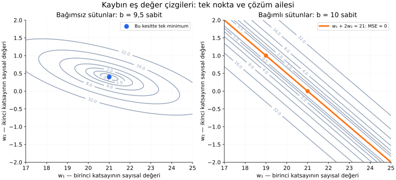

# Ders 19 — Matrislerle en küçük kareler ve parametrelerin belirlenebilirliği

[Bölüm girişine dön](README.md) · [Önceki ders: Çok girdili regresyon ve matrisler](18-cok-girdili-regresyon-ve-matrisler.md)

**Ana soru:** Gürültülü çok girdili veride parametreleri nasıl buluruz ve bulunan çözüm ne zaman tektir?

18. derste aynı tahmin hesabını matrisle yazdık. Bu derste matris gösterimini parametreleri bulmak için kullanacağız. Normal denklemleri kuracak, küçük bir sistemi elle çözecek ve bazı veri düzenlerinde neden birden fazla parametre vektörünün aynı sonucu verdiğini göreceğiz.

**Ders sonunda:** En küçük kareler problemini matrisle ifade edebilecek, normal denklemlerin nereden geldiğini açıklayabilecek, rank koşulunu somut bir örnekte yorumlayabilecek ve Python ile çözümün artıklarını kontrol edebileceksin.

**Ön koşul:** [16. ders](16-gradyan-inisi.md) ve [18. ders](18-cok-girdili-regresyon-ve-matrisler.md). Gerekli matris gösterimlerini hatırlatıyoruz; rank ve ters matris terimlerini ilk kullanıldıkları yerde açıklıyoruz.

## 1. Önceki tabloyu biraz değiştirelim

Sensör gerilimi $x_1$, $20$ °C'ye göre sıcaklık farkı $x_2$ ve basınç hedefi $y$ kullanıyoruz:

| Örnek | $x_1$ (V) | $x_2$ (°C) | $y$ (kPa) |
|---:|---:|---:|---:|
| $1$ | $1$ | $0$ | $30$ |
| $2$ | $2$ | $0$ | $52$ |
| $3$ | $1$ | $10$ | $35$ |
| $4$ | $2$ | $10$ | $55$ |

Bunlar yine sentetik verilerdir. Önceki derste ikinci hedef $50$ idi; şimdi $52$ yaptık. Tek bir düzlem artık dört hedefe birden tam uyamaz.

Model:

$$
\hat y=w_1x_1+w_2x_2+b
$$

Bias sütununu eklediğimiz matrise bu derste **$\mathbf A$** diyeceğiz. Önceki dersteki $\tilde{\mathbf X}$ ile aynı yapıdır; harfi değiştirerek ifadeleri kısaltıyoruz.

$$
\mathbf A=
\begin{bmatrix}
1&0&1\\
2&0&1\\
1&10&1\\
2&10&1
\end{bmatrix},
\qquad
\boldsymbol\theta=
\begin{bmatrix}w_1\\w_2\\b\end{bmatrix},
\qquad
\mathbf y=
\begin{bmatrix}30\\52\\35\\55\end{bmatrix}
$$

Burada $n=4$ örnek, $p=3$ parametre vardır. $\mathbf A$ boyutu $n\times p$, teta boyutu $p\times1$, hedef boyutu $n\times1$'dir.

Tahmin ve artık:

$$
\hat{\mathbf y}=\mathbf A\boldsymbol\theta,
\qquad
\mathbf r=\mathbf A\boldsymbol\theta-\mathbf y
$$

Veriler sabit, teta değişkendir. Sayısal hesapları volt, °C ve kPa cinsinden sabit birimler içinde yapıyoruz.

## 2. En küçük kareler problemi

$$
L(\boldsymbol\theta)=\frac1n\mathbf r^\top\mathbf r
=\frac1n\sum_{i=1}^{n}(r^{(i)})^2
$$

$\top$ transpoz işaretidir. Bir vektörün kendiyle iç çarpımı, bileşenlerinin karelerini toplar. Bu ifade önceki derslerdeki **MSE**'dir.

Amacımız $L$'yi mümkün olduğunca küçük yapan $\hat{\boldsymbol\theta}$ parametre tahminini bulmaktır.

$\mathbf A\boldsymbol\theta=\mathbf y$ denklemini tam sağlayabilseydik bütün artıklar sıfır olurdu. Gürültülü veya model biçimine tam uymayan veride bu mümkün olmayabilir. Böyle bir durumda denklemi **en küçük kareler anlamında** yaklaşık sağlarız.

“Yaklaşık” burada rastgele bir kabul değildir: hangi farkı azalttığımızı açıkça tanımladık.

## 3. Gradyandan normal denklemlere

16. derste MSE için her parametrenin gradyanını örneklerin katkılarını toplayarak bulmuştuk. Burada da aynı işlem var.

$\mathbf A$'nın $i$'nci satır, $j$'nci sütun elemanına $a_{ij}$ diyelim. Parametre $\theta_j$ küçük bir $h$ kadar değişirse, $i$'nci tahmin $ha_{ij}$ kadar değişir. O örneğin kare kaybındaki değişim oranı:

$$
\frac{(r^{(i)}+ha_{ij})^2-(r^{(i)})^2}{h}
=2r^{(i)}a_{ij}+ha_{ij}^2
$$

$h$ sıfıra yaklaşınca son terim kaybolur. Örnekleri toplayıp $n$'e bölersek:

$$
\frac{\partial L}{\partial\theta_j}
=\frac2n\sum_{i=1}^{n}a_{ij}r^{(i)}
$$

Bu toplamları bütün parametreler için birlikte hesaplayan matris çarpımı:

$$
\boxed{\nabla L(\boldsymbol\theta)
=\frac2n\mathbf A^\top
(\mathbf A\boldsymbol\theta-\mathbf y)}
$$

Nabla gradyan, $\partial$ kısmi türev işaretidir. $\mathbf A^\top$'un her satırı, bir özelliğin bütün örneklerdeki değerlerini taşır; bunları artıklarla çarpıp toplar.

Boyut kontrolü:

$$
(p\times n)(n\times1)\to(p\times1)
$$

Üç parametre için üç gradyan bileşeni çıkar.

En küçük kareler çözümünde gradyanı sıfıra eşitleyelim:

$$
\mathbf A^\top
(\mathbf A\hat{\boldsymbol\theta}-\mathbf y)=\mathbf0
$$

$\mathbf0$, burada üç elemanlı sıfır vektörüdür. Parantezi açıp düzenleyelim:

$$
\boxed{\mathbf A^\top\mathbf A\hat{\boldsymbol\theta}
=\mathbf A^\top\mathbf y}
$$

Bunlara **normal denklemler (normal equations)** denir. Buradaki “normal”, gürültünün normal dağıldığını varsaydığımız anlamına gelmez. Bu cebirsel çözüm için herhangi bir gürültü dağılımı varsaymadık.

Ayrıca $\mathbf A^\top\mathbf r=\mathbf0$, bütün artıkların sıfır olduğu anlamına gelmez. Artıkların her sütunla çarpılıp toplanan etkisi sıfırdır.

## 4. Matrisleri sayılarla hesaplayalım

$$
\mathbf A^\top=
\begin{bmatrix}
1&2&1&2\\
0&0&10&10\\
1&1&1&1
\end{bmatrix}
$$

Çarpımlar:

$$
\mathbf A^\top\mathbf A=
\begin{bmatrix}
10&30&6\\
30&200&20\\
6&20&4
\end{bmatrix}
$$

$$
\mathbf A^\top\mathbf y=
\begin{bmatrix}279\\900\\172\end{bmatrix}
$$

Birkaç elemanı açalım:

- Sol üst: $1^2+2^2+1^2+2^2=10$.
- İlk satırın ikinci elemanı: $1\cdot0+2\cdot0+1\cdot10+2\cdot10=30$.
- İlk satırın üçüncü elemanı: gerilimlerle birlerin çarpımı, yani $1+2+1+2=6$.
- Sağ tarafta ilk eleman: $1\cdot30+2\cdot52+1\cdot35+2\cdot55=279$.
- Sağ tarafta ikinci eleman: $10\cdot35+10\cdot55=900$.
- Son eleman: hedeflerin toplamı $30+52+35+55=172$.

Her matris elemanı bir satır–sütun iç çarpımıdır. Formülü ezberlemek yerine bu eşleşmeleri okuyabilmeliyiz.

## 5. Üç bilinmeyenli sistemi elle çözelim

Normal denklemleri satır satır yazarsak:

$$
10w_1+30w_2+6b=279\qquad(1)
$$

$$
30w_1+200w_2+20b=900\qquad(2)
$$

$$
6w_1+20w_2+4b=172\qquad(3)
$$

Parantezli numaralar bu bölümde denklemlerin adlarıdır.

Birinci denklemden üçüncünün $1{,}5$ katını çıkaralım:

$$
(10-9)w_1+(30-30)w_2+(6-6)b
=279-258
$$

$$
w_1=21
$$

İkinci denklemden üçüncünün $5$ katını çıkaralım:

$$
(30-30)w_1+(200-100)w_2+(20-20)b
=900-860
$$

$$
100w_2=40\quad\Rightarrow\quad w_2=0{,}4
$$

Üçüncü denkleme yerleştirelim:

$$
6\cdot21+20\cdot0{,}4+4b=172
$$

$$
126+8+4b=172
\quad\Rightarrow\quad b=9{,}5
$$

Sonuç:

$$
\boxed{\hat y=21x_1+0{,}4x_2+9{,}5}
$$

Bu, önceki dersteki gürültüsüz modelden farklıdır. Bir hedefin değişmesi, bütün ölçümleri birlikte değerlendiren çözümün parametrelerini değiştirdi.

## 6. Artıkları ve optimum koşulunu kontrol edelim

| Giriş $(x_1,x_2)$ | Hedef | Tahmin | Artık |
|---|---:|---:|---:|
| $(1,0)$ | $30$ | $30{,}5$ | $0{,}5$ |
| $(2,0)$ | $52$ | $51{,}5$ | $-0{,}5$ |
| $(1,10)$ | $35$ | $34{,}5$ | $-0{,}5$ |
| $(2,10)$ | $55$ | $55{,}5$ | $0{,}5$ |

$$
L=\frac{0{,}25+0{,}25+0{,}25+0{,}25}{4}
=0{,}25\ \text{kPa}^2
$$


Mavi ve yeşil çizgiler sıcaklık farkı sabitken modelin iki kesitidir. Siyah noktalar hedef, turuncu çarpılar tahmindir. Kırmızı kısa parçalar dikey artıklardır. Noktalardan tam geçmemek, yöntemin başarısız olduğu anlamına gelmez.

Şimdi gradyan koşulunu elle kontrol edelim:

$$
\sum_i x_1^{(i)}r^{(i)}
=0{,}5-1-0{,}5+1=0
$$

$$
\sum_i x_2^{(i)}r^{(i)}
=0+0-5+5=0
$$

$$
\sum_i r^{(i)}=0{,}5-0{,}5-0{,}5+0{,}5=0
$$

Üç gradyan bileşeni de sıfırdır. Artıklar sıfır değildir; etkileri dengelenmiştir.

### Bu nokta neden gerçekten minimum?

Parametreleri $\boldsymbol\delta$ vektörü kadar değiştirelim. Delta, herhangi bir parametre değişim vektörüdür. Yeni artık $\hat{\mathbf r}+\mathbf A\boldsymbol\delta$ olur.

Kareyi açarsak:

$$
L(\hat{\boldsymbol\theta}+\boldsymbol\delta)
=L(\hat{\boldsymbol\theta})
+\frac2n\boldsymbol\delta^\top\mathbf A^\top\hat{\mathbf r}
+\frac1n(\mathbf A\boldsymbol\delta)^\top
(\mathbf A\boldsymbol\delta)
$$

Normal denklemler nedeniyle ortadaki terim sıfırdır. Son terim bir vektörün bileşen karelerinin toplamıdır; negatif olamaz. Dolayısıyla hiçbir parametre değişimi kaybı daha küçük yapamaz.

Bu, genel bir kayıpta sıfır gradyanın yeterli olduğu iddiası değildir. **Bu karesel en küçük kareler problemi için** minimumu doğruladık.

## 7. Çözüm ne zaman tek?

**Doğrusal bağımsız sütunlar (linearly independent columns)**, bir sütunun diğerlerinin doğrusal birleşimiyle oluşturulamadığı bir düzen demektir.

Eşdeğer bir kontrol: $\mathbf A\boldsymbol\delta=\mathbf0$ ancak $\boldsymbol\delta=\mathbf0$ için sağlanabiliyorsa sütunlar bağımsızdır. Yani sıfır olmayan bir parametre değişimi eğitim tahminlerini tamamen aynı bırakamaz.

**Rank (rütbe)**, matrisin doğrusal bağımsız sütunlarının sayısıdır. $p$ sütunlu bir matriste:

$$
\operatorname{rank}(\mathbf A)=p
$$

ise **tam sütun rankı (full column rank)** vardır. Bu durumda en küçük kareler parametre çözümü tektir.

Sensör örneğimizde bunu doğrudan görebiliriz. Tahminleri değiştirmeyen bir değişim için ilk iki satır:

$$
\delta_1+\delta_b=0,\qquad
2\delta_1+\delta_b=0
$$

Çıkarınca $\delta_1=0$, sonra $\delta_b=0$ bulunur. Üçüncü satırdan $10\delta_2=0$, yani $\delta_2=0$ çıkar. Sıfır olmayan değişim kalmadı; rank $3$'tür.

En az $p$ satır bulunması gereklidir, fakat yeterli değildir. Aynı veya bağımlı bilgileri tekrar eden çok sayıda satır, bağımsız sütun sayısını artırmayabilir.

Buradaki **parametre belirlenebilirliği (parameter identifiability)**, seçtiğimiz doğrusal modelde mevcut verinin katsayıları ayrı ayrı ayırt edebilmesidir. Tek bir çözüm bulmak, katsayıların gerçek fiziksel değerler olduğunu veya yeni veride hatasız çalışacağını kanıtlamaz.

## 8. Birden fazla çözüm: bağımlı özellik örneği

Ayrı bir birimsiz özellik örneği kuralım. Bütün eğitim satırlarında:

$$
x_2=2x_1,\qquad y=21x_1+10
$$

olsun. Modeli yerine koyarsak:

$$
w_1x_1+w_2x_2+b
=(w_1+2w_2)x_1+b
$$

Veri $w_1$ ve $w_2$'yi ayrı ayrı değil, $w_1+2w_2$ birleşimini ayırt eder.

| $w_1$ | $w_2$ | $b$ | Eğitimdeki tahmin kuralı |
|---:|---:|---:|---|
| $21$ | $0$ | $10$ | $21x_1+10$ |
| $19$ | $1$ | $10$ | $21x_1+10$ |
| $23$ | $-1$ | $10$ | $21x_1+10$ |

Birinci sütun ile ikinci sütun bağımlıdır. Bias dahil rank $2$, parametre sayısı $3$ olur. Birden fazla parametre vektörü aynı minimum kaybı verir.



Solda sensör örneğinde bias $9{,}5$'te sabitken iki ağırlığı değiştiriyoruz. Mavi nokta bu kesitin tek minimumudur. Sağda birimsiz bağımlı özellik örneğinde bias $10$'da sabittir. Turuncu çizginin **tamamı**, $w_1+2w_2=21$ koşulunu sağlayarak sıfır MSE verir.

Paneller farklı veri örneklerine aittir. Gri eğrilerin üzerindeki sayılar ilgili örneğin MSE'sidir. Bias'ı sabit tutmak, üç parametreli kaybı iki eksende göstermek içindir.

Eğitimde eşit tahmin yapan çözümler her yeni girdide eşit davranmak zorunda değildir. Örneğin $(x_1,x_2)=(1,0)$ gibi eğitim bağımlılığının dışındaki bir girdide ilk iki model sırasıyla $31$ ve $29$ tahmin eder. Hangisinin doğru olduğunu eski veri tek başına söylemez.

## 9. Ters matris formülünün koşulu

Normal denklemleri:

$$
\mathbf G\hat{\boldsymbol\theta}=\mathbf q,
\qquad
\mathbf G=\mathbf A^\top\mathbf A,\quad
\mathbf q=\mathbf A^\top\mathbf y
$$

diye kısaltalım. $\mathbf G$ ve $\mathbf q$ hesaplanmış matris ve vektörün adlarıdır.

**Ters matris (inverse matrix)**, uygun kare matrisin çarpma etkisini geri alan matristir. $\mathbf G^{-1}\mathbf G=\mathbf I$ olur; $\mathbf I$ çarpımda vektörü aynı bırakan **birim matristir (identity matrix)**. $-1$ burada elemanları tek tek ters çevirmek değildir.

Tam sütun rankı varsa $\mathbf G$ terslenebilir ve matematiksel çözüm:

$$
\hat{\boldsymbol\theta}
=(\mathbf A^\top\mathbf A)^{-1}\mathbf A^\top\mathbf y
$$

olarak yazılabilir. Sütunlar bağımlıysa bu ters yoktur; formülü koşulsuz kullanamayız.

### Kodda neden doğrudan ters hesaplamıyoruz?

Formül matematiksel ilişkiyi açıklar. Sayısal hesapta ters matrisi açıkça oluşturmak zorunda değiliz. Ayrıca $\mathbf A^\top\mathbf A$ oluşturmak, birbirine çok yakın bağımlı sütunlarda sayısal duyarlılığı artırabilir.

Bu nedenle genel en küçük kareler kodunda **doğrudan $\mathbf A,\mathbf y$ ile çalışan bir çözücü** kullanacağız. QR veya SVD gibi ayrıştırmalar bu tür hesapların temel araçlarıdır; ayrıntılarını burada açmadan hazır çözücüyü kullanabiliriz.

**Kötü koşulluluk (ill-conditioning)**, veride veya hesapta küçük değişimlerin katsayılarda büyük değişimlere yol açabilmesidir. Tam bağımlılıktan farklıdır: çözüm teorik olarak tek olabilir, fakat duyarlı olabilir. Rankın tam çıkması, otomatik olarak sağlam katsayı tahmini demek değildir.

## 10. Python ile çözüm ve kontrol

```python
import numpy as np

A = np.array([
    [1.0, 0.0, 1.0],
    [2.0, 0.0, 1.0],
    [1.0, 10.0, 1.0],
    [2.0, 10.0, 1.0],
])
y = np.array([[30.0], [52.0], [35.0], [55.0]])

theta, _, rank, _ = np.linalg.lstsq(A, y, rcond=None)
prediction = A @ theta
residual = prediction - y
mse = np.mean(residual ** 2)

print(theta.ravel())       # [21.   0.4  9.5]
print(rank)                # 3
print(prediction.ravel())  # [30.5 51.5 34.5 55.5]
print(mse)                 # yaklaşık 0.25

assert np.allclose(A.T @ residual, 0.0)
```

$\texttt{lstsq}$, en küçük kareler çözücüsüdür. $\texttt{A.T}$ transpoz, $\texttt{@}$ matris çarpımıdır. Alt çizgi $\texttt{_}$, bu kısa örnekte kullanmadığımız dönüş değerlerini karşılar.

$\texttt{rcond=None}$, sayısal rank değerlendirmesinde kütüphanenin varsayılan eşiğini kullanır. Bilgisayarda “sıfıra çok yakın” ile “sıfır” ayrımı sonlu hassasiyet ve ölçekle ilişkilidir.

Bağımlı sütunlarda çözücü yine bir sonuç döndürebilir. NumPy, minimum kaybı sağlayan çözümler arasında **parametre vektörünün kareler toplamı en küçük olanını** seçer. Bu bir seçim kuralıdır; veriye eksik olan fiziksel bilgiyi kazandırmaz. Parametre birimleri veya ölçekleri değişince bu seçim de farklı anlam taşıyabilir.

Bu nedenle “kod bir ağırlık vektörü döndürdü” ile “veri bu ağırlıkları tek tek belirledi” aynı şey değildir.

## 11. Mühendislikte deney tasarımına bağlantı

Gerilim ile sıcaklık her deneyde birlikte aynı biçimde değişirse, veriden iki etkiyi ayırmak zorlaşabilir. Uygun ve mümkün olduğunda bir özelliği sabit tutup diğerini değiştiren ölçümler, ayrım bilgisi sağlar. 18. dersteki dört koşullu tablo bu nedenle kullanışlıydı.

Sistem tanımlamada da yalnızca kayıt sayısı değil, girdilerin hangi farklı koşulları uyardığı önemlidir. Aynı davranışı tekrar eden ölçümler, bilinmeyen her parametreye yeni bilgi sağlamaz.

Ölçümlerdeki gürültü, eksik özellikler ve modelin yanlış biçimi ise ayrı sorunlardır. Rank koşulu bunların tamamını çözmez. Yeni veride değerlendirme kuralları da önceki dersteki gibi devam eder.

## 12. Anlama kontrolü

1. Bu dersin optimumunda MSE sıfır mı? Gradyan sıfır mı?
2. Üç parametre için 100 satır olması çözümün tekliğini garanti eder mi?
3. $x_2=2x_1$ örneğinde $(w_1,w_2)=(15,3)$ ile $(21,0)$ eğitimde aynı tahmini verir mi?
4. Bias sütununu iki kez eklersek sütun bağımsızlığına ne olur?

<details>
<summary>Yanıtları aç</summary>

1. MSE $0{,}25$ kPa²; sıfır değildir. $\mathbf A^\top\mathbf r=\mathbf0$ olduğu için gradyan sıfırdır.
2. Hayır. Satır sayısı yeterli olsa bile sütunlar bağımlı olabilir.
3. Evet. $15+2\cdot3=21$. Bias da aynıysa $x_2=2x_1$ olan girişlerde tahminler aynıdır.
4. İki aynı sabit sütun oluşur. Bias etkisi iki katsayının toplamıyla belirlenir; ayrı katsayılar tek biçimde belirlenemez.

</details>

## 02 bölümü ne zaman tamamlanacak?

Bu bölümün kalan planı **22. derste tamamlanacak şekilde** düzenlendi:

- **20 — Özellik ölçekleme, Ridge/Lasso ve düzenlileştirme:** Katsayıları ve öğrenmeyi daha kontrollü nasıl kurarız?
- **21 — Regresyonun olasılıksal yorumu ve belirsizlik:** Tahmin ve hata modelini nasıl yorumlarız?
- **22 — Bölüm tekrarı ve uçtan uca uygulama:** Veri ayrımından son değerlendirmeye bütün adımları nasıl birleştiririz?

Ardından 03 — Klasik makine öğrenmesi bölümüne geçeceğiz. Bu üç ders henüz hazırlanmadı.

## Kaynak ve sonraki adım

Ana okuma: [Dive into Deep Learning — Linear Regression](https://d2l.ai/chapter_linear-regression/linear-regression.html), **“Analytic Solution”** başlığı. Bias sütunu, normal denklemler ve çözümün tekliği bu dersle ilişkilidir.

Kod referansı: [NumPy — numpy.linalg.lstsq](https://numpy.org/doc/stable/reference/generated/numpy.linalg.lstsq.html), döndürülen çözüm, rank ve birden fazla minimumdaki seçim açıklaması. Buradaki sayısal örnek, grafikler ve kod ders için ayrıca hazırlanmıştır.

[Önceki ders: Çok girdili regresyon ve matrisler](18-cok-girdili-regresyon-ve-matrisler.md) · [Bölüm girişine dön](README.md)

**Sonraki konu:** Ders 20 — Özellik ölçekleme, Ridge/Lasso ve düzenlileştirme *(henüz hazırlanmadı)*.
